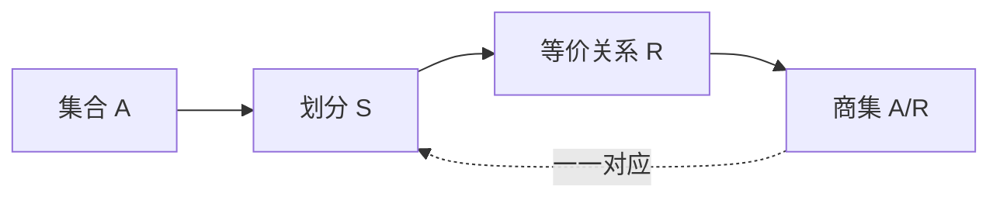

# 等价关系的判定、等价类的求法及商集A/R与划分的对应定理

## 等价关系的判定与商集

如何判断一个关系是否“等价”？关键在于它能否将集合元素进行==无遗漏、不重叠的分类==。等价关系本质上是集合划分的代数描述，而商集则是这种分类结果的集合表示。

### 三步判定法

给定集合 $A$ 上的二元关系 $R$，判定其是否为等价关系需严格验证三个性质：

1.  **自反性**：$\forall x \in A, \langle x,x \rangle \in R$（即 $I_A \subseteq R$）。
2.  **对称性**：$\forall x,y \in A, \langle x,y \rangle \in R \Rightarrow \langle y,x \rangle \in R$。
3.  **传递性**：$\forall x,y,z \in A, \langle x,y \rangle \in R \land \langle y,z \rangle \in R \Rightarrow \langle x,z \rangle \in R$。

> [!WARNING]
> 传递性是最易漏判的性质。不能仅凭直觉，必须检查所有满足前件的序偶对，确认其后件也在 $R$ 中。若 $R$ 以规则给出（如 $x-y=2$），优先验证自反性，若不成立则直接否定。

### 等价类与商集的求法

若 $R$ 是等价关系，元素 $a$ 的等价类定义为 $[a]_R = \{x \mid x \in A \land \langle a,x \rangle \in R\}$。所有不同等价类构成的集合称为商集 $A/R$。

> [!IMPORTANT]
> ==商集 $A/R$ 的元素是集合（等价类），而非单个元素==。且 $A/R$ 与 $A$ 的划分一一对应：每个划分块对应一个等价类，反之亦然。

由划分 $\pi = \{S_1, S_2, \dots, S_m\}$ 构造等价关系的公式为：
$$
R = \bigcup_{i=1}^{m} (S_i \times S_i)
$$
即每个分块内部取笛卡尔积再求并。例如 $A=\{a,b,c,d\}$，划分 $S=\{\{a,b\},\{c\},\{d\}\}$，则 $R = \{a,b\}^2 \cup \{c\}^2 \cup \{d\}^2$，共含 $4+1+1=6$ 个序偶。

### 与偏序关系的区别

| 特征 | 等价关系 | 偏序关系 |
| :--- | :--- | :--- |
| 核心性质 | 自反、对称、传递 | 自反、反对称、传递 |
| 结构意义 | 分类（水平分组） | 排序（垂直层次） |
| 图形表示 | 关系图为若干完全子图 | 哈斯图（有向无环） |
| 典型例子 | 模 $n$ 同余、集合相等 | 整除、子集包含 |

### 实战示例与避坑

**题目**：设 $A=\{1,2,3,4,5\}$，$R = \{\langle1,2\rangle,\langle2,1\rangle,\langle3,4\rangle,\langle4,3\rangle\} \cup I_A$，求商集。

**解**：先验证 $R$ 含 $I_A$（自反），显式序偶成对出现（对称），且无跨组连接（传递平凡成立）。故 $R$ 是等价关系。
- $[1]_R = [2]_R = \{1,2\}$
- $[3]_R = [4]_R = \{3,4\}$
- $[5]_R = \{5\}$

因此 $A/R = \{\{1,2\}, \{3,4\}, \{5\}\}$。

> [!TIP]
> 求商集时只需找出所有==互不相同==的等价类。同一等价类中的任一元素都可作为代表元，避免重复列举。若题目给出划分求 $R$，直接用分块直积公式，无需逐条验证三性质。

> [!CAUTION]
> 填空题“A 上等价关系个数”等于“A 的划分数”（贝尔数）。$|A|=3$ 时为 5，$|A|=4$ 时为 15。切勿与二元关系总数 $2^{n^2}$ 混淆！
