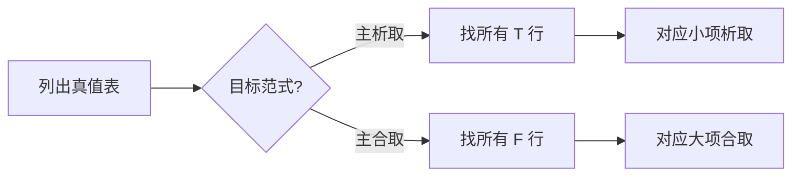

# 逻辑联结词（否定、合取、析取、蕴含、等价）及其真值表

## 逻辑联结词与真值表

命题逻辑的核心在于将自然语言“翻译”为符号公式。你是否想过，为什么“如果明天下雨，我就带伞”在逻辑上允许“明天没下雨且我没带伞”的情况成立？这正是因为==蕴含式的真值定义与日常直觉存在差异==。掌握五种基本联结词及其真值表，是后续求解主范式与进行逻辑推理的基石。

### 五种基本联结词

| 联结词 | 符号 | 读法 | 真值为 T 的条件 | 真值为 F 的条件 |
| :--- | :--- | :--- | :--- | :--- |
| 否定 | $\neg P$ | 非 P | P 为 F | P 为 T |
| 合取 | $P \land Q$ | P 且 Q | P, Q 均为 T | 其余情况 |
| 析取 | $P \lor Q$ | P 或 Q | P, Q 至少一个为 T | P, Q 均为 F |
| 蕴含 | $P \rightarrow Q$ | 若 P 则 Q | P→T, F→T, F→F | ==仅当 P=T 且 Q=F== |
| 等价 | $P \leftrightarrow Q$ | P 当且仅当 Q | P, Q 同真或同假 | P, Q 一真一假 |

> [!IMPORTANT]
> 蕴含式 $P \rightarrow Q$ 仅在“前件真、后件假”时为假。这是南邮离散数学考试中最常考的易错点，务必脱离自然语言中的因果联想，严格按真值表判定。

### 自然语言翻译陷阱

在将中文命题符号化时，连接词的语义往往比字面意思更丰富：

-   **“仅当” vs “当”**：“Q 仅当 P”表示 Q 是 P 的必要条件，应译为 $Q \rightarrow P$；而“Q 当 P”表示充分条件，译为 $P \rightarrow Q$。
-   **“除非”**：“P 除非 Q”通常等价于 $\neg Q \rightarrow P$ 或 $P \lor Q$。
-   **相容或与排斥或**：默认 $\lor$ 是相容或（可同时为真）；若语境明确“二者不可兼得”，需用 $(P \lor Q) \land \neg(P \land Q)$ 表达。

> [!WARNING]
> 典型错题：将“我将去镇上，仅当我有时间”误写为 $R \rightarrow Q$。正确翻译应为 $Q \rightarrow R$，因为“有时间”是“去镇上”的必要条件而非充分条件。

### 从真值表到范式

真值表不仅是验证工具，更是求解主范式的直接依据：

-   **主析取范式**：由真值为 T 的指派对应的==小项（布尔合取）==析取而成。小项编码规则：1 对应变元本身，0 对应变元否定。
-   **主合取范式**：由真值为 F 的指派对应的==大项（布尔析取）==合取而成。大项编码规则与小项相反：0 对应变元本身，1 对应变元否定。

> [!TIP]
> 记忆口诀：“析取看 T 写小项，合取看 F 写大项；小项 1 正 0 反，大项 0 正 1 反。”两者下标互补，知道一个即可推出另一个。

### 计算示例验证

以真题为例：设 $P$: 天下雪，$Q$: 我去镇上，$R$: 我有时间。命题“如果天不下雪和我有时间，那么我将去镇上”符号化为 $(\neg P \land R) \rightarrow Q$。

构造真值表可知，该公式仅在 $\neg P \land R = T$ 且 $Q = F$ 时为假，即 $P=F, R=T, Q=F$ 这一种指派。因此其主合取范式仅含一个大项 $M_{010}$（对应 $P \lor \neg Q \lor \neg R$），而主析取范式包含其余 7 个小项的析取。通过此例可验证：==严格遵循真值表定义，才能避免自然语言直觉带来的误判==。
