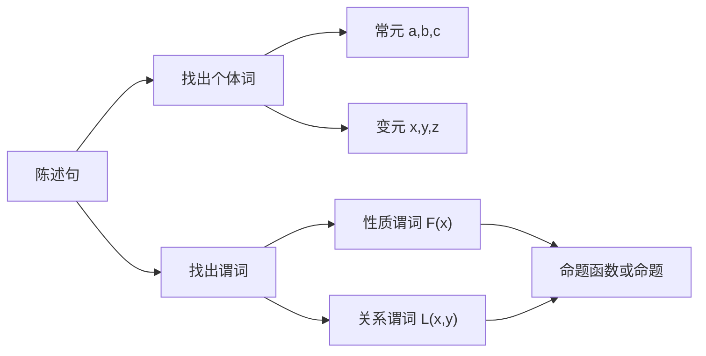

# 谓词的概念、个体词与命题函数的表示

## 谓词的概念、个体词与命题函数的表示

在命题逻辑中，我们面对的最小单位是**命题**——要么真要么假的完整陈述句。但很多推理结构藏在句子内部，比如“所有偶数都能被 2 整除”和“4 是偶数”，命题逻辑无法刻画这两句话之间的逻辑关联。要处理这类问题，就需要把命题**拆开**，引入谓词与个体词。

### 个体词与谓词

一个陈述句通常由两部分构成：被陈述的**对象**，以及对对象的**描述**。

- **个体词**：表示对象。常元用 $a,b,c$ 表示具体对象（如“4”“老王”），变元用 $x,y,z$ 表示不确定的对象。
- **谓词**：表示对象的性质或多个对象之间的关系。用大写字母及括号表示，如 $F(x)$ 表示“$x$ 具有性质 $F$”。

例如，把“4 是偶数”拆开：个体常元 $a=4$，谓词 $E(x)$：$x$ 是偶数。符号化为 $E(a)$。

当只有谓词和个体变元时，形如 $E(x)$ 的表达式**本身不是命题**——因为 $x$ 未确定，真假无从判断。这样的表达式称为**命题函数**或**谓词表达式**。只有将变元代换为具体个体，或加上量词约束后，才成为有真值的命题。

> [!IMPORTANT]
> 谓词 $F$ 本身不真不假，**命题函数不是命题**；必须给变元指定具体个体（代换），量词在下一节处理。

### 为什么需要谓词

命题逻辑的表达粒度太粗，无法处理**共性描述**与**内部结构**。谓词逻辑用“个体词 + 谓词 + 量词”的组合，可以精确刻画：

- 某个对象的性质：$A(a)$
- 多个对象之间的关系：$L(x,y)$ 表示“$x$ 小于 $y$”
- 对一类对象的整体断言：（下一节用 $\forall$、$\exists$ 完成）

### 多个谓词的组合

多个谓词可以通过逻辑联结词组合，表达更复杂的判断。“2 是偶数且是质数”需要两个谓词。设 $E(x)$：$x$ 是偶数；$P(x)$：$x$ 是质数；$a=2$，则符号化为：

$$E(a) \wedge P(a)$$

注意：这里的 $\wedge$ 连接的是**两个完整命题函数代换后的命题**，而不是两个谓词字母。

### 个体词选取影响符号化方式

同样的句子，选择不同的谓词和个体词，可以写出不同形式的符号化。比如“老王是山东人或河北人”：

- 方式一：$S(a) \overline{\vee} H(a)$，其中 $a$：老王，$S(x)$：$x$ 是山东人，$H(x)$：$x$ 是河北人。
- 方式二：$P(a, b) \overline{\vee} P(a, c)$，其中 $P(x,y)$：$x$ 籍贯是 $y$，$b$：山东，$c$：河北。

原课件中“或”用的是异或 $\overline{\vee}$，即“要么……要么……”，而非一般的析取 $\vee$。实际翻译时需根据语境判断。

> [!WARNING]
> 常见的坑是把 $F(x) \wedge G(x)$ 误写成 $F \wedge G(x)$，或者忘记谓词必须带括弧和个体。谓词字母**后面必须跟个体词列表**，例如 $F(x)$ 或 $L(x,y)$。

### 一个完整的符号化例子

没有不犯错误的人。

设 $N(x)$：$x$ 是人，$F(x)$：$x$ 犯错误。句子的字面意思是“不存在一个人不犯错误”，即：

$$\neg(\exists x)\bigl(N(x) \wedge \neg F(x)\bigr)$$

也可以理解为“所有人都会犯错误”：

$$(\forall x)\bigl(N(x) \rightarrow F(x)\bigr)$$

两种写法等价。关键在于先**确定个体域**——这里默认个体变元在所有事物中取值，所以才需要 $N(x)$ 来限定“人”。若个体域已限定为人，则可直接写 $(\forall x)F(x)$。

> [!TIP]
> 符号化步骤：先找个体词，再找谓词，最后按语义加入量词和联结词。遇到“没有……不……”这类双重否定，直接转化为“所有……都……”往往更简洁。
