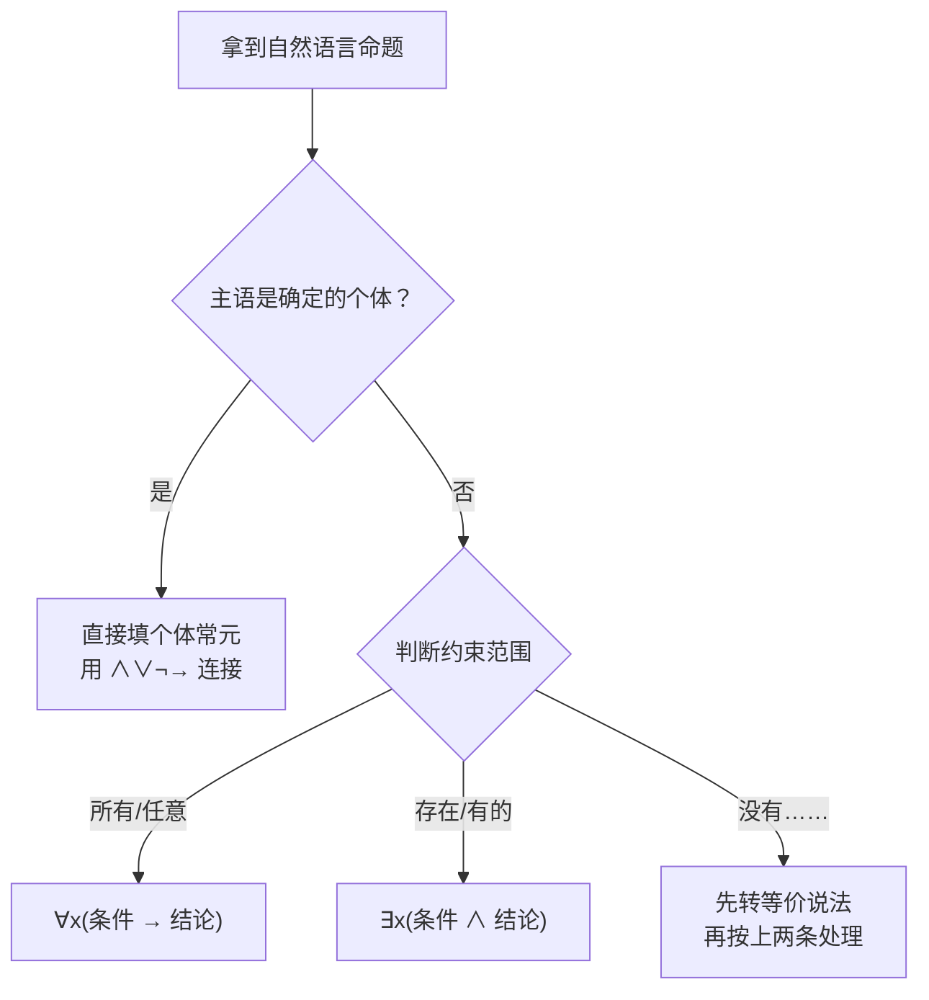

# 谓词公式的构成规则与自然语言翻译

## 谓词与量词：从自然语言到逻辑公式

在命题逻辑中，我们只能处理“老王是学生”这样完整的、不再分解的命题。但遇到“所有人都是要呼吸的”时，命题逻辑就无能为力了——这句话内部有“所有”和“人”的结构，需要更精细的工具。谓词逻辑正是为此而生。

### 什么是谓词

**谓词**可以理解为“带有空位的陈述句”。把句子中的主语挖掉，剩下的部分就是谓词。

> [!NOTE]
> 谓词本身没有真值，只有填入具体个体（或加上量词约束）后才成为命题。

假设论域是“所有人”：
- $M(x)$：$x$ 是人
- $H(x)$：$x$ 要呼吸
- $a$：张三

那么 $M(a)$ 是命题“张三是人”，有真值；但单独的 $M(x)$ 只是一个函数形式，不真不假。

### 两个量词：全称与存在

自然语言中约束“范围”的词，在谓词逻辑里只分成两类：

| 量词 | 符号 | 日常说法 | 关键词 |
|------|------|----------|--------|
| 全称量词 | $\forall x$ | “所有”“任意”“每一个” | 对任意 $x$ 都…… |
| 存在量词 | $\exists x$ | “存在”“至少有一个”“有的” | 至少有一个 $x$ 使得…… |

全称量词隐含“如果……那么……”的结构，存在量词隐含“并且”的结构。这是翻译中最容易出错的地方。

### 自然语言翻译的核心规则

==全称量词几乎总是与 $\rightarrow$ 搭配，存在量词几乎总是与 $\land$ 搭配。==

为什么？看两个典型例子：

**例1**：所有的人都是要呼吸的。

拆开理解：对任意 $x$，如果 $x$ 是人，那么 $x$ 要呼吸。

符号化：$\forall x (M(x) \rightarrow H(x))$

这里绝不能用 $\land$。如果写成 $\forall x (M(x) \land H(x))$，意思就变成“宇宙中每个 $x$ 都是人而且要呼吸”——这显然不是原意。

**例2**：存在一个数是质数。

拆开理解：至少存在一个 $x$，$x$ 是数**并且** $x$ 是质数。

符号化：$\exists x (N(x) \land P(x))$

这里绝不能用 $\rightarrow$。如果写成 $\exists x (N(x) \rightarrow P(x))$，只要找到一个不是数的东西，蕴含式前件为假，整个公式就为真——公式几乎永真，与原意完全偏离。

### 常见翻译模式与坑

> [!WARNING]
> “没有不犯错误的人”需要两步转换，直接硬翻容易错。

原命题：没有不犯错误的人。

先转换成等价说法：所有人都是犯错误的。

再符号化：设 $N(x)$：$x$ 是人，$F(x)$：$x$ 犯错误。
$$
\forall x (N(x) \rightarrow F(x))
$$

另一种等价写法（否定存在）：$\neg \exists x (N(x) \land \neg F(x))$，即“不存在一个人不犯错误”。两者等价，但在推理中形式不同。

> [!TIP]
> 翻译口诀：看到“所有/任意”先想 $\forall x(\cdots \rightarrow \cdots)$；看到“存在/有的”先想 $\exists x(\cdots \land \cdots)$。遇到“没有……”先转成“所有……都……”再翻。

### 个体常元：一个特殊情形

当命题讨论的是确定的个体时，量词退场，直接用谓词填个体常元。

**例**：2 是偶数且是质数。

设 $A(x)$：$x$ 是偶数，$B(x)$：$x$ 是质数，$a$：2。

符号化：$A(a) \land B(a)$

这里没有量词，因为主语是确定的“2”。

### 命题符号化的思维流程

### 用于推理：一个完整实例

符号化之后，谓词公式可以参与推理。下面是一个同时用到全称消去（US）和存在消去（ES）的典型证明。

前提：
- 任何人如果他喜欢步行，他就不喜欢乘汽车：$\forall x(P(x) \rightarrow \neg Q(x))$
- 每一个人或者喜欢乘汽车或者喜欢骑自行车：$\forall x(Q(x) \lor R(x))$
- 有的人不爱骑自行车：$\exists x \neg R(x)$

结论：有的人不爱步行：$\exists x \neg P(x)$

> [!IMPORTANT]
> 存在量词消去（ES）必须先于全称量词消去（US）处理，使用的新常元 $c$ 必须从未在前提中出现过。

证明：
1. $\exists x \neg R(x)$ （前提）
2. $\neg R(c)$ （对(1)做 ES，$c$ 是新常元）
3. $\forall x(Q(x) \lor R(x))$ （前提）
4. $Q(c) \lor R(c)$ （对(3)做 US）
5. $Q(c)$ （由(2)(4)：$\neg R(c)$ 为真，析取式中 $R(c)$ 为假，故 $Q(c)$ 必真）
6. $\forall x(P(x) \rightarrow \neg Q(x))$ （前提）
7. $P(c) \rightarrow \neg Q(c)$ （对(6)做 US）
8. $\nexists$ 需转换：(7)的逆否命题为 $Q(c) \rightarrow \neg P(c)$
9. $\neg P(c)$ （由(5)(8)分离）
10. $\exists x \neg P(x)$ （对(9)做 EG）$\square$

==这个推演中，ES 先于 US 是确保 $c$ 一致的关键，顺序颠倒将引入不公设。==
