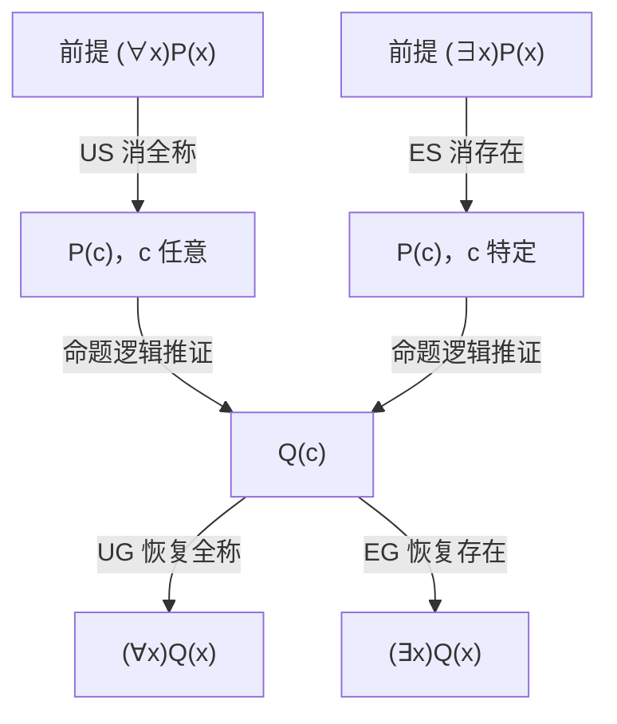

# 谓词逻辑中的推理规则（US、UG、ES、EG）及间接证法与CP规则应用

## 四条量化推理规则是什么

谓词演算中，命题逻辑的重言蕴含式（假言推理、拒取式、析取三段论等）依然可用，但**不能直接对带量词的公式做蕴含变换**。必须先用 US、ES 消去量词，在个体层面推证，再用 UG、EG 恢复量词。

| 规则 | 名称 | 形式 | 方向 |
|---|---|---|---|
| US | 全称指定 | $(\forall x)A(x)\Rightarrow A(c)$ | 任意个体 $c$ |
| UG | 全称推广 | $A(c)\Rightarrow(\forall x)A(x)$ | $c$ 必须任意 |
| ES | 存在指定 | $(\exists x)A(x)\Rightarrow A(c)$ | $c$ 为特定新名 |
| EG | 存在推广 | $A(c)\Rightarrow(\exists x)A(x)$ | $c$ 为某个体 |

> [!IMPORTANT]
> ==ES 指定的 $c$ 必须是“新鲜”特定个体，不得与已有任意个体同名==；而 US 对任意个体都成立，故 US 可在 ES 之后使用同一符号。

## 为什么需要间接证法与 CP 规则

结论为蕴含式 $A\to B$ 时，直接证法往往无从下手。**CP 规则**（附加前提证法）把 $A$ 作为附加前提引入，推出 $B$ 后利用

$$\frac{A\Rightarrow B}{\Rightarrow A\to B}\ (\text{CP})$$

得到结论。若结论是析取式，可先否定其一端转化为蕴含式，再用 CP 或归谬法。

## 一个完整的证明示例

> 任何人喜欢步行则不喜欢乘汽车；每人或喜欢汽车或喜欢自行车；有人不爱骑车。故有人不爱步行。

设 $P(x)$：$x$ 喜欢步行，$Q(x)$：喜欢汽车，$R(x)$：喜欢骑车。

$$\text{前提：}\forall x(P(x)\to\neg Q(x)),\ \forall x(Q(x)\lor R(x)),\ \exists x\neg R(x)$$
$$\text{结论：}\exists x\neg P(x)$$

| 步骤 | 公式 | 依据 |
|---|---|---|
| (1) | $\exists x\neg R(x)$ | P |
| (2) | $\neg R(c)$ | ES(1)，$c$ 特定 |
| (3) | $\forall x(Q(x)\lor R(x))$ | P |
| (4) | $Q(c)\lor R(c)$ | US(3) |
| (5) | $Q(c)$ | T(2)(4) 析取三段论 |
| (6) | $\forall x(P(x)\to\neg Q(x))$ | P |
| (7) | $P(c)\to\neg Q(c)$ | US(6) |
| (8) | $\neg P(c)$ | T(5)(7) 拒取式 |
| (9) | $\exists x\neg P(x)$ | EG(8) |

## 常见的坑

> [!WARNING]
> ==不能在量词辖域内直接做等价或蕴含变换==，必须先 US/ES 消量词再推证，最后 UG/EG 恢复。

> [!CAUTION]
> 顺序错误：若先 US 引入任意个体 $a$，再 ES 存在命题，绝不能把存在个体也指定为 $a$；反之先 ES 得特定 $c$，后 US 可用 $c$ 代入。

> [!TIP]
> 记忆口诀：==“US 任意、ES 特定、UG 需任意、EG 随便”==。检查证明时先盯住每行 $c$ 的来源与性质，再看命题逻辑推理是否合法。
