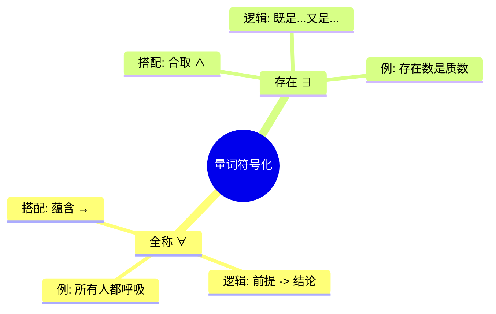

# 全称量词与存在量词的含义及命题符号化

## 量词的含义与核心逻辑

在谓词逻辑中，仅靠命题逻辑无法处理“所有”、“存在”等涉及个体数量的陈述。==全称量词 $\forall$== 表示“对论域中每一个个体”，对应自然语言中的“一切”、“任意”；==存在量词 $\exists$== 表示“论域中至少有一个个体”，对应“有的”、“存在”。

为什么需要区分？因为量词决定了公式的真值条件。若论域有限，$\forall x P(x)$ 等价于 $P(a_1) \land P(a_2) \dots$，而 $\exists x P(x)$ 等价于 $P(a_1) \lor P(a_2) \dots$。理解这一转化有助于直观判断真值。

## 命题符号化的关键规则

符号化的难点在于**特性谓词**（限制范围的谓词）与**连接词**的搭配。请思考：如果我说“所有猫都吃老鼠”，是指“如果是猫，则吃老鼠”，还是“是猫且吃老鼠”？

> [!IMPORTANT]
> **黄金搭配法则**
> - **全称量词 $\forall$** 通常搭配 **蕴含 $\rightarrow$**。
>   - 形式：$(\forall x)(M(x) \rightarrow H(x))$
>   - 含义：只要 $x$ 满足 $M$，就一定满足 $H$。
> - **存在量词 $\exists$** 通常搭配 **合取 $\land$**。
>   - 形式：$(\exists x)(N(x) \land P(x))$
>   - 含义：存在一个 $x$，它既满足 $N$ 又满足 $P$。

## 常见陷阱与易错点

> [!WARNING]
> **高危误区：连接词误用**
> 1. $\forall x (M(x) \land H(x))$ 错误！这表示“论域中所有东西都是人且都要呼吸”，显然荒谬。
> 2. $\exists x (N(x) \rightarrow P(x))$ 慎用！若存在一个非数的对象，蕴含式前件为假，整个公式即为真，这往往不符合原意。

此外，需注意量词的顺序。一般先使用 $\exists$ 指定特定对象，再用 $\forall$ 描述性质，反之未必成立。例如，“每个人都有母亲” ($\forall x \exists y$) 不等于 “有一个人是所有人的母亲” ($\exists y \forall x$)。

## 典型例题解析

**题目**：将命题“没有不犯错误的人”符号化。
设 $F(x)$：$x$ 犯错误，$N(x)$：$x$ 为人。

**分析步骤**：
1. **语义转换**：“没有不犯错误的人” 等价于 “不存在这样的人：他是人 且 他不犯错误”。
2. **直接翻译**：$\neg (\exists x)(N(x) \land \neg F(x))$。
3. **等价变换**：利用量词否定律 $\neg \exists x P(x) \Leftrightarrow \forall x \neg P(x)$ 及德摩根律，可转化为全称量词形式。
   $$ \neg (\exists x)(N(x) \land \neg F(x)) \Leftrightarrow (\forall x) \neg (N(x) \land \neg F(x)) \Leftrightarrow (\forall x) (N(x) \rightarrow F(x)) $$
4. **最终理解**：即“所有人都会犯错误”。

> [!TIP]
> **解题技巧**
> 遇到“没有...”、“凡...都...”时，优先尝试转化为 $(\forall x)(A(x) \rightarrow B(x))$ 的形式，这样通常更简洁且不易出错。
