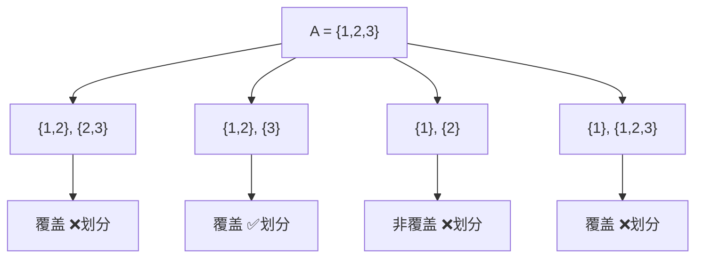

# 集合的划分与覆盖的概念及二者的区别

## 集合的划分与覆盖

### 从“分类”说起

给定一个非空集合 $A$，把它的元素分成若干**互不重叠**的“组”，且**每个元素都必须落在某一组中**——这正是“划分”的直观含义。

覆盖则放松了“互不重叠”这一要求：允许组与组之间有公共元素，但同样要求**并起来等于全集合**。

> [!IMPORTANT]
> 划分 = 覆盖 + 互不相交。==划分必须是覆盖，但覆盖不一定是划分==。这是两者最核心的关系。

### 形式化定义

设 $A$ 是非空集合，$S = \{S_1, S_2, \dots, S_m\}$ 是 $A$ 的**非空子集族**。

**覆盖**：满足
$$
\bigcup_{i=1}^{m} S_i = A
$$

**划分**：在覆盖的基础上，再满足
$$
S_i \cap S_j = \varnothing \quad (i \neq j)
$$

也就是说，==划分要求每两个不同分块的交集为空==。

### 一个例子看清区别

设 $A = \{1, 2, 3\}$。

| 子集族 | 是覆盖？ | 是划分？ | 原因 |
|---|---|---|---|
| $\{\{1,2\},\{2,3\}\}$ | ✅ | ❌ | $\{1,2\}\cap\{2,3\}=\{2\}\neq\varnothing$ |
| $\{\{1,2\},\{3\}\}$ | ✅ | ✅ | 并起来是 $A$，且互不相交 |
| $\{\{1\},\{2\}\}$ | ❌ | ❌ | 并起来缺 $3$ |
| $\{\{1\},\{1,2,3\}\}$ | ✅ | ❌ | $\{1\}\cap\{1,2,3\}\neq\varnothing$ |

### 划分与等价关系的对应

这是南邮考试中最常考的联系：**集合 $A$ 上的一个划分，可以唯一确定一个等价关系 $R$**，反之亦然。

给定划分 $S = \{S_1, S_2, \dots, S_m\}$，构造等价关系：
$$
R = \bigcup_{i=1}^{m} (S_i \times S_i)
$$

**做法**：对每一分块 $S_i$，取它与自身的笛卡尔积（分块内部两两都有关系），再把所有分块的结果并起来。

> [!TIP]
> 记忆口诀：==“一块一块取直积，全部并成大关系”==。同一分块内的元素互相等价，不同分块之间没有任何关系。

**例**：$A = \{a, b, c, d\}$，划分 $S = \{\{a,b\}, \{c\}, \{d\}\}$。

- $\{a,b\}\times\{a,b\} = \{(a,a),(a,b),(b,a),(b,b)\}$
- $\{c\}\times\{c\} = \{(c,c)\}$
- $\{d\}\times\{d\} = \{(d,d)\}$

$$
R = \{(a,a),(a,b),(b,a),(b,b),(c,c),(d,d)\}
$$

验证：$R$ 满足自反、对称、传递，确实是等价关系。

### 划分的计数：贝尔数

$n$ 个元素的集合有多少个不同划分？答案叫**贝尔数** $B_n$。

| $n$ | $B_n$ |
|---|---|
| 1 | 1 |
| 2 | 2 |
| 3 | 5 |
| 4 | 15 |
| 5 | 52 |

$n=3$ 时对应 $A=\{a,b,c\}$ 的 5 个划分：

1. $\{\{a,b,c\}\}$
2. $\{\{a\},\{b,c\}\}$
3. $\{\{b\},\{a,c\}\}$
4. $\{\{c\},\{a,b\}\}$
5. $\{\{a\},\{b\},\{c\}\}$

$n=4$ 时贝尔数为 $15$，可通过分类计数得到：一个分块 $1$ 种、两个分块 $C_4^1 + \frac{1}{2}C_4^2 = 4+3 = 7$ 种、三个分块 $C_4^2 = 6$ 种、四个分块 $1$ 种。

> [!WARNING]
> 两个分块时，$\{\{1,2\},\{3,4\}\}$ 和 $\{\{3,4\},\{1,2\}\}$ 是**同一个划分**，所以 $\{1,2\}$ 型要除以 $2$。这是最容易多算的地方。

### 常见的坑

> [!CAUTION]
> **空集不能作为分块**。例如 $P(A)$ 中含有 $\varnothing$，所以 $P(A)$ 本身不是 $A$ 的划分。
>
> **分块元素不能重复归属**。$P(A)-\{\varnothing\}$ 中元素 $\{1\}$ 和 $\{1,2\}$ 同时出现，元素 $1$ 出现在两个“分块”中，不满足互斥性。
