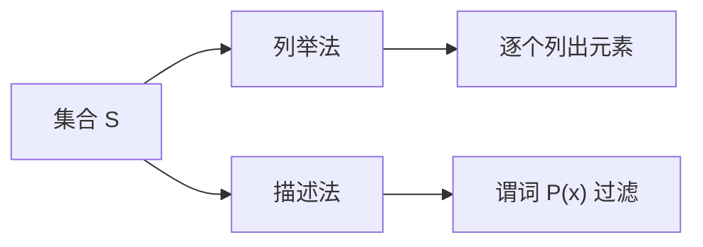

# 集合的定义、元素与集合的关系及集合的列举法与描述法表示

集合是离散数学的起点：后面的关系、函数、代数系统、图论全都建在它上面。先把"什么是集合""元素属于集合"和"两种记法"搞清楚，后面的 $\subseteq$、$\cap$、$\cup$、幂集才不会混。

## 一、集合与元素

我们把 ==具有相同性质的不同对象的全体== 称为**集合**，其中的每个对象称为集合的**元素**。习惯上用大写字母 $A, B, C, \dots$ 表示集合，小写字母 $a, b, c, \dots$ 表示元素。

> [!NOTE]
> 为什么从集合讲起？离散数学以**离散量**为研究对象（有限个或可数个），而集合正好是描述"一群离散对象"最自然的语言，与高数里讨论连续量的手段完全不同。

对集合的几点约定：

- **互异性**：集合中元素彼此不同，$\{1, 1, 2\} = \{1, 2\}$。
- **无序性**：$\{a, b, c\} = \{c, a, b\}$。
- **基数**：元素个数记作 $|A|$；有限个元素叫**有限集**，否则叫**无限集**。
- **元素也可以是集合**：如 $S = \{1, 2, p, \{b\}, c, \{q\}\}$，则 $1 \in S$，$b \notin S$，而 $\{b\} \in S$。

## 二、元素与集合的属于关系

- 若 $a$ 是 $A$ 的元素，记作 $a \in A$；否则记作 $a \notin A$。
- **空集** $\varnothing$（或 $\emptyset$）是不含任何元素的集合。对任意 $x$，$x \notin \varnothing$；但 $\varnothing$ 本身是个集合，所以 $\varnothing \subseteq \varnothing$ 为真、$\varnothing \in \{\varnothing\}$ 也为真。

> [!CAUTION]
> $\in$（属于）和 $\subseteq$（包含）差一个"层"：$\{a\} \in \{\{a\}, a\}$（作为元素），而 $\{a\} \subseteq \{\{a\}, a\}$（作为子集）都成立；但 $\{a\} \nsubseteq \{\{a\}\}$。

## 三、集合的两种表示法

| 表示法 | 形式 | 适用 |
|---|---|---|
| ==列举法== | $A = \{a, b, c, d\}$ | 元素可枚举 |
| ==描述法== | $S = \{x \mid P(x)\}$ | 用共同性质刻画 |

**列举法**：把元素一一列出，无限可数集用 $\dots$ 延伸，如 $B = \{2, 4, 6, \dots, 2n, \dots\}$。像 $(0, 1)$ 这种不可数集就无法用列举法写出。

**描述法**：写成 $S = \{x \mid P(x)\}$，其中 $P(x)$ 是谓词。判定 $b \in S$ 就是看 $P(b)$ 是否为 $T$。例如 $A = \{x \mid x \text{ 是奇数}\}$、$C = \{y \mid y = 2 \lor y = 4\} = \{2, 4\}$。

> [!TIP]
> 描述法转列举法的三步：①看 $x$ 的**取值范围**（$N$? $Z$? $R$?）；②把谓词 $P(x)$ **解出来**得到具体值；③检查是否**同时满足**所有条件。例如 $S_{3} = \{x \mid x \in N \land x^{2} - 1 = 0 \land x > 2\}$：方程只给出 $x = \pm 1$，再被 $x > 2$ 否掉，故 $S_{3} = \varnothing$。

## 一个做对了的例子

求 $S_{2} = \{x \mid x \in N \land y \in N \land x + y = 10\}$ 的列举形式。$x$ 的范围是 $N$，对每个 $y \in N$，$x = 10 - y \ge 0$，故 $y$ 只能取 $0, 1, \dots, 10$，对应 $x = 10, 9, \dots, 0$，于是
$$S_{2} = \{0, 1, 2, \dots, 10\}.$$

> [!WARNING]
> 常见坑：①忘记 $N$ 是否含 $0$（本课取含 $0$）；②只看主方程忽略附加条件（如 $x > 2$）；③把 $\{a\}$ 与 $a$ 混为一谈——$\{a\}$ 是**单元素集合**，$a$ 是元素。
