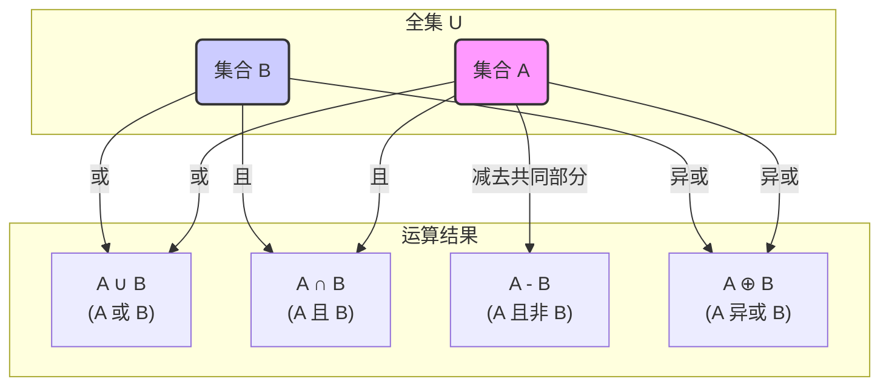

# 集合的交、并、差、补、对称差运算及集合恒等式的证明

## 集合的基本运算

集合间有五种基本运算，它们是构建更复杂集合表达式和证明集合恒等式的基础。理解它们的定义，尤其是==如何用逻辑符号精确描述==，是本章的关键。

### 五种基本运算定义

设 $A$ 和 $B$ 是全集 $U$ 的两个子集。

| 运算 | 记号 | 定义 | 逻辑描述 |
| :--- | :--- | :--- | :--- |
| **并集** | $A \cup B$ | 属于 $A$ **或** 属于 $B$ 的所有元素 | $\{x \mid x \in A \lor x \in B\}$ |
| **交集** | $A \cap B$ | 同时属于 $A$ **和** $B$ 的所有元素 | $\{x \mid x \in A \land x \in B\}$ |
| **相对补集（差）** | $A - B$ | 属于 $A$ 但**不**属于 $B$ 的元素 | $\{x \mid x \in A \land x \notin B\}$ |
| **绝对补集（补）** | $\bar{A}$ 或 $A^c$ | 全集 $U$ 中不属于 $A$ 的元素 | $\{x \mid x \in U \land x \notin A\}$ |
| **对称差** | $A \oplus B$ | 属于 $A$ 或属于 $B$，但**不同时属于两者**的元素 | $\{x \mid x \in A \oplus x \in B\}$ |

> [!NOTE]
> 对称差 $A \oplus B$ 的名字来源于其性质：$(A - B) \cup (B - A)$。它也可以通过异或（XOR）逻辑来理解：元素 $x$ 属于 $A \oplus B$ 当且仅当 $x \in A$ 和 $x \in B$ 的真值不同。
> 常见的等价形式有：$A \oplus B = (A \cup B) - (A \cap B)$。

### 集合恒等式的证明

集合恒等式是描述集合运算之间关系的等式，如交换律、结合律、分配律、德摩根定律等。证明一个集合恒等式 $X = Y$ 通常有两种方法。

> [!IMPORTANT]
> ==证明集合相等的核心方法是证明它们互为子集==，即：
> 1. 证明 $X \subseteq Y$ (任取 $x \in X$，证出 $x \in Y$)
> 2. 证明 $Y \subseteq X$ (任取 $x \in Y$，证出 $x \in X$)
> 两步都成立，才能得出 $X=Y$。

另一种方法是利用已知的集合恒等式进行等价变换，从等式的一端推导到另一端。

### 实例演算与常见误区

让我们通过几个例子来具体看看这些运算的应用和陷阱。

**例 1：交集与并集**
设 $A = \{x \mid x = 2n \land n \in N\}$（非负偶数集），$B = \{x \mid x = 2n + 1 \land n \in N\}$（正奇数集）。
-   $A \cap B$：一个数不可能既是偶数又是奇数，所以它们的交集是空集。$A \cap B = \varnothing$。
-   $A \cup B$：所有非负偶数与所有正奇数合起来构成了整个自然数集 $N$。$A \cup B = N$。

**例 2：空集 $\varnothing$ 与含空集的集合 $\{\varnothing\}$**
这是一个经典的易错点。$\varnothing$ 是一个不含任何元素的集合，而 $\{\varnothing\}$ 是一个只含一个元素（这个元素是空集）的集合。
-   $\varnothing \cap \{\varnothing\}$：因为 $\varnothing$ 中没有任何元素，它与任何集合的交集都是 $\varnothing$。
-   所以，$\varnothing \cap \{\varnothing\} = \varnothing$。

> [!WARNING]
> **空集相关运算的陷阱**
> 务必分清元素与集合的关系，特别是与空集 $\varnothing$ 相关的运算。
> - $\varnothing \cap A = \varnothing$
> - $\varnothing \cup A = A$
> - $\varnothing \in \{\varnothing\}$ (真)
> - $\varnothing \subseteq \{\varnothing\}$ (真，空集是任何集合的子集)

**例 3：对称差的判断**
判断：$A \oplus \varnothing = \varnothing$ 是否成立？
-   根据定义，$A \oplus \varnothing = (A - \varnothing) \cup (\varnothing - A)$。
-   $A - \varnothing = A$（从 $A$ 中减去没有东西的集合，还是 $A$）。
-   $\varnothing - A = \varnothing$（空集减去任何集合都还是空集）。
-   所以，$A \oplus \varnothing = A \cup \varnothing = A$。
-   仅当 $A = \varnothing$ 时，原式才成立。因此，该说法 **错误**。

> [!TIP]
> **对称差 $A \oplus B$ 的记忆技巧**
> 可以把它想象成“异或”电路，只有两个输入（属于A，属于B）状态不同时，输出才为1（元素存在于对称差中）。
> - $A \oplus A = \varnothing$ (所有元素状态都相同)
> - $A \oplus \varnothing = A$ (相当于 $A$ 与全0状态异或)
