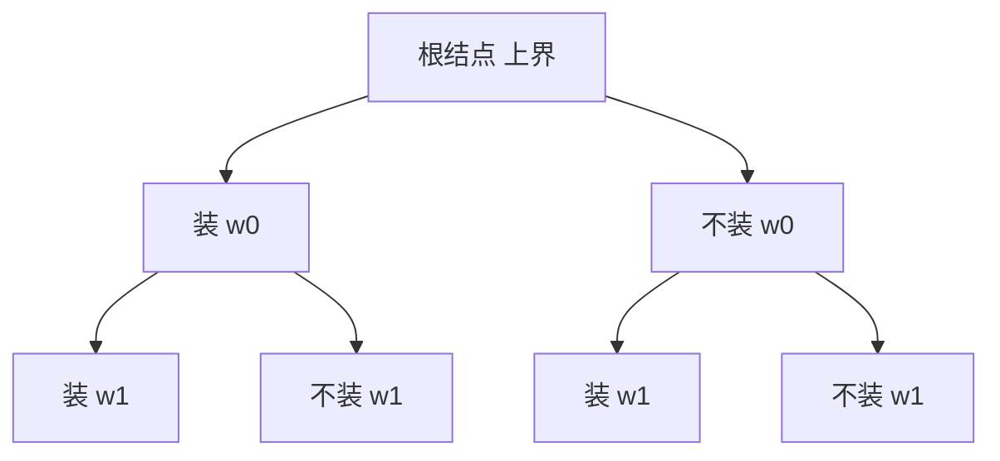

# 0/1背包问题的分枝限界法求解

## 0/1 背包问题的分枝限界法

分枝限界法求解 0/1 背包时，不再是盲目地穷举所有子集，而是在搜索过程中==用一个“界限”提前判断某棵子树有没有希望产生更优解==。如果不可能更优，就直接剪掉，不再深入。

先回忆回溯法：它按深度优先走子集树，遇到死结点就回溯。分枝限界法换了一个思路：它把**活结点**组织成一个优先队列，每次挑==上界最大（或价值最大）==的结点先扩展。这样往往能更快找到最优解，并用于剪枝。

### 为什么需要“限界”

假设背包容量 $M=31$，四个物品重量与价值为：

| 物品 $i$ | 重量 $w_i$ | 价值 $p_i$ |
|---|---|---|
| 0 | 7 | ？ |
| 1 | 11 | ？ |
| 2 | 13 | ？ |
| 3 | 24 | ？ |

如果已经知道当前获得的价值是 $v$，而某个结点即使把剩余物品“按单位价值最大”的理想方式全塞进去，算出的价值上界也不超过 $v$，那么这个结点就没有必要再往下搜了。这就是限界函数的作用。

### 限界函数怎么算

0/1 背包的常用上界是**贪心松弛上界**：对剩余物品按单位价值 $p_i/w_i$ 从大到小排序，依次装入，直到遇到第一个放不下的物品，再按分数装入该物品。这样得到的值一定 $\ge$ 真实的整数最优值，所以可以作为上界。

### 搜索过程

用优先队列管理活结点，优先级取结点的==上界==。

每一步先算当前结点的可行重量、已获价值和上界。若当前重量 $> M$，则丢弃；若上界 $\le$ 当前最优值，则剪掉右子树。==优先队列先弹出上界最大的结点==，一旦某结点是叶结点且价值优于当前最优，就更新最优值。

### 与回溯法、动态规划的区别

| 方法 | 搜索方式 | 剪枝依据 | 适用场景 |
|---|---|---|---|
| 回溯法 | 深度优先 | 约束 + 限界 | 找可行解、最优解 |
| 分枝限界法 | 广度优先 / 最小耗费优先 | 上界/下界 | 求最优解，剪枝更强 |
| 动态规划 | 填表递推 | 最优子结构 | 小规模、确定性求解 |

分枝限界法==不依赖重叠子问题==，因此在某些动态规划难以表示的场景也能用。

> [!WARNING]
> 限界函数必须保证“上界”永远不低估真实最优值，否则会把真正最优的子树剪掉。所以 0/1 背包的限界用的是分数背包上界，而不是随便取一个可行值。

> [!TIP]
> 考卷上画搜索树时，每个结点写清楚：当前重量、当前价值、上界，并标出被剪枝的结点。这样即使结果算错，过程分也容易拿到。

### 一个算对了的例子

取 $M=31$，$w=(7,11,13,24)$。物品按单位价值从大到小已排好序。根结点上界先计算一次。

搜索中先扩展装入 $w_0=7$ 的左子树，当前重量 $7 \le 31$，继续。再扩展装 $w_1=11$ 后重量 $18$，装 $w_2=13$ 后重量 $31$，此时不能再装 $w_3$，得到一个可行解。回溯到未装 $w_2$ 的右子树，计算上界后发现无法超过当前最优值，剪掉。最终得到最优装载方案：装入 $w_0,w_1,w_2$，总重量 $31$。

==限界的本质：用理想化上界去否定糟糕的子树，从而少搜一些。==
