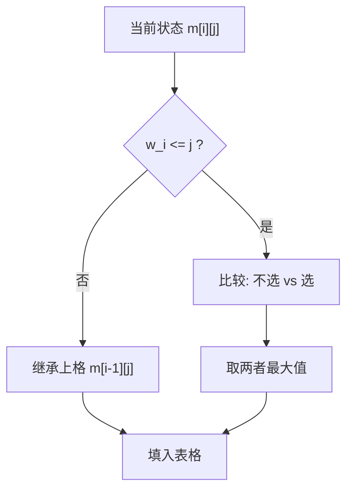

# 0/1背包问题的动态规划法求解（自底向上、反证法证明最优子结构）

## 最优子结构与反证法证明

0/1背包问题能否用动态规划求解，取决于它是否具备==最优子结构性质==。简单来说，就是全局最优解中必然包含了子问题的最优解。如果这个前提不成立，自底向上的递推就失去了根基。

如何用严谨的数学语言证明这一点？我们采用**反证法**。假设 $y_1, y_2, \dots, y_n$ 是容量为 $M$ 的0/1背包问题的一个最优解，但在选择第 $n$ 个物品后，剩余的子问题（容量为 $M-w_n$，物品集为前 $n-1$ 个）的解 $(y_1, \dots, y_{n-1})$ 并不是该子问题的最优解。这意味着存在另一个子问题解 $(z_1, \dots, z_{n-1})$，其总价值严格大于 $\sum_{i=1}^{n-1} p_i y_i$。那么，将 $z$ 与 $y_n$ 组合得到的新解，其总价值必然大于原“最优解” $y$ 的价值，这与 $y$ 是最优解的假设矛盾。因此，==0/1背包问题具有最优子结构==，这是使用DP法的理论基石。

## 自底向上求解与状态转移

既然具备了最优子结构，为什么不用分治法而要用动态规划？因为子问题高度重叠。自顶向下的递归会重复计算大量相同子问题，而==自底向上填表法==通过保存子问题答案，确保每个子问题只算一次，将指数级复杂度降至多项式级 $\Theta(nM)$。

定义状态 $m[i][j]$ 表示前 $i$ 个物品放入容量为 $j$ 的背包所能获得的最大收益。其核心递推关系如下：

$$
m[i][j] = 
\begin{cases} 
m[i - 1][j] & w_i > j \\
\max(m[i - 1][j], \ m[i - 1][j - w_i] + p_i) & w_i \leq j 
\end{cases}
$$

> [!IMPORTANT]
> 递推式的本质是决策：对于每个物品，只有“装”与“不装”两种选择。$m[i-1][j]$ 代表不装第 $i$ 个物品；$m[i-1][j-w_i]+p_i$ 代表装入第 $i$ 个物品并占用对应重量后的剩余空间最优值。==两者取大即为当前状态最优值==。

## 实例演算与回溯构造

以习题7-16为例：$n=6, M=12$，$w=(4,6,2,2,5,1)$，$p=(8,10,6,3,7,2)$。注意数组下标从1开始，需在前补0。

| $i \setminus j$ | 0 | 1 | 2 | 3 | 4 | 5 | 6 | 7 | 8 | 9 | 10 | 11 | 12 |
| :---: | :-: | :-: | :-: | :-: | :-: | :-: | :-: | :-: | :-: | :-: | :-: | :-: | :-: |
| 0 | 0 | 0 | 0 | 0 | 0 | 0 | 0 | 0 | 0 | 0 | 0 | 0 | 0 |
| 1 ($w=4,p=8$) | 0 | 0 | 0 | 0 | 8 | 8 | 8 | 8 | 8 | 8 | 8 | 8 | 8 |
| 2 ($w=6,p=10$) | 0 | 0 | 0 | 0 | 8 | 8 | 10 | 10 | 10 | 10 | 18 | 18 | 18 |
| 3 ($w=2,p=6$) | 0 | 0 | 6 | 6 | 8 | 8 | 14 | 14 | 16 | 16 | 18 | 18 | 24 |
| ... | ... | ... | ... | ... | ... | ... | ... | ... | ... | ... | ... | ... | ... |
| 6 ($w=1,p=2$) | 0 | 2 | 6 | 8 | 9 | 11 | 14 | 16 | 17 | 19 | 19 | 21 | ==24== |

> [!TIP]
> 填表顺序必须是==逐行从左到右==，因为计算 $m[i][j]$ 仅依赖上一行数据。最终 $m[n][M]=24$ 即为最大收益。

求得最优值后，需从 $m[6][12]$ 开始==逆向回溯==确定哪些物品被选中：若 $m[i][j] = m[i-1][j]$，说明第 $i$ 个物品未选，$x_i=0$，位置移至 $(i-1, j)$；否则 $x_i=1$，位置移至 $(i-1, j-w_i)$。本例回溯可得最优解向量 $(1,1,1,0,0,1)$。

> [!WARNING]
> 常见误区：混淆备忘录法与DP法。==备忘录是自顶向下按需计算==，保留递归结构；==DP是自底向上迭代填表==。考试中若问“自底向上”，务必答DP填表法而非备忘录。此外，时间复杂度 $\Theta(nM)$ 是伪多项式时间，当 $M$ 极大时算法仍可能失效，这与贪心法的效率有本质区别。
