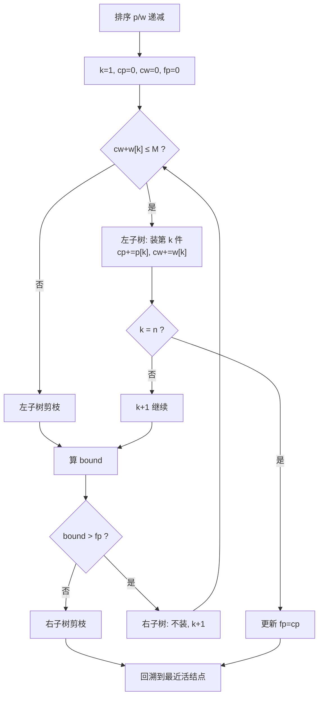
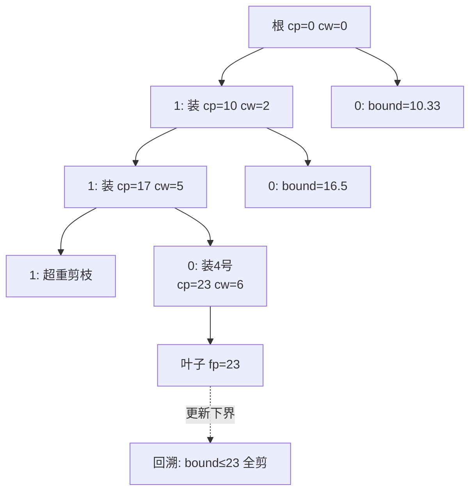

# 0/1背包问题的回溯法求解（限界函数更新下界）

## 问题与解空间

0/1 背包问题：$n$ 件物品，重量 $w_i$、收益 $p_i$，背包容量 $M$；每件物品要么整体装入（1）、要么不装（0），求收益最大的装法。解是长度为 $n$ 的 0/1 向量，共 $2^n$ 个候选解。

> [!IMPORTANT]
> 解空间结构是**子集树**（填空常考）：第 $k$ 层对应物品 $k$ 的"装/不装"决策，左分支取 1、右分支取 0，从根到叶子的每条路径就是一个可行解。

## 为什么需要限界

穷举 $2^n$ 个叶子太慢。回溯法在扩展结点时先算"这个分支最多还能赚多少"——若连上界都超不过当前已找到的最好收益 $fp$，整棵子树剪掉，不再深入。

> [!TIP]
> 先按**单位重量收益** $p_i/w_i$ 从大到小排序，再构造状态空间树。这样同层中先装的物品"性价比高"，上界估计更紧、剪枝更早。

## 上界与下界

设当前结点已装收益 $cp$、已用重量 $cw$，正考察第 $k$ 件物品，剩余容量 $r = M - cw$。上界函数（分数背包松弛）：

$$bound = cp + \sum_{i=k}^{j-1} p_i \cdot \frac{r - \sum_{i=k}^{j-1} w_i}{w_j}$$

即把第 $k$ 到 $j-1$ 件能整装的都装上，第 $j$ 件装不下时按分数 $r/w_j$ 折算收益。

> [!IMPORTANT]
> **限界函数更新下界**：当某结点满足 $bound \le fp$（已找到的最好收益）时剪枝；当搜索到达叶子得到一个完整可行解且 $cp > fp$ 时，**更新 $fp \gets cp$**。$fp$ 就是"当前下界"，随搜索动态抬高，剪枝越来越狠。

## 算法流程

## 算例（例 8-4）

$n=4$，$M=6$，物品已按 $p_i/w_i$ 排序：

| $i$ | $w_i$ | $p_i$ | $p_i/w_i$ |
|---|---|---|---|
| 1 | 2 | 10 | 5.0 |
| 2 | 3 | 7 | 2.33 |
| 3 | 4 | 8 | 2.0 |
| 4 | 4 | 6 | 1.5 |

最优解 $(1,1,0,1)$，最大收益 $fp=23$。

> [!WARNING]
> 易错点：① 上界比较用严格大于 $fp$ 才扩展右子树，等于即剪（否则多走无用分支）；② $bound$ 里务必用**剩余容量** $r$ 而非 $M$；③ 排序后物品编号已变，输出解向量要还原原编号。

> [!NOTE]
> 与分支限界法区别：回溯法按深度优先逐层试探、边搜边更新 $fp$；分支限界（如 FIFO、LC）常配合优先队列整批扩展结点，但剪枝本质相同——上界不超当前最优就放弃。
