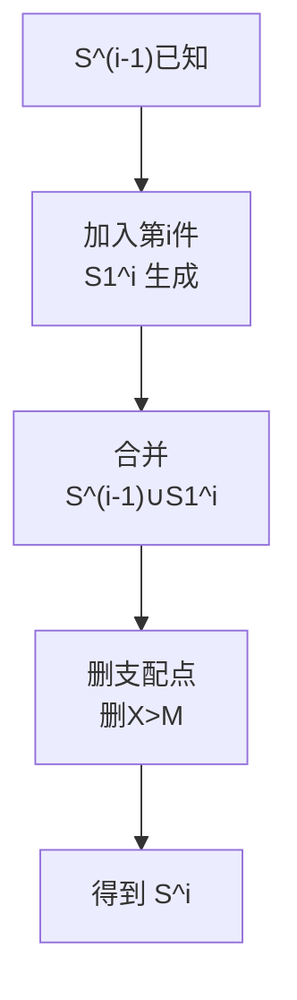

# 0/1背包问题实数重量的阶跃点集合求解（非启发式与启发式方法）

## 它是什么

0/1 背包问题：有 $n$ 件物品，第 $i$ 件重量为 $w_i$、收益为 $p_i$，背包载重为 $M$。每件物品要么选（1）要么不选（0），求总重量不超过 $M$ 时的最大收益。

当重量是**实数**时，经典二维 DP 表 $O(nM)$ 失效——$M$ 不再是整数下标。==阶跃点集合 $S^i$== 正是应对实数重量的有力工具：它记录“考虑前 $i$ 件物品后，在不同重量下能达到的最大收益”的**关键拐点**，舍弃那些重量更大但收益不更优的冗余点。

> [!IMPORTANT]
> $S^i$ 中每个点 $(X, P)$ 表示：重量恰好为 $X$ 时可达收益 $P$。若一点 $(X_1,P_1)$ 存在另一点 $(X_2,P_2)$ 满足 $X_2 \le X_1$ 且 $P_2 \ge P_1$，则 $(X_1,P_1)$ 被**支配**，必须舍弃。

## 为什么需要阶跃点

整数重量时，可以用收益函数 $f(i,X)$ 的完整曲线表示，实数重量下曲线变成“阶梯”：收益只在某些临界重量处跳变。保存整条曲线不现实，==保存跳变处的阶跃点集合==既压缩了信息，又保留了最优决策所需的一切。

## 计算过程

从空集开始递推：

- $S^{-1}=\{(0,0)\}$
- 对第 $i$ 件物品，在 $S^{i-1}$ 基础上生成 $S_1^i = \{(X+w_i,\ P+p_i) \mid (X,P)\in S^{i-1}\}$（即“放入第 $i$ 件”）
- 合并 $S^{i-1} \cup S_1^i$，删除被支配点及 $X>M$ 的点，得 $S^i$

## 一个算对了的例子

设 $(w_0,w_1,w_2,w_3)=(10,15,6,9)$，$(p_0,p_1,p_2,p_3)=(2,5,8,1)$，$M=32$。

从 $S^{-1}=\{(0,0)\}$ 开始：

| 步骤 | 集合 |
|------|------|
| $S^0$ | $\{(0,0),(10,2)\}$ |
| $S^1$ | $\{(0,0),(10,2),(15,5),(25,7)\}$ |
| $S^2$ | $\{(0,0),(6,8),(16,10),(21,13),(31,15)\}$ |
| $S^3$ | $\{(0,0),(6,8),(15,9),(16,10),(21,13),(30,14),(31,15)\}$ |

**最优解值**：$S^3$ 中最大收益为 $15$，对应重量 $31 \le 32$。

**回推最优解**：

- $(31,15)\in S^2$，故 $x_3=0$
- $(31,15)\in S_1^2$，故 $x_2=1$，回减 $(6,8)$ 得 $(25,7)$
- $(25,7)\in S_1^1$，故 $x_1=1$，回减 $(15,5)$ 得 $(10,2)$
- $(10,2)\in S_1^0$，故 $x_0=1$

最优解 $(x_0,x_1,x_2,x_3)=(1,1,1,0)$，收益 $15$。

## 启发式方法与常见坑

> [!WARNING]
> 合并后**必须**删两类点：被支配点、$X>M$ 的点。漏删会污染后续递推和回推。

**非启发式方法**：老老实实合并所有候选项再统一删冗余，适合小规模手算。

**启发式方法**：在合并过程中利用支配关系提前剪枝——当新生成点 $(X',P')$ 已知被某保留点支配时，不放入候选集；或先按重量排序、再只保留收益严格递增的点。本质相同，但减少了“生成—再删除”的来回开销，对规模大时更友好。

> [!TIP]
> 手算验算：$S^i$ 中**重量递增时收益必须严格递增**，否则就有支配点没删干净。

> [!CAUTION]
> 回推最优解时，若 $(X,P)$ 同时出现在 $S^{i-1}$ 和 $S_1^i$ 中，优先判断是否属于 $S_1^i$ 会得到 “选 $i$” 的结论；实际题目约定按先查 $S_1^i$ 再查 $S^{i-1}$ 的顺序即可，但要对某一侧口径保持统一。
