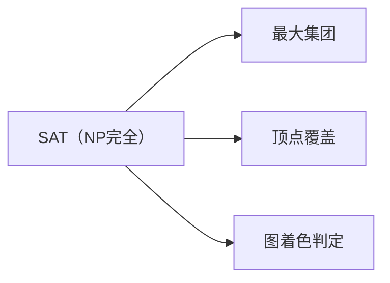

# Cook定理及其证明思路

## 它是什么

先问一个问题：如果有一个问题，随便给它一个解，都能在多项式时间里验证对不对（即 $Q\in\mathrm{NP}$），但又“难”到所有 $\mathrm{NP}$ 问题都能归约到它，那它算什么？

> [!IMPORTANT]
> 若 $Q\in\mathrm{NP}$ 且 $Q$ 是 $\mathrm{NP}$ 难度的，则称 $Q$ 是 ==NP 完全的==（Cook 定理语境下的标准定义）。

而 ==Cook 定理（Cook–Levin 定理）表明：可满足性问题（SAT / CNF-SAT）是 $\mathrm{NP}$ 完全的==。这也是课程里反复考的结论：==第一个被证明是 $\mathrm{NP}$ 完全的问题就是 CNF 可满足性问题（即 SAT），不是最大集团、顶点覆盖或图着色==。

## 为什么需要它

在 Cook 之前，我们不知道“$\mathrm{NP}$ 里到底有没有最难的问题”。有了 Cook 定理，才有“种子”：

只要从 SAT 出发做多项式归约，就能证明后面一串问题也都是 $\mathrm{NP}$ 完全的。

## 证明思路（怎么做）

证明分两步：

1. **$\mathrm{SAT}\in\mathrm{NP}$**：给一组布尔变量赋值，可在多项式时间内代入 CNF 公式，检查是否为真。
2. **$\mathrm{SAT}$ 是 $\mathrm{NP}$ 难的**：对任意 $L\in\mathrm{NP}$，设其由非确定图灵机 $M$ 在多项式时间 $p(n)$ 内判定。构造 CNF 公式 $\phi$，使得
   $$x\in L \iff \phi\text{ 可满足}$$
   $\phi$ 用布尔变量编码 $M$ 的“计算历史表”（格局、读写头位置、状态转移），再加上子句约束：初始格局合法、每步转移合法、最终进入接受状态。这样 $\phi$ 可满足 $\Leftrightarrow$ 存在一条接受计算路径 $\Leftrightarrow x\in L$。整个构造规模是 $p(n)$ 的多项式。

> [!TIP]
> 记忆：==两步走——“SAT 自己能在多项式验证” + “任意 NP 问题都能变成 SAT”==。

## 与相近概念的区别

| 概念 | 含义 |
|---|---|
| $\mathrm{NP}$ | 解可在多项式时间验证 |
| $\mathrm{NP}$ 难度 | 所有 $\mathrm{NP}$ 问题可多项式归约到它 |
| $\mathrm{NP}$ 完全 | 既属于 $\mathrm{NP}$，又是 $\mathrm{NP}$ 难度 |

## 常见的坑

> [!WARNING]
> 考卷里“第一个 NP 完全问题”选 ==CNF 可满足性问题 / SAT==，别选最大集团、顶点覆盖、图着色。另外注意：==“NP 难度”不等于“NP 完全”，还必须同时满足属于 NP==（有题里把“NP 难度的”写错成“MP 难度的”，属印刷错误）。

## 一个算对了的例子

题：第一个被证明是 NP 完全问题的是（ ）
A. 最大集团　B. CNF 可满足性问题　C. 顶点覆盖　D. 图着色数判定

按上述：Cook 定理证明 SAT（CNF 形式）是首个 $\mathrm{NP}$ 完全问题，故选 **B（或相应题干中的 SAT/CNF-SAT 选项）**。
