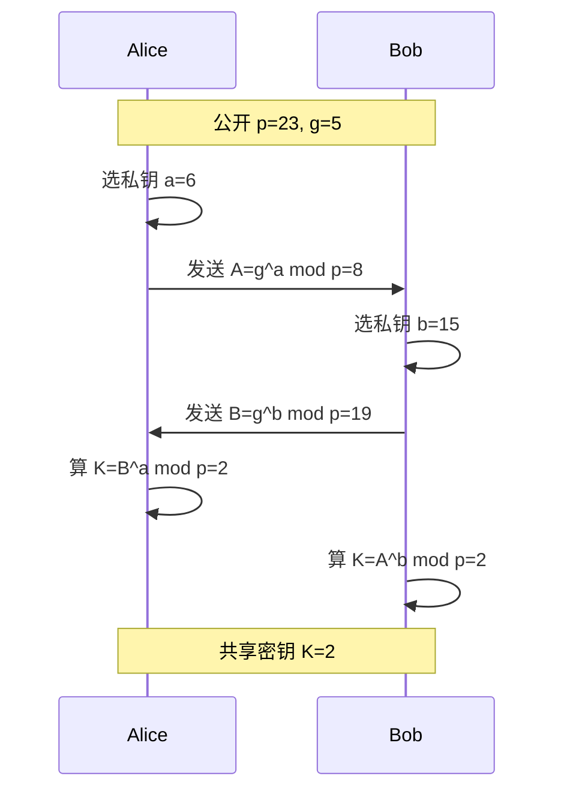

# Diffie-Hellman密钥交换协议原理与举例

## 协议本质与核心问题

在对称加密中，通信双方必须拥有相同的密钥。但如果 Alice 和 Bob 从未见过面，且信道完全公开，如何安全地协商出一个只有他们知道的共享密钥？这就是 Diffie-Hellman（DH）密钥交换协议要解决的核心问题。

> [!IMPORTANT]
> DH 协议本身==不提供加密或签名功能==，它仅用于在不安全信道上安全地协商出共享会话密钥，后续仍需结合对称加密算法实现机密性。

其安全性建立在==离散对数问题的计算困难性==之上：已知大素数 $p$、生成元 $g$ 和 $g^a \bmod p$，反推私钥 $a$ 在计算上是不可行的。

## 协议交互流程

假设 Alice 和 Bob 约定公开参数：大素数 $p = 23$，生成元 $g = 5$。

**计算验证**：

- Alice 计算公钥：$A = 5^6 \bmod 23 = 15625 \bmod 23 = 8$
- Bob 计算公钥：$B = 5^{15} \bmod 23 = 19$
- Alice 计算共享密钥：$K = B^a \bmod p = 19^6 \bmod 23 = 2$
- Bob 计算共享密钥：$K = A^b \bmod p = 8^{15} \bmod 23 = 2$

双方独立算出相同结果，因为数学上恒有 $(g^b)^a \equiv (g^a)^b \pmod p$。

> [!TIP]
> 手算模幂时用==快速幂取模==：将指数二进制分解，逐位平方取模再相乘，避免中间结果溢出。考试中务必写出每步取模过程。

## 与相近概念的区别

| 对比维度 | Diffie-Hellman | RSA |
| :--- | :--- | :--- |
| 主要用途 | 密钥协商 | 加密 / 数字签名 |
| 数学基础 | 离散对数问题 | 大整数分解难题 |
| 密钥角色 | 临时会话密钥 | 长期公私钥对 |
| 是否可签名 | 否 | 是 |

> [!NOTE]
> DH 属于==非对称密码体制的应用==，但它不直接加解密数据，这与 RSA 有本质区别。复习提纲中“两种密码体制”的对比常在此处设坑。

## 常见误区与安全警告

> [!CAUTION]
> DH 协议==无法抵抗中间人攻击==！攻击者可分别与 Alice、Bob 建立两个独立的 DH 会话，伪装成对方。实际部署时必须结合数字证书或预共享认证机制。

> [!WARNING]
> 参数选择至关重要：$p$ 必须是足够大的安全素数，$g$ 必须是模 $p$ 的原根。若 $g$ 生成的子群过小，离散对数问题将变得容易求解，协议安全性彻底崩塌。

考试举例题时，务必确认 $g$ 确实是模 $p$ 的生成元，并完整展示模幂运算步骤，这是得分关键。
