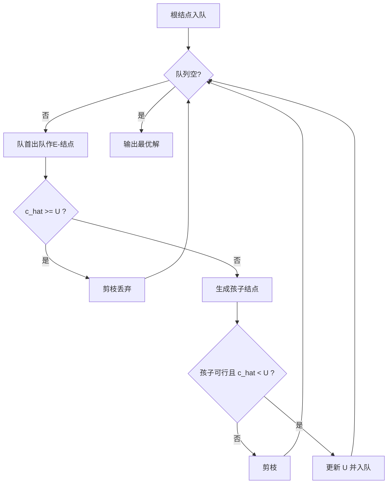

# FIFO（队列式）分枝限界法算法框架

---
requires: [算法分析与设计/回溯法, 算法分析与设计/状态空间树]
---

FIFO（队列式）分枝限界法是一种==将活结点表组织成先进先出队列==的搜索策略。它按广度优先的方式遍历状态空间树，每次从队首取出一个活结点作为当前扩展结点（E-结点），生成其所有孩子，经过剪枝判断后将存活的孩子加入队尾，直到找到最优解或队列为空。

为什么需要它？回溯法采用深度优先搜索，容易在某条“深而差”的路径上浪费大量时间。FIFO 分枝限界法通过广度优先配合界限函数，能更早发现较优可行解并更新阈值，从而剪去更多无望的子树。

## 算法框架与流程

算法的核心在于三个动作：**取结点、生孩子、做剪枝**。以目标函数为“损失最小”的问题为例：

1. 初始化全局上界阈值 $U$（如贪心求得的初始损失），将根结点入队。
2. 当队列非空时，队首出队成为 E-结点。若该结点的损失下界 $\hat{c} \ge U$，则直接剪枝丢弃。
3. 扩展 E-结点生成孩子结点：
   - 若孩子不可行（如作业超时），剪去；
   - 若孩子可行，计算其损失下界 $\hat{c}$ 和损失上界 $u$；
   - 若 $\hat{c} < U$，将该孩子入队；否则剪枝；
   - 每生成一个孩子，检查是否用 $u$ 更新 $U$（若 $u < U$ 则令 $U = u$）。

> [!IMPORTANT]
> 选取扩展结点的规则决定了分枝限界法的类型：==FIFO 用队列，LIFO 用堆栈，LC 用优先队列==。

| 方法 | 活结点表结构 | 选取 E-结点原则 | 搜索特性 |
| :--- | :--- | :--- | :--- |
| FIFO | 队列 | 先进先出 | 广度优先 |
| LIFO | 堆栈 | 后进先出 | 深度优先 |
| LC | 优先队列 | 优先级最高 | 最小代价优先 |

## 算例：带时限的作业排序（JSFIFOBB）

设有 5 个作业，收益 $p=\{6,3,4,8,5\}$，处理时间 $t=\{2,1,2,1,1\}$，时限 $d=\{3,1,4,2,4\}$。总收益为 26，目标函数转化为**损失最小**。

> [!TIP]
> 前提：必须先将作业按时限 $d_i$ 升序排列！排序后顺序为作业 2, 4, 1, 3, 5。利用贪心法求得初始入选集合 $X=\{2,4,1\}$，对应损失上界 $U=7$（即未入选作业 3 和 5 的收益之和 $4+5=9$？不对，贪心选的是 2,4,1，落选的是 3,5，但课件标准答案中重排后贪心得到 $U=7$）。

在 JSFIFOBB 算法中，我们画出实际生成的状态空间树：

1. **第 0 层**：根结点入队，$\hat{c}=0 < U=7$。
2. **第 1 层**：根结点出队，生成选/不选作业 2 的孩子。计算下界，满足 $\hat{c} < 7$ 的入队。若某分支损失上界 $u < 7$，则更新 $U$。
3. **后续各层**：严格按队列 FIFO 顺序，先扩展完第 1 层所有存活结点，再扩展第 2 层。
4. **剪枝**：一旦发现某结点 $\hat{c} \ge U$，打 `×` 标记，不再展开其子树。

最终求得最优解 $X=\{2,4,1\}$（对应原编号 $\{4,1,5\}$ 等视具体排序而定），最大收益 $= 26 - 7 = 19$。

> [!WARNING]
> FIFO 并非万能。对于 $n$-皇后问题，FIFO 搜索了 31 个结点，而回溯法只搜索了 16 个。因为判定问题不需要找“最优”，广度优先反而产生大量无用中间状态。==FIFO 优势在于最优化问题中尽早压低上界 $U$==。

> [!CAUTION]
> 考试画状态空间树时，务必标明每个结点的 $\hat{c}$、$u$ 以及 $U$ 的更新过程。被剪去的结点用 `×` 标记，获得中间解的结点用单圆圈，最优解用双圆圈，切勿遗漏。
