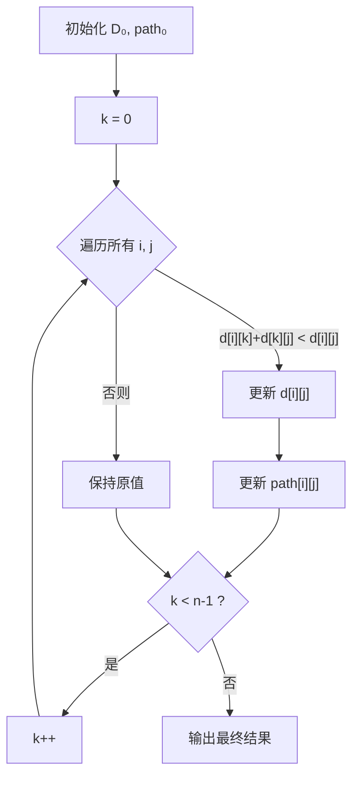

# 每对结点间最短路径的Floyd（弗洛伊德）算法及正确性证明

弗洛伊德（Floyd）算法用于求解带权有向图 $G=(V,E)$ 中==任意一对结点间的最短路径==。它允许图中包含负边，但==不允许包含路径长度为负值的回路==。

如果只求单源最短路径，可以跑一次 Dijkstra；但如果要求所有结点对之间的最短路径呢？对每个结点都跑一次单源算法固然可行，但 Floyd 算法用更优雅的动态规划思想，以统一的框架解决了这个问题。

## 基本思想与递推式

假设图有 $n$ 个结点，编号为 $0$ 到 $n-1$。我们一步步放宽限制：如果从 $i$ 到 $j$ 的路径上，只允许经过编号不大于 $k$ 的中间结点，最短路径是多少？

令 $d_k[i][j]$ 表示该最短路径长度。在第 $k$ 步，我们需要做一个决策：从 $i$ 到 $j$ 的最短路径上是否包含结点 $k$？

- **不包含 $k$**：最短路径就是上一阶段的结果，即 $d_{k-1}[i][j]$。
- **包含 $k$**：路径被拆成两段 $i \to k$ 和 $k \to j$，且这两段也只能经过编号不大于 $k-1$ 的中间结点，总长为 $d_{k-1}[i][k] + d_{k-1}[k][j]$。

由此得到核心递推式：

$$
d_k[i][j] = \min \{ d_{k-1}[i][j],\; d_{k-1}[i][k] + d_{k-1}[k][j] \}
$$

同时用二维数组 `path` 记录路径信息。当 $d_k[i][j]$ 因经过 $k$ 而更新时，说明 $i$ 到 $j$ 的最短路径先走到 $k$，再从 $k$ 走到 $j$，因此 $j$ 的前驱应继承 $k$ 到 $j$ 路径上 $j$ 的前驱：

$$
path_k[i][j] = path_{k-1}[k][j]
$$

> [!IMPORTANT]
> 初始状态（$k=-1$ 或 $k=0$ 视教材下标而定）：$D_0$ 即为图的邻接矩阵，若无边则为 $\infty$；$path_0[i][j]$ 初始化为 $i$（若存在边）或 $-1$。

## 算法流程与复杂度

程序实现采用三重循环，最外层枚举中间结点 $k$，内两层枚举起点 $i$ 和终点 $j$。时间复杂度为 ==$O(n^3)$==。

> [!TIP]
> 实际编程中，由于 $d_k[i][k] = d_{k-1}[i][k]$ 且 $d_k[k][j] = d_{k-1}[k][j]$，可以直接在原数组上原地滚动更新，无需开辟三维空间。

## 正确性证明思路

为什么这样递推一定能得到全局最短路径？利用数学归纳法：
1. **基础**：$D_0$ 记录了不经过任何中间结点时的最短路径（即直接相连的边权），显然正确。
2. **归纳**：假设 $D_{k-1}$ 正确保存了只经过编号 $\le k-1$ 的中间结点时的最短路径。对于 $D_k$，任意一条只经过编号 $\le k$ 的中间结点的最短路径，要么不经过 $k$（由归纳假设已被 $D_{k-1}$ 记录），要么经过 $k$。若经过 $k$，由于无负权回路，可将其在 $k$ 处断开为 $i \to k$ 和 $k \to j$ 两段，这两段的中间结点编号必然 $\le k-1$，其最优解恰为 $d_{k-1}[i][k] + d_{k-1}[k][j]$。两者取极小值即为 $D_k$ 的正确解。
当 $k=n-1$ 时，所有结点均可作为中间结点，$d_{n-1}[i][j]$ 即为全局最短路径。

## 实例演算

已知 3 个结点的初始矩阵 $D_0$，求 $D_1, D_2, D_3$（对应 $k=0,1,2$）：

$$
D_0 = \begin{pmatrix} 0 & \infty & 2 \\ 3 & 0 & 6 \\ 10 & 5 & 0 \end{pmatrix}
$$

- **$k=0$（允许经过结点 0）**：考察能否通过结点 0 缩短路径。例如 $D_1[1][2] = \min(6,\; D_0[1][0]+D_0[0][2]) = \min(6,\; 3+2) = 5$。其余不变。
- **$k=1$（允许经过结点 0,1）**：考察结点 1。$D_2[2][0] = \min(10,\; D_1[2][1]+D_1[1][0]) = \min(10,\; 5+3) = 8$。
- **$k=2$（允许经过所有结点）**：考察结点 2。$D_3[0][1] = \min(\infty,\; D_2[0][2]+D_2[2][1]) = \min(\infty,\; 2+5) = 7$。

最终结果：

$$
D_1 = \begin{pmatrix} 0 & \infty & 2 \\ 3 & 0 & 5 \\ 10 & 5 & 0 \end{pmatrix}, \quad D_2 = \begin{pmatrix} 0 & \infty & 2 \\ 3 & 0 & 5 \\ 8 & 5 & 0 \end{pmatrix}, \quad D_3 = \begin{pmatrix} 0 & 7 & 2 \\ 3 & 0 & 5 \\ 8 & 5 & 0 \end{pmatrix}
$$

## 易错点辨析

| 对比项 | Floyd 算法 | Dijkstra 算法 |
| :--- | :--- | :--- |
| 求解目标 | 所有结点对 | 单源 |
| 负权边 | 支持 | 不支持 |
| 算法策略 | 动态规划 | 贪心 |
| 时间复杂度 | $O(n^3)$ | $O(n^2)$ 或更低 |

> [!WARNING]
> 考试中常考 `path` 数组的回溯。注意课件约定：`path[i][j]` 存的是最短路径上结点 $j$ 的==前一个顶点==。回溯时要从终点 $j$ 开始，不断查表找前驱直到起点 $i$，最后将序列反转才是正序路径。

> [!CAUTION]
> 千万不要把最外层的 $k$ 循环放到最内层！必须是 $k$ 在外，$i, j$ 在内，否则破坏了动态规划的阶段依赖关系，会导致错误结果。
