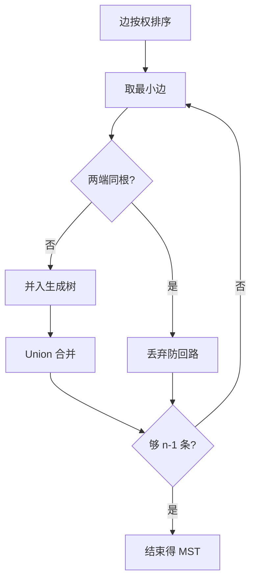

# 最小代价生成树的Kruskal算法（边集扩展与并查集）

## 它是什么与为什么需要

在无向连通带权图 $G=(V,E)$ 中，==最小代价生成树==（最小生成树）是包含全部 $n$ 个顶点、 $n-1$ 条边且权值和最小的连通子图。Kruskal 算法属于**第6章 贪心法**：每步选当前代价最小、且与已选边不构成回路的边，逐步**边集扩展**成树。

为什么需要它？相比 Prim（适合边多、近完全图，$m=O(n^{1.99})\approx O(n^2)$ 时选 Prim），Kruskal 对**边数较少的带权图**效率更高（如习题6-9）。课件里还提到：为加快处理，用**并查集 UnionFind**（每子集由树根标号标识，见 P112-6.3）管理连通分支，将作业/顶点分组，改进的 Find 为 $O(\log n)$、Union 为 $O(1)$。

先看一个问题：不断加边时，如何快速判断新边两端是否已在同一连通块里？答案正是并查集。

## 怎么做：边集扩展 + 并查集

算法流程：

用并查集时，初始每个顶点自成子集；Find 查根判断是否同根，不同则 Union 合并。总时间约 $O(m\log m)$（主导为排序），并查集操作近线性。

## 和相近概念的区别

| 算法 | 贪心依据 | 适用 | 时间 |
|---|---|---|---|
| Kruskal | 最小边不形成回路 | 边少图 | $O(m\log m)$ |
| Prim | 最近顶点扩展 | 边多/近完全 | $O(n^2)$ 或 $O(m\log n)$ |

> [!WARNING]
> 别混淆：Prim 是“顶点扩展”，Kruskal 是“边集扩展”；课件【程序6-5】用并查集做的是带时限作业排序 FJS，不是 Kruskal 本身，但同为并查集应用。

## 常见的坑

> [!WARNING]
> 忘记按权排序直接贪心取边，会得不到 MST；未用并查集而用邻接矩阵查回路会退化；认为所有边权相等则 MST 唯一——其实不唯一（习题6-11：仅当无边权相同时才唯一）。

## 一个算对了的例子

取习题6-10：原图 MST 为 $T$，每条边加相同值 $c$。新图代价 $\text{cost}'(T)=\text{cost}(T)+c(n-1)$。若新图有 $T'$ 更优，则 $\text{cost}(T')<\text{cost}(T)$，即原图存在更优树，与 $T$ 为原 MST 矛盾。故 ==$T$ 仍是新图的最小代价生成树==。此性质与 Kruskal 只比相对大小、不依赖绝对零点的贪心本质一致。
