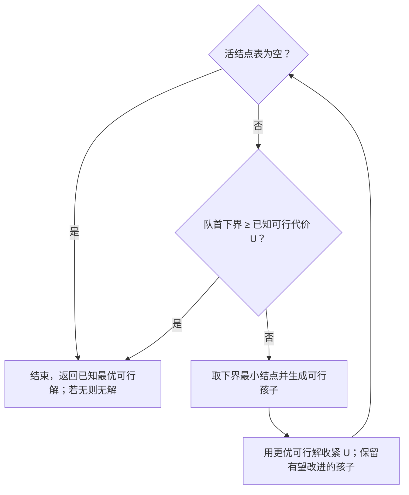

# LC（优先队列式）分枝限界法与代价估计函数

LC 检索把活结点放入优先队列，每次选择==估计代价最小==的结点扩展。FIFO 按入队时间选，LIFO 取最后入表的结点；LC 则可以先扩展更深但估价更低的结点。若只按层次排序、同层再按入队先后打破平局，其扩展次序才与 FIFO 相同。

## 路径代价：剩余估价不必逐步下降

在最短路径型搜索中，课件使用 $\hat c(X)=f(X)+\hat g(X)$。$f(X)$ 是到达结点 $X$ 已付出的路径代价，只有单位步长时才等于层次；$\hat g(X)$ 是从 $X$ 到达目标的最小剩余代价的估计。若要把 $\hat c$ 当成剪枝所需的下界，应保证 $\hat g(X)$ 不高估最小剩余代价，而不是要求每次移动都使 $\hat g$ 下降。

第 9 章的十五谜算例用「不在其位的非空白牌数」估剩余步数。每步只移动一张数字牌，因此每块错位牌至少要移动一次，这个估计不会高估。它却可以上升：目标棋盘下面两行是 $(9,10,11,12)$ 和 $(13,14,15,\square)$；若只把 15 与空格对调，得到结点 $X$，只有 15 错位，$\hat g(X)=1$。从 $X$ 再把 11 下移到空格，得到子结点 $Y$，11 和 15 都错位，$\hat g(Y)=2$。从 $Y$ 反向两步就能到目标，说明这两个估值甚至正好等于最小剩余步数。

> [!IMPORTANT]
> 在单位步长的十五谜中，每步最多改变一张牌是否错位，所以 $\hat g(X)\le 1+\hat g(Y)$。一般把这类条件写成 $\hat g(X)\le w(X,Y)+\hat g(Y)$，称为一致性，它保证沿路径的总估价 $f+\hat g$ 不下降。它和「$\hat g(Y)\le\hat g(X)$」不是一回事；下面的树搜索剪枝只需要可靠的子树下界，不要求剩余估价单调。

## 优化问题：排序规则和剪枝判据要分开

对最小化问题，设 $c^*(X)$ 是 $X$ 代表的候选分支中可达到的最优代价。若要用估价剪枝，必须有 $\hat c(X)\le c^*(X)$。用 $U$ 记录**已经找到的最好可行解的实际代价**。找到更优可行解立即更新 $U$，不是看到一个更低的估计就更新。

当只需一个最优解时，$\hat c(X)\ge U$ 就可以排除该分支。如果优先队列恰按这个可靠下界排序，队首的下界已不小于 $U$，那么队中每个分支都不能严格改进现有答案；即使队未空，也可结束。若用的是任意优先级而非有效下界，不能据此剪枝，也不能仅凭先找到一个解就认定最优。若要收集所有并列最优解，等号不能作为丢弃该分支的理由。

## 算例：把带时限作业排序改用 LC

《习题答案（9-2题）》给出的是 FIFO 轨迹。下面沿用其输入，**改用 LC 独立推演**，不要把展开顺序当作原件的 FIFO 标号。

按作业编号 0 至 4，收益是 $(3,8,6,4,5)$，截止时刻是 $(1,2,3,4,4)$，处理时间是 $(1,1,2,2,1)$。总收益为 26，损失是未入选作业的收益和。空元组可行，故初始 $U=26$，并不知道最优损失是多少。

- 元组只追加编号比末项更大的作业，因这些编号已按截止时刻非减排列。追加后完工时间超过该作业的截止时刻，就放弃候选。
- 当前结点的损失下界是**已经跳过且不能补选**的作业收益和，并非搜索深度。当前元组若可行，立即停止时的损失就是 $26$ 减已选收益，可用来收紧全局上界。
- 按下界从小到大扩展；同一下界按入队先后，生成孩子时按作业编号增加尝试。

| 展开的元组 | 损失下界 | 扩展开始时的 $U$ | 处理孩子后的 $U$ |
| --- | --- | --- | --- |
| 空元组 | 0 | 26 | 18 |
| $(0)$ | 0 | 18 | 15 |
| $(0,1)$ | 0 | 15 | 10 |
| $(1)$ | 3 | 10 | 10 |
| $(1,2)$ | 3 | 10 | 7 |
| $(0,1,3)$ | 6 | 7 | 7 |

上界的完整更新序列为 $26,23,18,15,11,10,7$。例如扩展 $(1,2)$ 时，追加作业 3 会在时刻 5 完工，超过截止时刻 4；追加作业 4 则准时完成。后者只丢掉作业 0 和 3，损失为 $3+4=7$。此时还不能立刻停：队里尚有下界为 6 的 $(0,1,3)$；把它处理完，队首下界才达到 7，可以结束。

因此所选作业为 $(1,2,4)$，完成时刻为 $(1,3,4)$，恰不超过各自的截止时刻 $(2,3,4)$。最大收益是 $8+6+5=19$，也等于 $26-7=19$。
