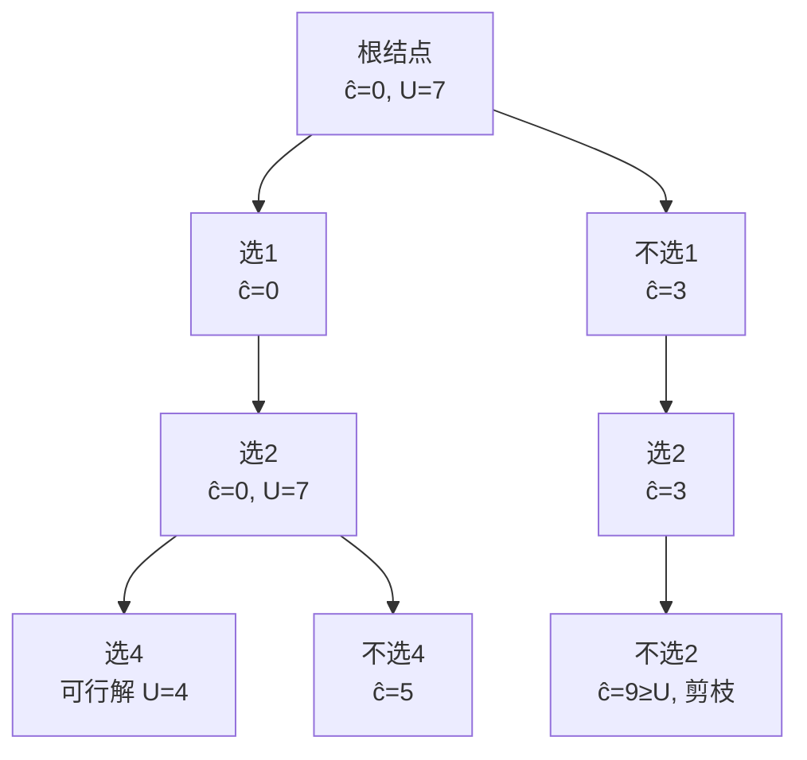

# LC（优先队列式）分枝限界法与代价估计函数
分枝限界法的核心动作只有两步：**扩展**一个活结点，全部孩子进活结点表；然后从表中**选**下一个扩展结点。活结点表的组织方式不同，选择策略就不同。FIFO 用队列，LIFO 用堆栈，而 LC 分枝限界法用**优先队列**——每次从活结点表中取出“最有希望”的结点先扩展。

问题来了：什么叫“最有希望”？

### 为什么需要代价估计函数

设想你在搜索十五谜问题的状态空间树。盲目按 FIFO 一层层铺开，会生成大量离目标很远的废结点。如果能给每个结点打一个“前途分”，分低的优先扩展，搜索就会更快向答案收敛。这个“前途分”就是代价估计函数。

一个结点 $X$ 的总估计代价记为 $\hat c(X)$，定义为：

$$\hat c(X)=f(X)+\hat g(X)$$

其中：

- $f(X)$：从根到 $X$ 已实际付出的代价，通常是 $X$ 在树中的层次；
- $\hat g(X)$：从 $X$ 到达一个答案结点**还需付出代价的估计值**。

> [!IMPORTANT]
> $\hat g(X)$ 是 $g(X)$ 的估计值。若 $Y$ 是 $X$ 的孩子，则要求 $\hat g(Y)\le \hat g(X)$——越往下走，剩余代价的估计不应增加，这是保证搜索合理性的常见前提。

LC 检索的基本规则：==每次选取 $\hat c(\cdot)$ 值最小的活结点作为下一个 E-结点==。因此 LC 分枝限界法又称**最小成本检索**（Least Cost search）。

一个有趣的特例：若令 $\hat c(X)=f(X)$ 且 $f(X)$ 等于层次，则 LC 检索退化为 FIFO——因为层次小的结点总先出队。

### LC 与 FIFO、LIFO 的区别

| 策略 | 活结点表 | 选扩展结点的原则 | 搜索形态 |
|------|----------|------------------|----------|
| FIFO | 队列 | 先进先出 | 广度优先 |
| LIFO | 堆栈 | 后进先出 | 类似于深度优先 |
| LC | 优先队列 | $\hat c$ 最小优先 | 启发式“最优优先” |

> [!WARNING]
> LC 的“最优优先”不等于“一定先找到最优解”。$\hat c$ 只是估计值，必须配合**上下界剪枝**才能避免无效扩展。

### 基于上下界的 LC 分枝限界法

在实际求最优解问题（如带时限的作业排序、0/1 背包）中，每个结点还会计算：

- 下界 $\hat c(X)$：以 $X$ 为根的子树中任意解代价的下界估计；
- 上界 $U$：**当前已经找到的最好可行解的代价**，是全局变量，随搜索推进不断收紧。

扩展结点前先做剪枝判断：

- 若 $\hat c(X)\ge U$，则该子树不可能产生比当前最优更好的解，剪掉；
- 若得到一个可行解且其代价 $<U$，更新 $U$。

> [!TIP]
> 在 LC 检索中，一旦队首结点被剪枝（$\hat c(X)\ge U$），由于优先队列按 $\hat c$ 排序，剩余结点的下界也都不小于 $U$，因此整棵搜索可以提前终止。这正是 LC 相比 FIFO 的高效之处。

### 一个带时限作业排序的例子

设有 4 个作业，收益 $p=(3,8,6,4,5)$，时限 $d=(1,2,3,4,4)$，总收益 $26$。求收益最大即**损失最小**的作业子集。

把“损失”定义为不选某作业而丢失的收益。上界 $U$ 初始为 $7$（即损失不超过 $7$ 的已知可行方案）。LC 检索按 $\hat c$（损失下界）从小到大的顺序扩展，生成部分状态空间树：

最优解为 $\{1,2,4\}$，对应收益 $3+8+5=16$，损失 $26-16=10$？回头检查：初始 $U=7$ 表示已知存在损失不超过 $7$ 的方案，最终算法找到一个可行解后不断更新 $U$，直至无法再改进。==关键是：$\hat c\ge U$ 的结点一律不再扩展==。

### 常见误区

1. **把 $\hat c$ 当成精确代价**：$\hat c$ 只是估计，精度直接影响剪枝效率。估计越准，剪得越狠。
2. **忘记更新 $U$**：一旦找到更优可行解必须立即收紧 $U$，否则后续剪枝会失效。
3. **混淆 $\hat g$ 与 $g$**：$g$ 是真实剩余代价，通常未知；$\hat g$ 是它的估计。

> [!NOTE]
> LC 分枝限界法面对状态空间极大且估价函数设计良好的问题时，常比 FIFO 和回溯法搜索少得多的结点；但估价函数本身计算代价若过高，反而得不偿失。
