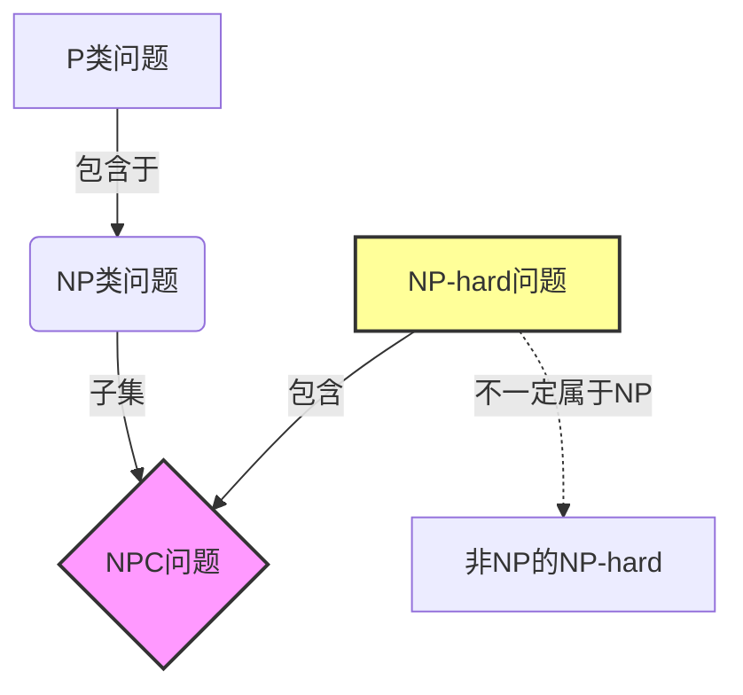

# NP难度（NP-hard）与NP完全（NPC）问题的定义及证明策略

## NP难度与NP完全问题的定义及证明

在算法设计中，我们常遇到一些“难解”的问题。理解 **P类**、**NP类**、**NP-hard** 和 **NPC** 的关系是本章核心。

> [!IMPORTANT]
> **核心定义**
> - **NP问题**：可在多项式时间内用**不确定算法**验证解的正确性。
> - **NP-hard**：若所有NP问题都能多项式时间归约到问题 $Q$，则 $Q$ 为NP-hard。它不一定属于NP。
> - **NP-complete (NPC)**：若 $Q \in \text{NP}$ 且 $Q$ 是 NP-hard，则 $Q$ 为 NPC。
>
> ==核心结论==：**第一个被证明的NPC问题是CNF可满足性问题（SAT）**（Cook定理）。

### 概念辨析与关系图谱

很多初学者容易混淆 NP-hard 和 NPC。关键在于是否属于 NP 类。

| 概念 | 属于NP? | 难度特征 | 典型例子 |
| :--- | :---: | :--- | :--- |
| **P** | ✅ | 多项式时间可解 | 排序、最短路径 |
| **NP** | ✅ | 多项式时间可验证 | SAT、TSP判定 |
| **NPC** | ✅ | NP中最难，互可归约 | SAT、最大集团、顶点覆盖 |
| **NP-hard** | ❌/✅ | 至少和NPC一样难 | 停机问题、优化版TSP |

> [!WARNING]
> **常见误区**：认为 NP-hard 一定不可解。实际上，若找到任意一个 NPC 问题的多项式算法，则 $P=NP$，所有 NP 问题均可多项式求解。但目前尚未发现此类算法。

### 证明策略：如何证明问题是 NPC？

证明一个新问题 $Q$ 是 NPC，通常分两步走：

1.  **证明 $Q \in \text{NP}$**：给出一个多项式时间的验证算法。
2.  **证明 $Q$ 是 NP-hard**：选择一个**已知**的 NPC 问题 $Q_1$，构造从 $Q_1$ 到 $Q$ 的多项式时间归约（$Q_1 \propto Q$）。

> [!TIP]
> **归约方向记忆**：我们要证明 $Q$ 很难，所以要把已知的难题 $Q_1$ “转化”为 $Q$。即 $Q_1 \leq_p Q$。如果 $Q$ 能轻松解决，那 $Q_1$ 也能轻松解决，这与 $Q_1$ 是 NPC 矛盾。

### 典型例题解析

**题目**：下列 CNF 公式中（ ）不存在真值指派。

*   A. $(x_1 \lor x_2 \lor \overline{x}_3) \land (\overline{x}_1 \lor x_3) \land (x_1 \lor \overline{x}_2 \lor \overline{x}_3)$
*   B. $(\overline{x}_1 \lor x_2) \land (\overline{x}_2 \lor x_3) \land (x_1 \lor \overline{x}_3)$
*   C. $(\overline{x}_1 \lor x_2) \land (\overline{x}_1 \lor \overline{x}_2) \land (x_1 \lor x_2)$
*   D. $(x_1 \lor x_2) \land (x_1 \lor x_3) \land \overline{x}_1 \land (\overline{x}_2 \lor \overline{x}_3)$

**解析**：
SAT 问题是判断是否存在一组变量赋值使公式为真。我们直接代入验证或逻辑推导。
看选项 D：
1.  由子句 $\overline{x}_1$ 可知，必须 $x_1 = \text{False}$。
2.  代入 $(x_1 \lor x_2)$，因 $x_1=\text{F}$，故必须 $x_2 = \text{True}$。
3.  代入 $(x_1 \lor x_3)$，因 $x_1=\text{F}$，故必须 $x_3 = \text{True}$。
4.  检查最后子句 $(\overline{x}_2 \lor \overline{x}_3)$：此时 $x_2=\text{T}, x_3=\text{T}$，则 $\overline{x}_2=\text{F}, \overline{x}_3=\text{F}$，结果为 False。
5.  产生矛盾，故 D 无解。

> [!NOTE]
> 此题虽简单，但体现了 SAT 作为 NPC 问题的基础地位。在实际复杂图中（如最大集团问题），我们正是通过将其归约为 SAT 或反之来证明难度的。
