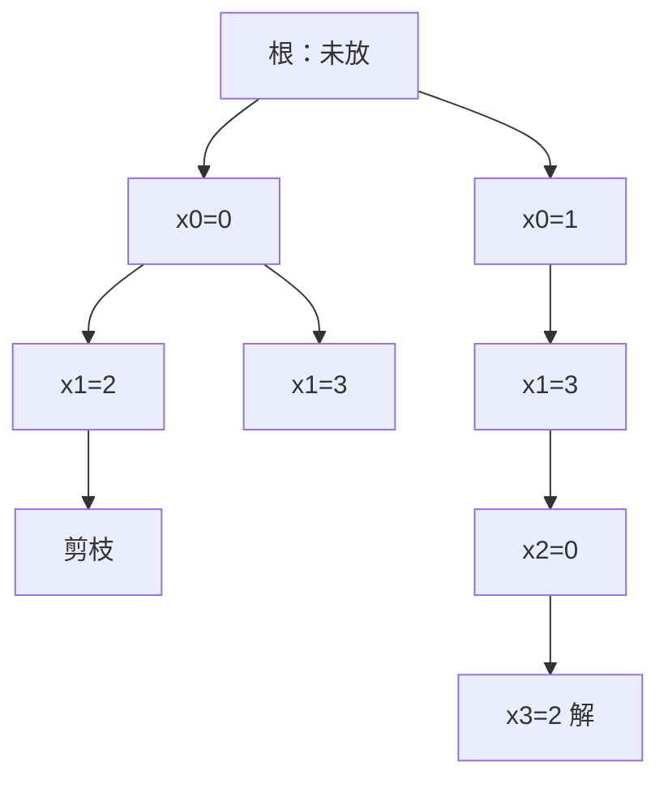

# n-皇后问题的回溯法求解及状态空间树分析

## 它是什么

$n$-皇后问题要求在一个 $n \times n$ 棋盘上放 $n$ 个皇后，使它们互不同行、同列、同斜线。回溯法按行放置，用数组 $x[0 \dots n-1]$ 记录第 $i$ 行皇后所在列号。状态空间树是一棵排列树：根表示未放置，第 $k$ 层结点表示已确定前 $k$ 行的列位置。



## 为什么需要

显式检查所有 $n^n$ 种放法不可行。回溯法用约束函数 `Place(k)` 剪去同行、同列、同斜线的分支，只在“部分解可能扩展成可行解”时才深入，从而把状态空间树从指数级压到实际生成的小规模子树。

## 怎么做

算法 `NQueens` 从第 0 行开始递归：对每行枚举列 $j$，若 `Place(k)` 通过则设 $x[k]=j$ 并进入 $k+1$ 行；当 $k=n$ 时得到一个可行解。若只要第一个解，可在输出后直接退出——这就是考题里“修改程序使之求得第一个可行解后算法终止”的做法：在递归出口处加终止标志，不再继续回溯兄弟分支。

```c
// 找到第一个解即终止的核心改动
if (k == n) { output(x); terminated = true; return; }
if (terminated) return; // 上层不再展开
```

## 相近概念的区别

| 概念 | 含义 |
|------|------|
| 显式约束 | 每个 $x[i] \in \{0,\dots,n-1\}$ |
| 隐式约束 | 不同列、不同斜线，由 `Place` 检查 |
| 状态空间树结点 | 每次尝试一个列位置就生成一个结点 |
| 解的对偶性 | 若 $(x_0,\dots,x_{n-1})$ 是解，则其左右镜像 $(n-1-x_0,\dots)$ 也是解 |

## 常见的坑

> [!WARNING]
> 统计结点数时常忘记把根结点算进去；4-皇后路径 $(1,3,0,2)$ 含根是 5 个结点。另一个坑是把列号与行号混写，南邮课件中 $x[i]$ 是“第 $i$ 行的列”。

> [!TIP]
> 只求不对称解时，令 $x[0]$ 只取 $0 \dots \lfloor n/2 \rfloor$，即可去掉镜像重复，这就是简答 3 的修改思路。

## 一个算对了的例子

题干给出随机路径 $(0,2)$ 与 $(1,3,0,2)$。$(1,3,0,2)$ 是可行解，路径生成结点为根、第1行选1、第2行选3、第3行选0、第4行选2，共 5 个含根结点。$(0,2)$ 在后续无合法位被剪枝，含根结点为 3 个。蒙特卡罗估计取样本平均：
$$
\frac{5 + 3}{2} = 4
$$
即估算实际生成的状态空间树结点数为 4。这里的关键是：==样本路径结点数平均值就是该蒙特卡罗估计值==。
