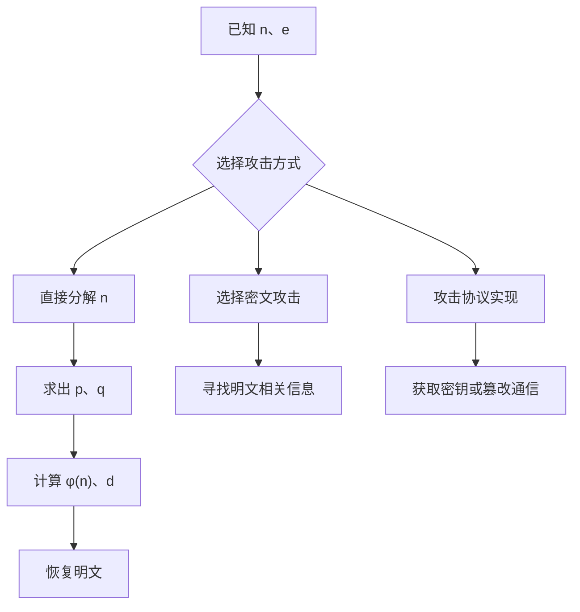
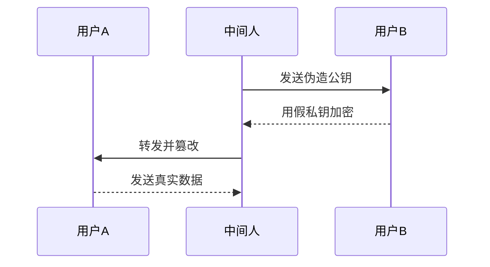

# RSA的安全性分析及可能存在的攻击方式

## RSA 安全性分析

RSA 是基于==大整数分解困难性==的非对称密码体制。设明文分组为 $M$，公开密钥为 $(e,n)$，则加密过程为：

$$
C=M^e\bmod n
$$

若私有密钥为 $(d,n)$，解密过程为：

$$
M=C^d\bmod n
$$

其中通常有 $n=pq$，$p,q$ 为两个大素数，并满足：

$$
ed\equiv 1\pmod{\varphi(n)}
$$

RSA 的安全性并不是建立在“不知道私钥”本身，而是建立在攻击者难以从公开的 $n$ 中有效分解出 $p,q$，进而计算私钥 $d$。

## 可能存在的攻击方式

### 大整数分解攻击

这是 RSA 最直接、也是理论上的核心攻击。攻击者若能得到

$$
n=pq
$$

就可以计算：

$$
\varphi(n)=(p-1)(q-1)
$$

再利用扩展欧几里得算法求 $d$，满足：

$$
ed\equiv 1\pmod{\varphi(n)}
$$

随后便能解密任意密文。因此，RSA 的实际安全性高度依赖于分解大整数 $n$ 的计算困难性。

### 选择密文攻击

攻击者选择某个密文 $C$，要求合法解密系统返回：

$$
M=C^d\bmod n
$$

如果系统对不同密文的解密结果、错误信息或运行时间表现出可利用的差异，攻击者就可能据此推导明文或私钥信息。因此，实际实现中通常使用填充机制，如 OAEP，而不是直接对任意消息使用“裸 RSA”。

### 中间人攻击

攻击者冒充通信双方，截获公开密钥并替换为自己的密钥，再分别与双方通信。通信双方可能都认为自己在与对方安全通信，实际上密钥已经被窃取。

注意：==RSA 本身不能自动防止中间人攻击==。通常需要结合数字证书、认证和密钥交换协议确认通信对方的身份。

### 时间攻击与侧信道攻击

如果解密程序的执行时间、功耗、电磁辐射等物理特征与私钥运算存在依赖关系，攻击者可以通过测量这些信息推测私钥。这类攻击针对的是实现过程，而不是 RSA 数学公式本身。

### 数字认证辨析

数字认证主要用于确认消息来源、保证完整性并防止抵赖。它是 RSA 可以支持的安全功能或配套机制，而不是针对 RSA 的攻击方式。题干给出的选择题中，正确答案是 **D**。

> [!TIP]
> 记忆方法：RSA 攻击主要问“怎样恢复明文或私钥”，如分解、选择密文、中间人和时间攻击；“数字认证”属于安全服务或防护机制。

## 实际使用中的注意事项

| 事项 | 正确做法 | 常见错误 |
|---|---|---|
| 密钥长度 | 使用足够长的 $n$ | 密钥过短，容易被分解 |
| 消息加密 | 使用安全填充方案 | 直接使用裸 RSA |
| 身份确认 | 使用数字证书和认证协议 | 只看到公钥就相信对方 |
| 参数生成 | 保证 $p,q$ 独立且随机 | 参数选择不当 |
| 实现保护 | 防止时间、功耗等侧信道 | 泄露解密时间信息 |

> [!IMPORTANT]
> RSA 的核心安全假设是：已知 $n,e$，求因数分解或恢复私钥在计算上不可行；但安全实现还必须防止协议攻击、填充问题和侧信道泄漏。

## 一个算对了的例子

取 $p=3,q=11$，则：

$$
n=pq=33,\qquad \varphi(n)=(3-1)(11-1)=20
$$

选择 $e=3$，因为：

$$
\gcd(3,20)=1
$$

通过扩展欧几里得算法得到：

$$
3\times 7=21\equiv 1\pmod{20}
$$

所以：

$$
d=7
$$

设明文 $M=5$，公开密钥为 $(e,n)=(3,33)$，加密得到：

$$
C=5^3\bmod 33=125\bmod 33=26
$$

再使用私钥 $(d,n)=(7,33)$ 解密：

$$
M=26^7\bmod 33=5
$$

因此，加密公式应选：

$$
\boxed{C=M^e\bmod n}
$$

而 $M=C^d\bmod n$ 是解密公式，不能与加密公式混淆。
