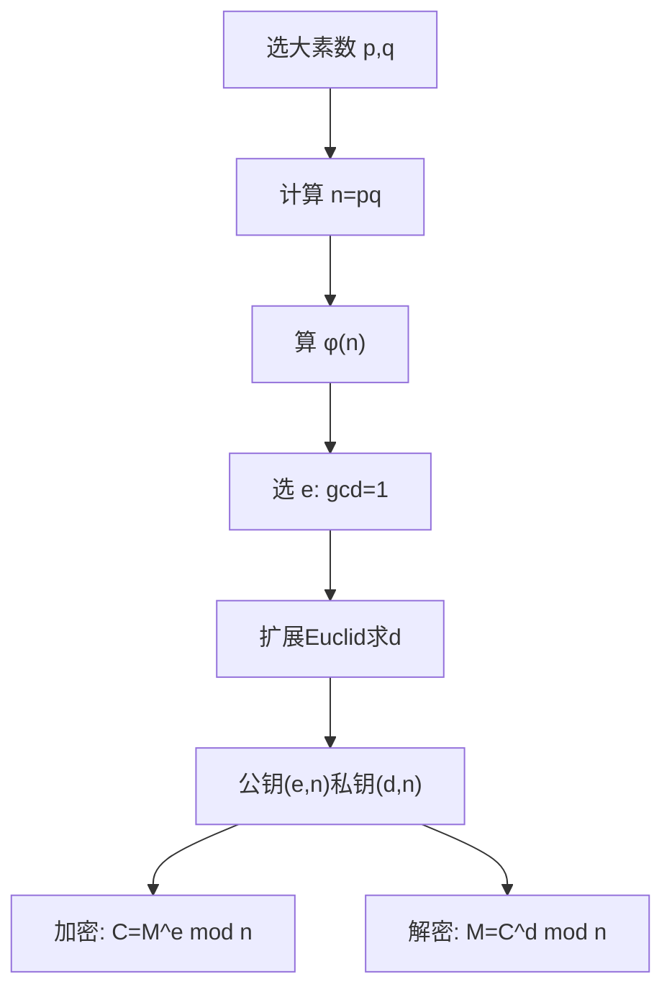

# RSA机制的密钥产生、加解密过程与扩展Euclid算法

## RSA 机制与扩展 Euclid 算法

RSA 是第一个完善的==非对称密码体制==，既可用于加密，也可用于数字签名。其安全性基于大整数分解的困难性。复习提纲反复强调“用扩展 Euclid 算法”，正是因为它是求解私钥 $d$ 的唯一数学工具。若只背公式而不会手算扩展 Euclid，应用题必然失分。

### 密钥产生与加解密流程

RSA 的核心在于构造一对满足模逆关系的指数 $(e, d)$。整个过程可概括为以下流程：

> [!IMPORTANT]
> ==私钥 $d$ 是 $e$ 模 $\phi(n)$ 的乘法逆元==，即满足 $ed \equiv 1 \pmod{\phi(n)}$。这一步必须通过扩展 Euclid 算法求解，不能靠猜。

### 扩展 Euclid 算法实战

为什么课件三次强调该算法？因为 $d$ 无法直接计算，只能通过求解线性同余方程 $ex + \phi(n)y = 1$ 得到，其中 $x$ 即为 $d$。

以真题应用题为例：已知 $e=5, n=35, M=12$，求密文并验证过程。

1.  **分解 $n$**：$35 = 5 \times 7$，故 $p=5, q=7$。
2.  **计算欧拉函数**：$\phi(35) = (5-1)(7-1) = 24$。
3.  **验证 $e$**：$\gcd(5, 24) = 1$，合法。
4.  **加密计算**：$C = 12^5 \bmod 35$。
    -   $12^2 = 144 \equiv 4 \pmod{35}$
    -   $12^4 \equiv 4^2 = 16 \pmod{35}$
    -   $12^5 = 12^4 \times 12 \equiv 16 \times 12 = 192 \equiv 17 \pmod{35}$
    -   故密文 $C = 17$。

> [!TIP]
> 手算模幂时务必使用==快速幂取模==（平方-乘算法），避免直接计算大数溢出。上例中 $12^5$ 拆解为 $12^4 \times 12$ 即是此法。

### 概念辨析与安全边界

| 对比维度 | RSA | 对称密码（如 AES） |
| :--- | :--- | :--- |
| 密钥数量 | 公钥/私钥成对 | 单一共享密钥 |
| 核心运算 | 模幂、扩展 Euclid | 置换、异或 |
| 主要用途 | 密钥交换、数字签名 |  bulk 数据加密 |
| 安全基础 | 大整数分解困难 | 混淆与扩散 |

> [!WARNING]
> 真题反复考查“RSA 不能用于数字签名”为==错误说法==。RSA 既能加密也能签名，这是非对称密码的基本特性。

> [!CAUTION]
> 针对 RSA 的攻击包括大整数分解、时间攻击、中间人攻击等，但==数字认证不是攻击方式==，而是 RSA 的应用场景。切勿混淆“攻击手段”与“安全服务”。

### 常见坑点提醒

-   **$\phi(n)$ 算错**：忘记 $n=pq$ 时 $\phi(n)=(p-1)(q-1)$，误用 $n-1$。
-   **逆元符号**：扩展 Euclid 求出的 $x$ 可能为负数，需执行 $d = (x \bmod \phi(n) + \phi(n)) \bmod \phi(n)$ 转为正整数。
-   **模数混淆**：加密解密模 $n$，但求逆元时模 $\phi(n)$，两者绝不可混用。

> [!NOTE]
> 考试中若要求“含过程”，务必写出扩展 Euclid 的回代步骤或快速幂的中间结果，仅写最终答案通常只得一半分。
