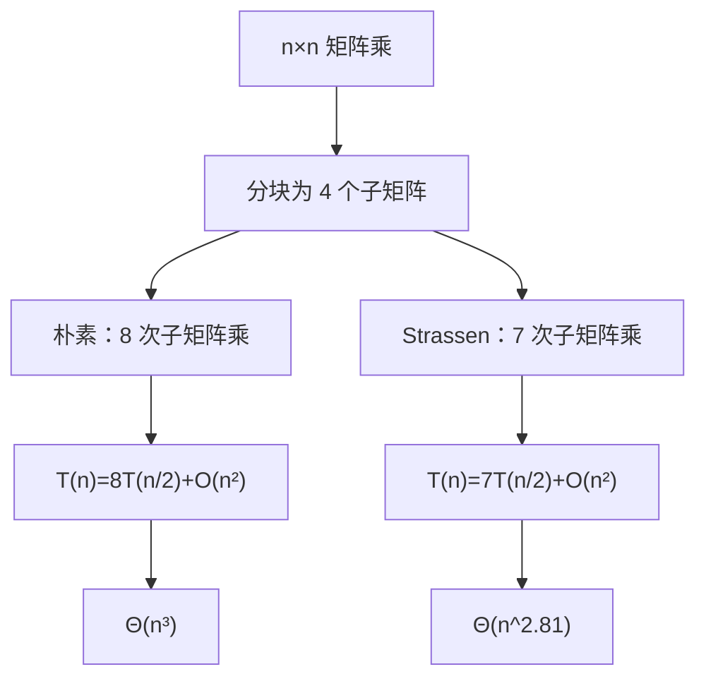

# Strassen矩阵乘法分治策略及时间复杂度改进

## Strassen 矩阵乘法

把两个 $n \times n$ 矩阵相乘，常规三重循环需要 $\Theta(n^3)$ 次标量乘法。分治策略能否打破这个界限？先看最朴素的分块做法。

将 $A$、$B$、$C$ 各分为四个 $\frac{n}{2} \times \frac{n}{2}$ 的子矩阵：

$$
C_{11}=A_{11}B_{11}+A_{12}B_{21}
$$

$$
C_{12}=A_{11}B_{12}+A_{12}B_{22}
$$

$$
C_{21}=A_{21}B_{11}+A_{22}B_{21}
$$

$$
C_{22}=A_{21}B_{12}+A_{22}B_{22}
$$

每个式子含两次子矩阵乘法和一次加法。四个式子共 **8 次子矩阵乘法**、4 次矩阵加法。于是递推方程为：

$$
T(n)=8T\!\left(\frac{n}{2}\right)+cn^2
$$

由主定理，$n^{\log_2 8}=n^3$，时间复杂度仍是 $\Theta(n^3)$——分块本身没有带来本质改进。

> [!IMPORTANT]
> 决定分治矩阵乘法效率的关键不是加法的次数，而是==子矩阵乘法的次数==。矩阵加法是 $O(n^2)$ 级别，矩阵乘法递归分支才是主导项。

### Strassen 的突破口：7 次乘法

Strassen 的核心思想是用**巧妙的线性组合**，把 8 次子矩阵乘法压缩为 7 次。多做一些加（减）法，但换来递归树分支的减少。

先计算 7 个中间子矩阵：

$$
P=(A_{11}+A_{22})(B_{11}+B_{22})
$$

$$
Q=(A_{21}+A_{22})B_{11}
$$

$$
R=A_{11}(B_{12}-B_{22})
$$

$$
S=A_{22}(B_{21}-B_{11})
$$

$$
T=(A_{11}+A_{12})B_{22}
$$

$$
U=(A_{21}-A_{11})(B_{11}+B_{12})
$$

$$
V=(A_{12}-A_{22})(B_{21}+B_{22})
$$

再由这 7 个中间量拼装出 $C$ 的四个子矩阵：

$$
C_{11}=P+S-T+V
$$

$$
C_{12}=R+T
$$

$$
C_{21}=Q+S
$$

$$
C_{22}=P+R-Q+U
$$

一共 **7 次子矩阵乘法** + 18 次矩阵加（减）法。

### 时间复杂度分析

递推方程变为：

$$
T(n)=7T\!\left(\frac{n}{2}\right)+O(n^2)
$$

由主定理：

$$
T(n)=\Theta\!\left(n^{\log_2 7}\right)\approx\Theta\!\left(n^{2.81}\right)
$$

当 $n$ 充分大时，$n^{2.81}$ 明显优于 $n^3$。

> [!TIP]
> 记忆口诀：**“8 次变 7 次，加法换乘法”**。矩阵乘法是递归瓶颈，加法是低阶项，用加法多换乘法少是划算的。

### 一个“算对了”的例子：验证 $C_{12}$

担心公式记不住？考试可以直接手算验证。以 $C_{12}$ 为例，它应为 $A_{11}B_{12}+A_{12}B_{22}$：

$$
R+T=A_{11}(B_{12}-B_{22})+(A_{11}+A_{12})B_{22}
$$

$$
=A_{11}B_{12}-A_{11}B_{22}+A_{11}B_{22}+A_{12}B_{22}
$$

中间项恰好抵消：

$$
=A_{11}B_{12}+A_{12}B_{22}=C_{12}
$$

> [!WARNING]
> 直接替换时注意正负号：$R$ 中是 $B_{12}-B_{22}$，展开后会出现 $-A_{11}B_{22}$，恰好被 $T$ 中的 $+A_{11}B_{22}$ 抵消。不要忘记补上 $A_{12}B_{22}$ 这一项。

### 与朴素分块的对比

| 方案 | 子矩阵乘法次数 | 子矩阵加减次数 | 时间复杂度 |
|:---|:---:|:---:|:---:|
| 朴素分块 | 8 | 4 | $\Theta(n^3)$ |
| Strassen | 7 | 18 | $\Theta(n^{2.81})$ |

Strassen 以更多加法为代价，换取递归分支从 8 到 7 的缩减。由于加法是 $O(n^2)$ 量级，而乘法递归主导复杂度，整体仍然获益。

### 常见的坑

- **认为加法次数优化能降低主项**：加法是 $cn^2$ 项，无论怎样优化常数 $c$，在递归树中都不改变指数。真正改变指数的是分支数 8 → 7。
- **记住 7 个中间量但拼错符号**：建议考前自己手推一遍 $C_{11}$ 或 $C_{12}$，考试直接代入验证最稳。
- **$n$ 很小时不必用 Strassen**：常数因子较大，实际工程中往往在 $n$ 较大或结合其他优化时才使用。
