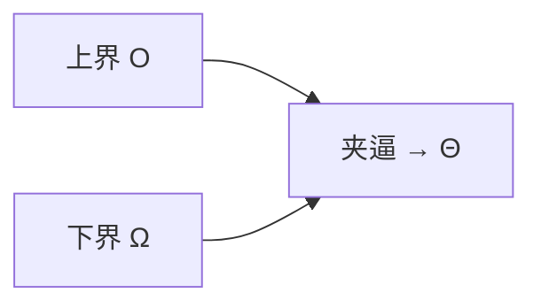

# 渐近表示法：Θ记号（紧渐近界）

## Θ记号：紧渐近界

先想一个问题：我们说一个算法“差不多就是 $n^2$ 这个量级”，这句话能不能用数学语言严格表达？

$O$ 只看上界，$\Omega$ 只看下界。单独用它们描述算法时，信息都不完整——一个算法可以说是 $O(n^3)$，但其实它可能也是 $O(n^2)$。如果我们想**同时卡住上下两头**，就需要 $\Theta$。

### 定义

> [!IMPORTANT]
> 若存在正常数 $c_1, c_2$ 和 $n_0$，使得当 $n \geq n_0$ 时，
> $$ c_1 \cdot g(n) \leq f(n) \leq c_2 \cdot g(n) $$
> 则称 $f(n) = \Theta(g(n))$，读作“$f(n)$ 是 $g(n)$ 的紧渐近界”。

也就是说，当 $n$ 足够大以后，$f(n)$ 被**夹在** $g(n)$ 的两个常数倍之间，既不会跑得太高，也不会跌得太低。

### 为什么需要它

$O$ 用来给最坏情况“兜底”，但有时太宽松。比如 $3n^2 + n = O(n^3)$ 没错，但这句话没有告诉读者真实增长趋势。$\Theta$ 则明确表态：==这个函数“就是”这个量级的，不多不少==。在分析分治算法如归并排序时，我们真正想说的是 $T(n) = \Theta(n\log n)$，而不是笼统的 $O(n^2)$。

### 怎么证明

证明 $f(n) = \Theta(g(n))$，就是找一个 $n_0$，再找两个常数 $c_1, c_2$，使不等式夹住。经典步骤是**分开证**：

先证 $f(n) = O(g(n))$（找 $c_2$），再证 $f(n) = \Omega(g(n))$（找 $c_1$），最后取两者公共的 $n_0$ 合并。

### 一个算对了的例子

证明 $5n^2 - 8n + 2 = \Theta(n^2)$。

**上界方向**：当 $n \geq 1$ 时，
$$ 5n^2 - 8n + 2 \leq 5n^2 $$
取 $c_2 = 5,\ n_0 = 1$，得 $f(n) = O(n^2)$。

**下界方向**：需要找一个正系数。当 $n \geq 4$ 时，$8n \leq 2n^2$，于是
$$ 5n^2 - 8n + 2 \geq 5n^2 - 2n^2 = 3n^2 $$
取 $c_1 = 3,\ n_0 = 4$，得 $f(n) = \Omega(n^2)$。

**合并**：取 $c_1 = 3,\ c_2 = 5,\ n_0 = 4$，当 $n \geq 4$ 时：
$$ 3n^2 \leq 5n^2 - 8n + 2 \leq 5n^2 $$
所以 $5n^2 - 8n + 2 = \Theta(n^2)$。

### 和相近概念的区别

| 记号 | 含义 | 表达关系 | 直观理解 |
|------|------|----------|----------|
| $O$ | 上界 | $f(n) \leq c \cdot g(n)$ | “不会超过” |
| $\Omega$ | 下界 | $f(n) \geq c \cdot g(n)$ | “至少是” |
| $\Theta$ | 紧界 | $c_1 g(n) \leq f(n) \leq c_2 g(n)$ | “就是” |

$f(n) = \Theta(g(n))$ 当且仅当 $f(n) = O(g(n))$ 且 $f(n) = \Omega(g(n))$ 同时成立。

> [!WARNING]
> 下界证明最容易翻车的地方是“随便放缩”。例如要证 $5n^2 - 8n + 2 \geq c \cdot n^2$，不能直接扔掉 $-8n$ 再设 $c=5$，因为 $5n^2 - 8n + 2 \leq 5n^2$，方向反了。必须先用较小的 $n^2$ 项“吸收”掉线性项。

> [!TIP]
> 判断多项式 $an^2 + bn + c$ 的紧界，只需看最高次项。只要 $a > 0$，就一定是 $\Theta(n^2)$。低次项在 $n$ 大时会被“压住”，这正是渐近分析的核心直觉。

### 一个隐藏的坑

$\Theta$ 不是“完全相等”。$5n^2 - 8n + 2 \neq \Theta(8n^2 + 3)$ 吗？其实**等式成立**，因为常数倍差异在渐近记号里不改变量级。$\Theta$ 描述的是**增长率的等价类**，而不是具体函数值的近似。
