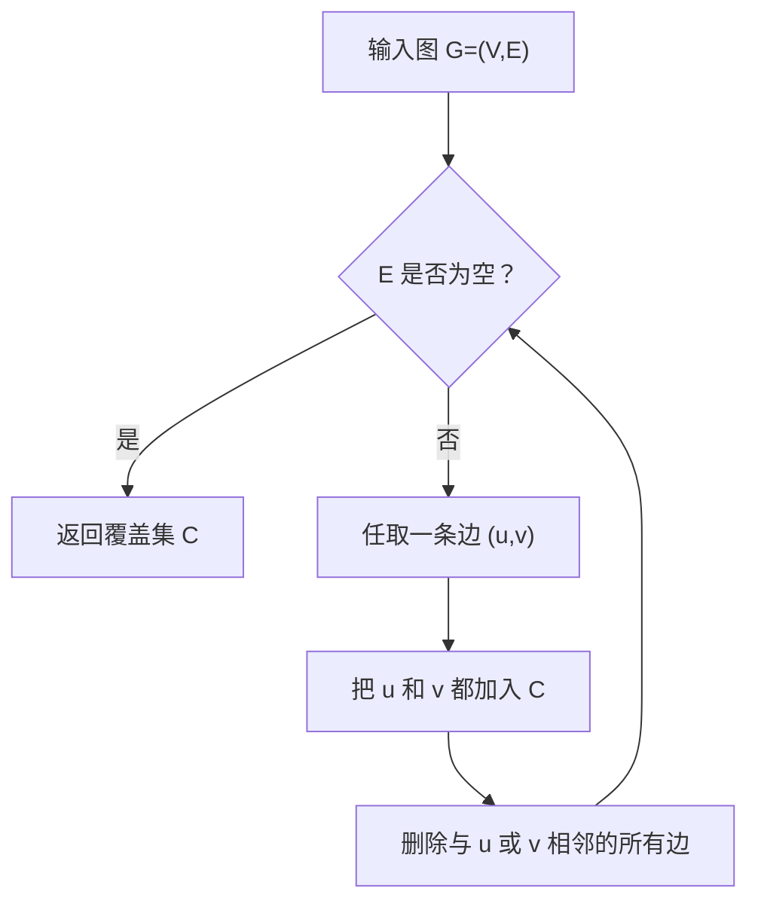
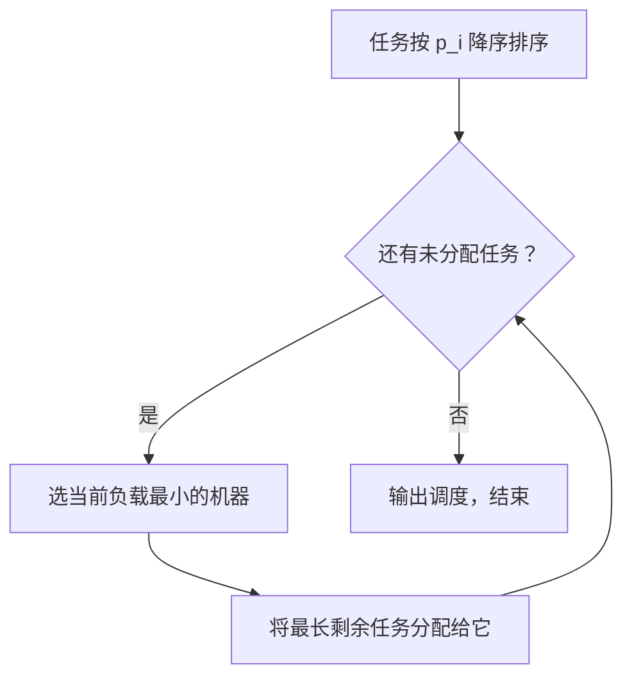

# ε-近似算法（顶点覆盖、具有三角不等式的TSP问题2-近似算法、任务调度LPT）

## 顶点覆盖的 ε-近似算法

无向图 $G=(V,E)$ 的一个顶点覆盖是 $V$ 的一个子集 $C$，使得每条边 $(u,v)\in E$ 至少有一个端点在 $C$ 中。顶点覆盖问题是求 $G$ 的最小规模顶点覆盖。已知该问题是 NP 难度的，因此多项式时间内求最优解不现实。

一种自然的贪心想法：每条边都必须被覆盖，那就**不断取一条尚未被覆盖的边，把它的两个端点都放入覆盖集**，并删除与这两个端点相邻的所有边。

[!IMPORTANT]
> 该算法是多项式时间的，且是**相对误差界 $\varepsilon=1$** 的近似算法，即 $|C_{\text{approx}}|\le 2\,|C^*|$，因此也常称为 **2-近似算法**。

**为什么成立？** 设算法选取的边集合为 $M$（算法过程中选中的边两两无公共端点，即 $M$ 是一个匹配）。算法输出 $|C|=2|M|$。而任意顶点覆盖必须覆盖 $M$ 中每条边的至少一个端点，且 $M$ 中边互不相交，所以 $|C^*|\ge |M|$。于是 $|C|=2|M|\le 2|C^*|$。

[!WARNING]
> **常见误区**：有人误以为“每条边取一个端点”能得到最优解。反例：星形图 $K_{1,n}$ 中，每条边取叶子端点会得到 $n$ 个顶点，而最优覆盖只取中心顶点 1 个。本算法取边的两个端点恰好规避了这个陷阱，但代价是可能取到 $2$ 倍最优。

---

## 具有三角不等式的 TSP 的 2-近似算法

旅行商问题（TSP）要求访问每个顶点一次并回到起点，总路程最小。一般 TSP 不存在常数因子近似算法（除非 $P=NP$）。但当距离满足**三角不等式** $d(u,w)\le d(u,v)+d(v,w)$ 时，情况大为改善。

**关键思路**：先求图的最小生成树（MST），对 MST 做一次**深度优先遍历**，按首次访问顶点的顺序输出哈密顿回路。由于 DFS 走遍 MST 的每条边恰好两次，总代价为 $2w(MST)$。利用三角不等式可“抄近路”跳过已访问顶点，不增加代价，因此回路总长 $L\le 2w(MST)\le 2\cdot OPT$。

[!TIP]
> 记忆口诀：**“先取 MST 抄近路，两倍最优兜得住”**。MST 的权值总是不超过最优 TSP 回路（去掉最优回路中任意一条边即得一棵生成树），所以 $w(MST)\le OPT$。

[!NOTE]
> 稍加改进的 Christofides 算法（加入最小权完美匹配）可把近似比降到 $3/2$，是三角不等式 TSP 的经典结果。

---

## 任务调度 LPT 近似算法

设有 $m$ 台相同机器、$n$ 个加工时间分别为 $p_i$ 的任务。目标是求调度方案使**完工时间（makespan）最小**，即 $C_{\max}=\max_j \sum_{i\in S_j} p_i$。该问题是 NP 难度的。

**LPT（Longest Processing Time）规则**：将任务按加工时间**从长到短排序**，依次把下一个任务分配给当前负载最小的机器。

[!IMPORTANT]
> LPT 的近似比为 $\le \frac{4}{3}-\frac{1}{3m}$，即 $C_{\max}^{LPT}\le\left(\frac{4}{3}-\frac{1}{3m}\right)C_{\max}^*$。

**为什么有效？** 直觉上，后期短任务更容易“见缝插针”填平负载差异，整体完工时间不会过度偏离平均水平 $\frac{1}{m}\sum p_i$。

[!WARNING]
> **常见坑**：必须先排序再调度，否则近似比会退化。若乱序调度，最坏情况下近似比可能接近 $2-\frac{1}{m}$。例如 $m=2$，任务时间 $50,1,1,\dots,1$（共 50 个 1）按升序调度，完工时间为 75，而 LPT 排布得 50 与 50，完工时间 50，恰为最优。
