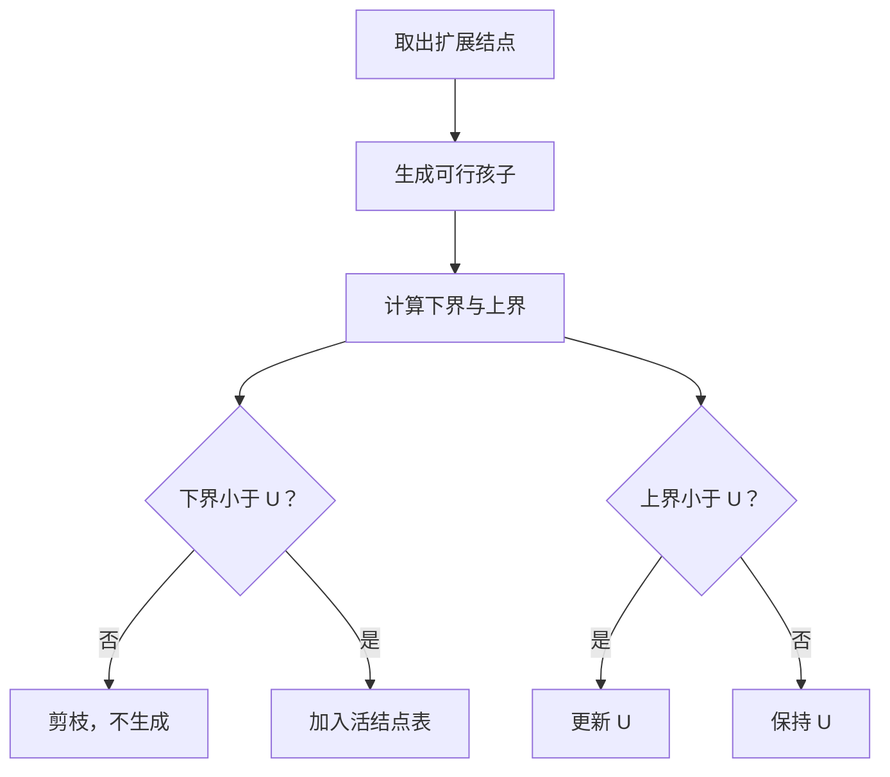

# 求最优解的上下界函数设计与剪枝方法

## 上下界函数与剪枝

分枝限界法在状态空间树上搜索最优解。若把整棵树都生成出来，代价与回溯法相当；真正提高效率的关键是：==用界函数判断“这棵子树还值不值得搜索”==。

对结点 $X$，通常设计两个估计值：

- $\hat c(X)$：$X$ 子树中可行解代价的**下界估计**，即“最好也只能这么好”；
- $u(X)$：$X$ 子树中可行解代价的**上界估计**，常可由一个可行解直接得到。

二者应满足 $\hat c(X)\le \text{子树最优代价}\le u(X)$。估计越紧，剪枝越多，但计算界函数本身也不能过于复杂。

## 最小化问题怎样剪枝

以求最小代价为例，用变量 $U$ 记录迄今已知的最小代价上界。最优答案的代价不会超过 $U$。

若某结点满足

$$\hat c(X)\ge U,$$

说明该子树即使达到最理想情况，也不可能优于当前已知解，因此可以剪枝。若 $\hat c(X)<U$，则生成该结点并继续考察；同时若 $u(X)<U$，就用它更新 $U$。

> [!IMPORTANT]
> 最小化问题的两条规则是：==$\hat c(X)\ge U$ 时剪枝；$u(X)<U$ 时更新 $U$==。剪枝看“还能不能更好”，更新看“是否已经找到更好的可行解”。

若目标函数取最大值，则改用下界变量 $L$ 记录迄今已知可行解的最大值：当 $u(X)\le L$ 时剪枝；发现更大的可行解代价时更新 $L$。不要把最大化问题机械套成最小化公式。

## 与 FIFO、LC 搜索的区别

上下界函数负责**哪些结点不必生成**，活结点表的组织方式负责**先生成谁的孩子**：

| 方法 | 活结点表 | 下一个扩展结点 |
|---|---|---|
| FIFO 分枝限界法 | 队列 | 最早进入队列者 |
| LC 分枝限界法 | 优先队列等 | $\hat c$ 最小者（最小化问题） |

因此，“画出实际生成的状态空间树”时，既要按指定顺序扩展，也要在每个孩子产生时立即检查可行性、界函数和 $U$，不能最后再统一剪枝。

## 带时限作业排序中的应用

先把作业按时限非降序排列，便于判断入选作业能否按时完成。目标函数取**未入选作业的收益损失最小**。若全部收益为 $\text{total}$，最小损失为 $c^*$，则最大收益为 $\text{total}-c^*$。

生成孩子时依次检查：

1. 入选作业集合是否能在各自时限内完成，不可行则剪去；
2. 计算损失下界 $\hat c$ 和损失上界 $u$；
3. $\hat c<U$ 才生成结点，否则不生成；
4. 若 $u<U$，立即修正 $U$。

> [!WARNING]
> 课件答案中的“$c(X)<U$，入队”和“$U(X)<U$，修正 $U$”分别对应生成条件与更新条件。$\hat c(X)\ge U$ 的结点直接不生成，不能先画进树中再声称剪枝；等号也不能漏掉。

## 一个算对的例子

实例为

$$p=\{3,8,6,4,5\},\quad d=\{1,2,3,4,4\},\quad t=\{1,1,2,2,1\},$$

总收益为 $26$，初始 $U=7$。搜索过程中，只生成可行且满足 $\hat c<U$ 的孩子；每生成孩子，同时检查是否用 $u$ 更新 $U$。最终得到最小损失 $7$，最优入选作业为

$$X=\{1,2,4\},$$

对应 $(p,d,t)$ 分别为 $(8,2,1),(6,3,2),(5,4,1)$。这些作业可按 $1\to2\to4$ 的顺序完成，总耗时 $1+1+1=3$，且均不超过各自时限。因此最大收益为

$$26-7=19.$$

> [!TIP]
> 作图题建议在每个保留结点旁写“$\hat c,u$”，在 $U$ 改变处写新值；被剪结点注明“不可行”或“$\hat c\ge U$”。最后用“总收益－最小损失”求最大收益，并检查最优作业子集确实可行。
