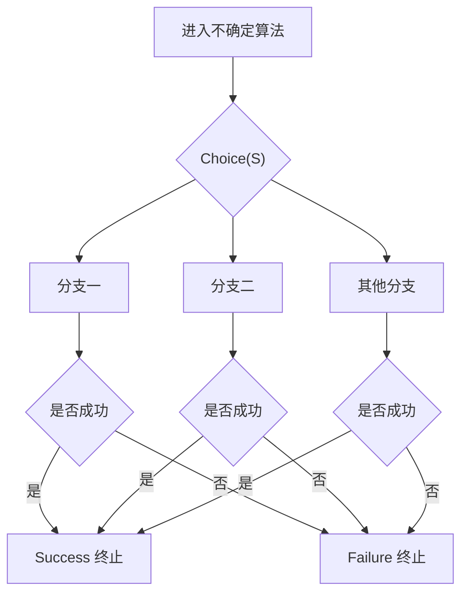

# 不确定算法、不确定机（Choice/Success/Failure）与P类、NP类问题定义

## 什么是不确定算法

确定算法在每一步执行时，后续路径都是唯一确定的；不确定算法则允许算法在多个候选方案中“选择一种尝试”。它主要包含三类操作：

- `Choice(S)`：从集合 $S$ 中任意选择一个元素；
- `Success()`：发出成功信号并终止算法；
- `Failure()`：发出失败信号并终止算法。

不确定机可理解为同时执行所有可能分支：执行 `Choice(S)` 时，相当于复制出 $|S|$ 个程序副本；只要有一个副本到达 `Success()`，就终止全部副本；若所有分支都只能到达 `Failure()`，则失败终止。



> [!IMPORTANT]
> 不确定算法的成功条件是：==存在至少一条选择序列能够成功==；失败条件是：==任何选择序列都不能成功==。

`Choice(S)` 不代表“随机选一个”。随机算法可能选错，不确定机则保留全部可能选择，并总能选中能成功的分支。

## 不确定搜索示例

在含 $n$ 个元素的数组 $a$ 中查找 $x$：

```cpp
void Search(int a[], int n, T x) {
    int j = Choice({0, 1, ..., n - 1});
    if (a[j] == x) {
        Success();
        return;
    }
    Failure();
}
```

若 $a[j]=x$ 的下标存在，不确定机可选择该下标并成功；若不存在，则所有选择都会失败。因此，一个普通查找问题借助不确定机后，可以被“尝试所有下标”的方式解决。

## P 类与 NP 类

这里讨论的都是==判定问题==，即答案可以明确回答“是”或“否”的问题。

| 类别 | 定义 | 关键含义 |
|---|---|---|
| P 类 | 可在多项式时间内用确定算法求解的判定问题 | 已知高效确定解法 |
| NP 类 | 可在多项式时间内用不确定算法求解的判定问题 | 答案可被多项式时间验证 |
| NP 完全 | 属于 NP，且所有 NP 问题都能多项式约化到它 | NP 中最难的一类 |
| NP 困难 | 所有 NP 问题都能多项式约化到它，但不要求它属于 NP | 范围比 NP 完全更广 |

NP 中的“多项式时间可验证”应理解为：给出一个候选解后，可以在多项式时间内检查其是否正确。例如，可满足性问题能够检查一组布尔变量取值是否满足公式，但寻找这组取值未必有多项式时间算法。

> [!NOTE]
> “可验证”不等于“容易找到”。查找答案与验证答案不是同一件事。

由于确定算法是不确定算法的特例，Choice 只有一个可选元素时，不确定机就退化为确定机，所以有：

$$
P \subseteq NP
$$

是否严格包含仍是经典未解问题，不能直接写成 $P=NP$ 或 $P\ne NP$。

## 多项式约化与 NP 完全

若问题 $Q_1$ 能在多项式时间内转换为问题 $Q$，记为 $Q_1\propto Q$。若对任意 $Q_1\in NP$ 都有 $Q_1\propto Q$，则 $Q$ 是 NP 困难的；若进一步有 $Q\in NP$，则 $Q$ 是 NP 完全的。

> [!WARNING]
> NP 困难问题不一定属于 NP；不属于 NP 的问题不能称为 NP 完全问题。NP 完全问题一定是 NP 困难问题，但 NP 困难问题未必是 NP 完全问题。

## 15 谜可达性示例

将棋盘按行展开，依次统计每块牌右侧比它小的牌数，得到逆序数之和：

$$
0+0+1+1+1+0+1+1+1+0+0+1+1+1+0=10
$$

空格位于第 $1$ 行。忽略空格后，标准 $4\times4$ 棋盘目标排列的逆序数为偶数，因此可达。还可同时比较棋盘逆序数与空格位置行号的奇偶性，判断移动后二者奇偶关系是否保持。

> [!CAUTION]
> 常见错误是把“NP 类”定义成“不能在多项式时间内由确定算法求解的问题”。正确说法是：==能在多项式时间内由不确定算法求解==。另外，逆序数条件必须结合棋盘尺寸以及空格位置判断，不能只数逆序对。
