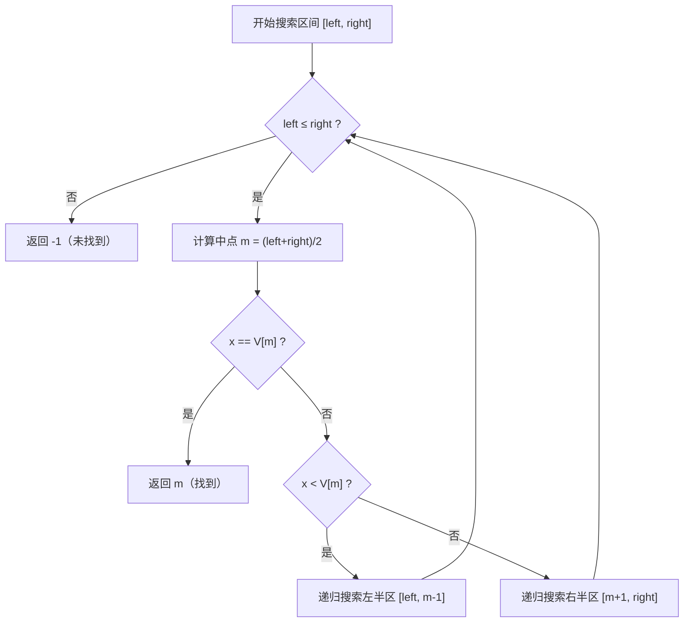
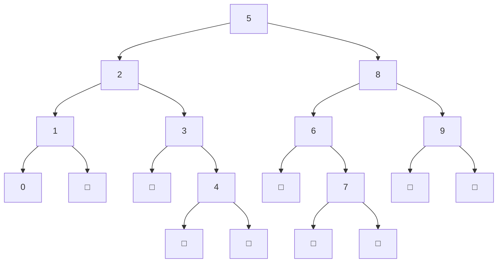

# 二分搜索（对半搜索）的递归与迭代实现

## 二分搜索：从查字典说起

想象你正在翻一本新华字典，要查“算法”的“算”字。你不会从第一页开始逐页翻，而是先翻到中间——如果中间的字比“算”小，就把前半本扔掉；比“算”大，就把后半本扔掉。每次扔掉一半，这就是==二分搜索==的核心思想。

把这个问题抽象一下：给定一个**有序表** `V[0], V[1], …, V[n-1]`，要在其中查找目标值 `x`。二分搜索的“分治”策略是：每次与**分割点**比较，将搜索范围缩小为原问题的一个子问题。

> [!IMPORTANT]
> 二分搜索的正确性建立在==有序表==这个前提上。如果数据没有排序，必须先排序再搜索，或者改用其他查找方法。

根据选取分割点的规则不同，二分搜索有多种变体。其中最简单的就是==对半搜索==：每次都取当前区间正中间的元素作为分割点。

---

## 对半搜索的递归与迭代实现

### 递归版本：自然的想法

用递归描述对半搜索非常直观：



写成代码就是这个样子（对应课件程序5-7）：

```cpp
template<class T>
int SortableList<T>::BSearch(const T& x, int left, int right) const {
    if (left <= right) {
        int m = (left + right) / 2;    // 对半分割
        if (x < l[m]) 
            return BSearch(x, left, m-1);  // 搜左半区
        else if (x > l[m]) 
            return BSearch(x, m+1, right); // 搜右半区
        else 
            return m;                      // 找到了
    }
    return -1;  // 搜索失败
}
```

> [!NOTE]
> 注意到递归调用是函数的最后一条可执行语句，这叫==尾递归==。尾递归可以直接转换为循环，这就引出了迭代版本。

### 迭代版本：效率更高

递归有函数调用开销。把尾递归改成 `while` 循环，就是迭代版（对应课件程序5-8）：

```cpp
template<class T>
int SortableList<T>::BSearch(const T& x) const {
    int left = 0, right = n-1;
    while (left <= right) {
        int m = (left + right) / 2;
        if (x < l[m]) 
            right = m - 1;
        else if (x > l[m]) 
            left = m + 1;
        else 
            return m;       // 找到
    }
    return -1;              // 未找到
}
```

迭代版本在执行效率上通常优于递归版本，也是工程实践中的首选。

---

## 二叉判定树：把搜索过程画出来

对半搜索的每一步都在做一次"选择左半区还是右半区"的决策。把所有可能的决策路径画成一棵树，就是==对半搜索二叉判定树==。

举个例子：一个长度为 10 的有序表，其对半搜索的判定树长这样：



树的**内结点**代表表中实际存在的元素，**外结点**（用□表示）代表搜索失败的区间。

### 判定树的性质（考点）

二叉判定树不是随便长的，它有严格的数学规律：

| 性质 | 内容 |
|:---|:---|
| 性质5-1 | 左子树有 $\lceil (n-1)/2 \rceil$ 个内结点，右子树有 $\lfloor n/2 \rfloor$ 个内结点 |
| 性质5-2 | 树高为 $\lceil \log(n+1) \rceil$（不计外结点） |
| 性质5-3 | 若 $n = 2^h - 1$，则为满二叉树 |
| 性质5-4 | 外结点均在第 $h$ 或 $h+1$ 层上 |

> [!WARNING]
> 关于性质5-1，很多同学会误认为左右子树结点数相等。事实上只有 $n = 2^h - 1$（满二叉树）时才相等。一般情况是==左子树结点数不少于右子树==。

---

## 时间复杂度分析

判定树的高度直接决定了算法的性能：

| 场景 | 比较次数 | 时间复杂度 |
|:---|:---|:---|
| 最好情况（第一次就命中） | $1$ | $O(1)$ |
| 最坏情况（走到叶子） | $\lceil \log(n+1) \rceil$ | $O(\log n)$ |
| 成功搜索平均 | $\Theta(\log n)$ | $\Theta(\log n)$ |
| 不成功搜索 | $\lfloor \log n \rfloor + 1$ 或 $\lfloor \log n \rfloor + 2$ | $O(\log n)$ |

> [!IMPORTANT]
> 定理5-4和5-5共同说明：通过关键字值间的比较来搜索指定元素，这类算法的最坏情况时间下界是 $\Omega(\log n)$。==对半搜索达到了这个下界，因此是最优算法==。判定树是所有二叉判定树中**最矮**的。

---

## 实战演练

**题目**：有7名同学学号分别是 `5, 8, 11, 24, 33, 39, 45`，用对半搜索查找 `33`。

**手算过程**：

1. 区间 `[0,6]`，中点 `m=3`（值 `24`），`33 > 24` → 搜右半区
2. 区间 `[4,6]`，中点 `m=5`（值 `39`），`33 < 39` → 搜左半区
3. 区间 `[4,4]`，中点 `m=4`（值 `33`），命中！

依次访问的学号是：==24 → 39 → 33==。

---

## 常见的坑

> [!CAUTION]
> **中点计算溢出**：`m = (left + right) / 2` 在 `left + right` 超出 `int` 范围时会溢出。安全的写法是 `m = left + (right - left) / 2`。

> [!CAUTION]
> **循环边界**：很多同学在写迭代版时，搞不清楚应该用 `left <= right` 还是 `left < right`。记住：==当 `left == right` 时，区间只有一个元素，仍需检查==，所以条件是 `left <= right`。
