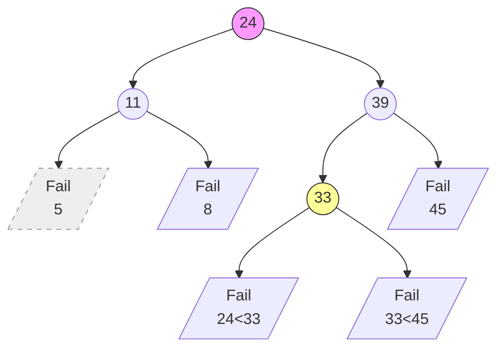

# 对半搜索的二叉判定树性质及基于关键字比较的搜索算法时间下界

## 对半搜索的二叉判定树与时间下界

对半搜索（Binary Search）是分治法的经典应用。为了深入分析其性能并证明其最优性，我们需要引入**二叉判定树**这一模型。它将搜索过程抽象为一棵二叉树，其中==内结点==代表成功查找的关键字，==外结点==（失败结点）代表查找失败的区间。

### 二叉判定树的构造与性质

在构建判定树时，根结点对应第一次比较的元素 $A[mid]$。若目标值较小，进入左子树；较大则进入右子树。
- **内路径长度 $I$**：所有内结点深度之和（成功比较次数总和）。
- **外路径长度 $E$**：所有外结点深度之和（失败比较次数总和）。

二者存在恒等关系：$$E = I + 2n$$
其中 $n$ 为表中元素个数。

> [!NOTE]
> 上图以 `{5, 8, 11, 24, 33, 39, 45}` 为例。查找 33 的路径为 `24 -> 39 -> 33`，比较 3 次。

### 为什么它是最优的？（时间下界）

基于关键字比较的搜索算法，其最坏情况下的比较次数至少为判定树的高度 $h$。对于 $n$ 个结点，二叉树的最小高度为 $\lfloor \log n \rfloor$ 或 $\lceil \log(n+1) \rceil - 1$。
因此，任何基于比较的搜索算法，其时间复杂度的下界均为 $\Omega(\log n)$。对半搜索生成的判定树是==平衡==的（或接近平衡），树高最低，故它是==最优算法==。

> [!WARNING]
> **常见误区**：对半搜索的判定树**不一定**是满二叉树或完全二叉树（取决于 $n$ 和取整方式），且左右子树结点数**不一定相等**（仅当 $n=2^k-1$ 时才严格相等）。

### 性能分析结论

根据路径长度公式，可推导平均搜索长度（ASL）：

| 搜索类型 | 比较次数范围 | 平均时间复杂度推导 | 结果 |
| :--- | :--- | :--- | :--- |
| **成功** | $\lfloor \log n \rfloor \sim \lfloor \log n \rfloor + 1$ | $A_s(n) = \frac{I+n}{n} = \frac{E}{n} - 1$ | $\Theta(\log n)$ |
| **不成功** | $\lfloor \log n \rfloor + 1 \sim \lfloor \log n \rfloor + 2$ | $A_u(n) = \frac{E}{n+1}$ | $\Theta(\log n)$ |

### 典型例题解析

**题目**：有序表 `{5, 8, 11, 24, 33, 39, 45}`，查找 33。
**解析**：
1. $low=1, high=7, mid=4$。$A[4]=24 < 33$，向右。
2. $low=5, high=7, mid=6$。$A[6]=39 > 33$，向左。
3. $low=5, high=5, mid=5$。$A[5]=33 == 33$，成功。
访问序列为 `24, 39, 33`。

> [!TIP]
> 记忆技巧：对半搜索每次排除一半数据，效率极高。只要看到“有序表”+“静态查找”，首选对半搜索。注意区分“比较次数”与“访问下标”。
