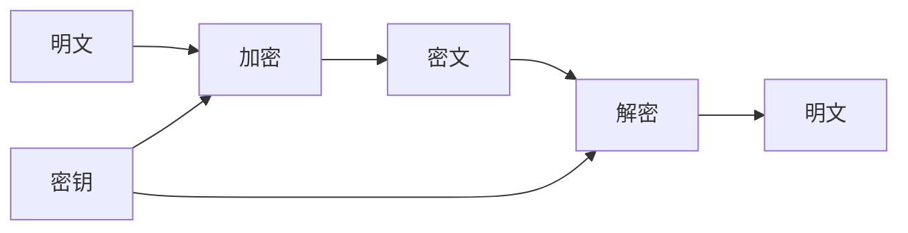

# 信息安全目标与密码体制（对称密码体制与非对称密码体制）

## 信息安全目标

信息安全的目标是保护信息的==机密性、完整性，并具有抗否认性和可用性==。这四个目标常作为填空题整体考查。

| 目标 | 含义 | 典型威胁 |
|---|---|---|
| 机密性 | 信息不被泄露给非授权者 | 窃听、非法读取 |
| 完整性 | 维护信息的一致性，防止非授权篡改 | 修改报文、破坏数据 |
| 抗否认性 | 行为主体不能否认自己实施过的行为 | 发信后抵赖 |
| 可用性 | 授权用户需要时能正常访问和使用 | 拒绝服务、系统瘫痪 |

> [!TIP]
> 看到“信息的一致性”“不发生非授权篡改”，应选**完整性**；看到“防止泄露”，才是机密性。

## 密码体制为什么出现

早期保密通信主要依靠特殊编码或隐藏方法。例如斯巴达棒将腰带缠绕在特定尺寸的棒上才能读出信息，凯撒密码则将字母按固定规则替换，如 $A\to D$、$B\to E$。这些方法说明密码通信的基本过程：发送方将明文加密为密文，接收方再解密恢复明文。

传统保密通信机制中，双方必须共享密钥，由此产生一个关键问题：**密钥怎样安全地交给对方？**

## 对称密码体制

对称密码体制（symmetric encryption）中，==加密和解密使用相同的密钥==，可表示为

$$
C=E_k(P),\qquad P=D_k(C).
$$

其中 $P$ 为明文，$C$ 为密文，$k$ 为双方共享的密钥。

其优点是算法通常较简单、加解密速度快，适合大量数据加密。缺点是通信双方必须通过秘密信道传递密钥，**密钥分发成为薄弱环节**；参与通信的用户增多时，密钥管理也更复杂。

## 非对称密码体制

非对称密码体制（asymmetric encryption）也称**公开密钥密码体制**或**双密钥密码体制**。每个用户拥有一对公钥和私钥：公钥可以公开，私钥由本人保密。用其中一个密钥处理的信息，可由对应的另一个密钥恢复。

以 RSA 为例，接收方公开公钥、保存私钥。发送方用接收方公钥加密，接收方用自己的私钥解密，因此不必事先通过秘密信道共享同一把密钥。其代价是计算通常更复杂、速度较慢。

| 对比项 | 对称密码体制 | 非对称密码体制 |
|---|---|---|
| 密钥数量 | 加解密共用一把密钥 | 每个用户有公钥/私钥对 |
| 密钥公开性 | 必须保密 | 公钥公开，私钥保密 |
| 主要优点 | 速度快，适合大量数据 | 便于公开分发公钥 |
| 主要不足 | 密钥分发困难 | 计算开销较大 |
| 典型算法 | 传统共享密钥算法 | RSA |

> [!WARNING]
> “非对称”不是“不需要密钥”，而是加解密使用一对不同但相关的密钥；公钥可以公开，**私钥不能公开**。

## RSA 与数字签名

RSA 采用非对称密码体制，为每个用户生成一个公钥/私钥对，既可以用于加密，也可以用于数字签名，因此“RSA 算法不能用于数字签名”的说法错误。

签名与加密的用途不同：签名强调验证来源并支持抗否认，加密强调保护内容不被非授权者读取，不能简单把二者混为一谈。

> [!IMPORTANT]
> 考试核心结论：传统密码体制加解密密钥相同，称为**对称密码体制**；RSA 属于**非对称密码体制**，且**能用于数字签名**。
