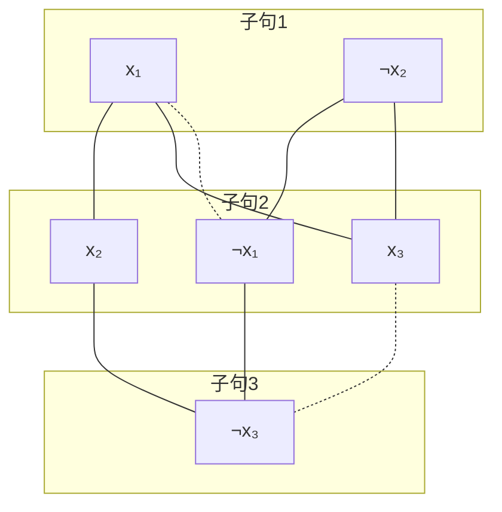

# 典型NP完全问题证明（如CNF可满足性规约至最大集团判定问题）

## 多项式规约与 NP 完全性证明

### 为什么需要多项式规约

我们已知可满足性问题（SAT）是 NP 完全的。但面对一个新问题 Q，如何证明它也是 NP 完全的？你不能每次都从图灵机停机问题重新推导。你需要一座“桥”——这就是**多项式规约**。

[!IMPORTANT]

> ==多项式规约==是一个函数 f，它在多项式时间内将问题 A 的实例映射到问题 B 的实例，使得 A 的“是”实例恰好对应 B 的“是”实例。记作 A ≤p B。

直观理解：如果 A ≤p B，那么 B 至少和 A 一样难。因为如果能在多项式时间内解决 B，那么也能在多项式时间内解决 A（先把 A 规约到 B，再解 B）。

### NP 完全问题的证明步骤

要证明问题 Q 是 NP 完全的，需要两步：

1.  **证明 Q ∈ NP**：给定一个解，能在多项式时间内验证它是否正确。
2.  **证明 Q 是 NP 难度的**：找一个已知的 NP 完全问题（如 SAT），将它的**每一个实例**多项式规约到 Q 的一个实例（通常举例说明即可）。

[!TIP]

> 记忆口诀：“先验成员，再找祖宗”——先证问题本身在 NP 里，再规约一个已知的 NP 完全问题到它。

### 核心案例：CNF-SAT ≤p 最大集团判定问题

**最大集团判定问题**（CLIQUE）：给定无向图 G=(V,E) 和整数 k，问 G 中是否存在一个顶点数不少于 k 的完全子图（团）？

下面看如何把一个 SAT 实例“变成”一个图。

---

**问题实例**

假设有一个合取范式（CNF）公式 F：

$$F = (x_1 \lor \neg x_2) \land (\neg x_1 \lor x_2 \lor x_3) \land (\neg x_3)$$

F 有 3 个子句。我们要构造一个图 G，使得：F 可满足 ⟺ G 中存在规模为 3 的团。

**构造规则**：

1.  **顶点**：为公式中每个文字（变量或其否定在子句中的一次出现）创建一个顶点。同一子句内的顶点归为一组。
2.  **边**：两个顶点之间连边，当且仅当它们满足两个条件：
    -   **不在同一子句内**（同组内不连边，保证团从每组至多选一个顶点）。
    -   **文字不互补**（例如 x₁ 和 ¬x₁ 不能同时为真，故不连边）。

[!NOTE]

> 虚线表示不能连边：A1(x₁) 与 B1(¬x₁) 互补，B3(x₃) 与 C1(¬x₃) 互补。

**为什么等价**？

-   **F 可满足 ⇒ G 有 k=3 团**：存在一组真值赋值，使每个子句至少一个文字为真。从每个子句组里挑出那个为真的文字顶点。因为被挑出的文字都取真值，它们之间不可能互补（否则一个变量既真又假），根据构造它们之间必有边相连。于是这 k 个顶点两两相连，构成一个 k 团。

-   **G 有 k=3 团 ⇒ F 可满足**：团中 k 个顶点来自 k 个不同组，且两两不互补。将所有对应文字赋真值（若一个变量既出现正文字又未出现负文字，任意赋值即可），这样每个子句都有文字为真，公式得满足。

### 常见误解与辨析

| 易混淆概念 | 正确理解 | 常见错误 |
| :--- | :--- | :--- |
| **规约方向** | 把**已知难问题**规约到**待证问题** | 把待证问题规约到 SAT，证明不了难度下界 |
| **NP 与 NP 难度** | NP 难度不一定在 NP 中；NP 完全 = NP ∩ NP 难度 | 认为 NP 难度问题一定能快速验证 |
| **最优化 vs 判定** | 构造性规约通常建立在判定版本上 | 直接拿最优化问题做规约，无法严格对应“是/否”实例 |

[!WARNING]

> 证明时最容易翻车的点：把已知 NP 完全问题（如 SAT）的**一个实例**多项式归约到目标问题就声称“因为 SAT 难所以目标问题难”——规约必须对 SAT 的==所有可能实例==都有效，图示中用“典型实例”说明只是示例，逻辑上要声明构造方法具有通用性。

### 课后习题精讲（10-8 为例）

**题目**：已知子集和问题（Subset Sum）是 NP 完全的，试证明划分问题（Partition）也是 NP 完全的。

> 划分问题：给定有限集 A 及每个元素 a∈A 的大小 s(a)，问能否将 A 划分成两个子集，使各自元素大小之和相等。

**证明**：

1.  **划分问题 ∈ NP**：给定一个划分，验证两部分和是否相等，多项式时间可完成。
2.  **子集和 ≤p 划分问题**：设子集和问题实例为 `(A, S, M)`，问是否存在子集和为 M。构造划分问题实例：在 A 中新增两个元素 x 和 y，令 `s(x)=M+1`，`s(y)=S-M+1`，其中 S 为原总大小。新总大小为 S+(M+1)+(S-M+1)=2S+2。可以证明：原实例有子集和为 M，当且仅当新实例可划分为总大小各为 S+1 的两部分——其中一部分必须恰好包含 x 和和为 M 的子集。

[!CAUTION]

> 规约完成不等于证明完成。务必首先确认待证问题“确实是 NP 的”，缺少这一步在考试中会扣失近半分数。
