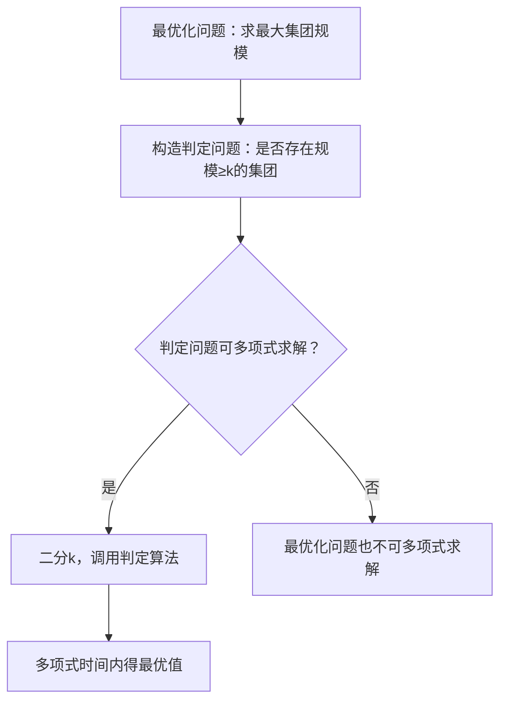

# 判定问题和最优化问题的转化关系

## 判定问题与最优化问题

许多实际问题天然以“找最大/最小”的形式出现：最大集团、最短路径、最小顶点覆盖。但 NP 完全理论的研究对象却是**判定问题**——只回答“是（1）”或“否（0）”。为什么要把最优化问题“降格”成只输出 0/1 的判定问题？

因为判定问题的输出空间只有两个值，形式简单、便于规约和比较难度。那最优化问题和判定问题之间是什么关系？

> [!IMPORTANT]
> ==一个最优化问题能够在多项式时间内求解，当且仅当它对应的判定问题能够在多项式时间内求解。==  
> 如果判定问题不能在多项式时间内求解，那么对应的最优化问题也不能在多项式时间内求解。

用最大集团问题来理解。最优化版本是：求图 $G$ 中顶点数最多的完全子图（集团）的规模。通过二分查找规模 $k$，再反复询问“是否存在规模至少为 $k$ 的集团”，就能用判定版本来反推最优值。

反过来，如果能直接解最优化问题得到最大规模 $k'$，则判定“是否存在规模至少为 $k$ 的集团”只需比较 $k' \geq k$。二者在计算难度上等价——这是研究 NP 完全理论时只讨论判定问题的根本原因。

## P 与 NP 的定义对象

| 类别 | 定义 | 关键短语 |
| :--- | :--- | :--- |
| **P 类问题** | 所有可在==多项式时间==内用==确定算法==求解的判定问题 | 确定性、多项式时间 |
| **NP 类问题** | 所有可在多项式时间内用==不确定算法==求解的判定问题 | 非确定性、多项式时间可验证 |

> [!WARNING]
> NP 不是 “Not Polynomial”（非多项式），而是 “Nondeterministic Polynomial”（非确定性多项式）。这是最常见的望文生义错误。

## 一个算对了的例子

**选择**：所有可在多项式时间内用确定算法求解的判定问题是（ **A. P 类问题** ）。

再看最大集团判定问题为什么属于 NP：给定一个候选的 $k$ 个顶点集合，只需检查这 $k$ 个顶点两两之间是否都有边相连。这个验证过程显然是多项式时间的——非确定性算法可以在多项式时间内“猜”出这个集合并验证它。

> [!TIP]
> 记住这条判断链：==P 类是“能快速解”，NP 类是“能快速验证”==。能快速解的判定问题一定也能快速验证（因为解出来本身就是一种验证），所以 $\mathrm{P} \subseteq \mathrm{NP}$。

那么最大集团判定问题是否在 P 里？目前不知道。但可以证明它是 **NP 完全的**：一方面它属于 NP，另一方面 CNF 可满足性可以多项式规约到它（CNF SAT $\propto$ 最大集团判定），说明它“至少和所有 NP 问题一样难”。

> [!NOTE]
> 理解“NP 难度”与“NP 完全”的区别：  
> - ==NP 完全 = 属于 NP 且 NP 难度==；  
> - ==NP 难度 = 所有 NP 问题都能规约到它，但它自己不一定属于 NP==（可能不是判定问题）。
