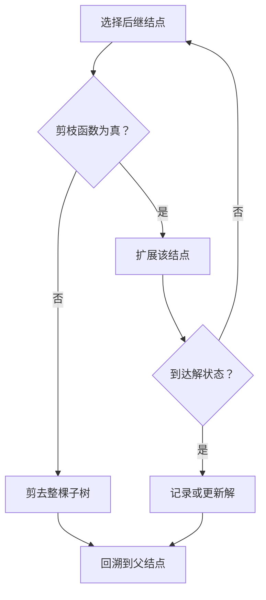

# 剪枝函数设计与回溯法效率分析（蒙特卡罗估计算法）

剪枝函数是回溯法提高效率的核心手段，而蒙特卡罗估计算法则用于在运行前预测回溯法的实际效率。两者分别从“减少搜索”和“预估搜索量”的角度解决状态空间树规模过大的问题。

## 剪枝函数的设计

回溯法以深度优先方式搜索状态空间树。若不加限制，算法可能访问大量不可能产生答案状态的结点。因此，在扩展结点时，需要判断当前部分向量 $(x_0,x_1,\ldots,x_k)$ 是否还有继续搜索的必要。

剪枝函数包括两类：

| 类型 | 判断依据 | 主要作用 | 典型应用 |
|---|---|---|---|
| 约束函数 | 当前路径是否可能满足隐式约束 | 剪去不可能得到可行解的子树 | $n$ 后问题、子集和数问题 |
| 限界函数 | 当前分支是否可能得到更优解 | 剪去不可能改进最优值的子树 | 0/1 背包、旅行商问题 |

按照课件中的定义，约束函数 $B_k(x_0,x_1,\ldots,x_k)$ 是关于部分向量的函数：若能判定当前结点的子树中不含任何答案状态，则返回 false，否则返回 true。==剪枝函数的共同目的，是减少实际生成的状态结点数，而不是改变问题的可行解集合。==

设计时应先找出“继续搜索必然无效”的条件，再把它写成只依赖当前部分向量的判断。例如子集和数问题中，若当前已选元素之和已经超过 $M$，则该分支不可能产生可行解，可以立即剪枝。

> [!WARNING]
> 剪枝条件必须保证被剪子树中确实没有所需答案。条件过弱会减少不了多少结点；条件过强则可能误删可行解或最优解。尤其是限界函数，不能简单用“当前收益不超过最优值”代替对未来收益上界的估计。

## 回溯法的效率分析

回溯法最坏情况下仍可能遍历指数级规模的状态空间树，因此通常不能仅依靠最坏时间复杂度评价实际效果。真正影响运行时间的是：

- 状态空间树的规模；
- 剪枝函数的强弱；
- 每个结点处约束检查和限界计算的代价；
- 输入数据的排列及具体特征。

==剪枝越强，生成的结点通常越少，但单次判断也可能更复杂。== 因此不能笼统地认为剪枝条件越多越好，而应比较“节省的搜索代价”和“增加的判断代价”。

蒙特卡罗估计算法提供了一种实验性估计方法：从根结点开始，随机选择一条满足约束的路径向下走，并据此估计整棵树中实际需要生成的结点数。

设当前位于第 $i$ 层，满足约束的后继结点数为 $m_i$，上一层估计的结点数倍乘因子为 $r_i$，则可按

$$
r_{i+1}=r_i m_i
$$

逐层估计各层结点数量，最后将各层估计值相加。随机选择其中一个后继继续，重复若干次并取平均，可降低单次随机路径造成的偏差。

> [!NOTE]
> 蒙特卡罗方法这里估计的是回溯算法实际搜索规模，不是用随机取样直接求问题的解，也不能给出严格的运行时间上界。

## 结合子集和数实例分析

对 $W=(5,7,10,12,15,18,20)$、$M=35$ 执行改进的 SumOfSub，算法利用当前和、剩余元素和等条件剪枝，最终得到全部 4 个可行解：

$$
(5,12,18),\quad(7,10,18),\quad(5,10,20),\quad(15,20).
$$

实验生成 37 个结点、搜索 41 个结点。将数据改为逆序 $(20,18,15,12,10,7,5)$ 后，只生成 10 个结点、搜索 11 个结点，但仅求得 1 个可行解。

这个例子说明两点：一是结点越少通常运行越快；二是==运行时间短并不等于算法结果正确==。SumOfSub 的剪枝设计依赖输入有序，逆序或无序输入可能使剪枝条件误删答案，因此比较效率前必须先保证算法适用条件得到满足。

> [!TIP]
> 答题时可按“树有多大—每个结点代价多大—剪枝后实际生成多少结点”展开；若要求估计实际效率，再说明用蒙特卡罗随机路径估计结点数，并用多次试验取平均。
