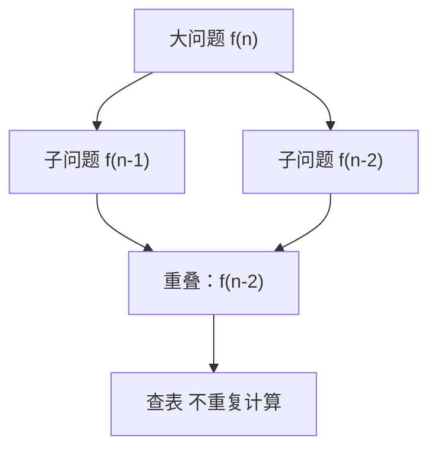

# 动态规划法与分治法、贪心法的异同比较

## 动态规划法与分治法、贪心法的异同

三种方法都遵循"分而治之"的思想：把大问题拆成同类的小问题，再由小问题的解合成大问题的解。但**拆出来的子问题长什么样、怎么被求解**，决定了该选哪一种方法。

> [!IMPORTANT]
> 动态规划法适用于==最优子结构==性质与==重叠子问题==性质同时成立的最优化多步决策问题；分治法的子问题==相互独立==；贪心法则要求问题具有==贪心选择性质==。

## 与分治法的异同

共同点：都递归地把问题分解为规模更小的同类子问题。

关键区别在子问题是否独立。分治法（如二分搜索、合并排序）分解出的子问题互不重叠，每个子问题只被求解一次；而动态规划面对的子问题**往往不是相互独立的**，同一子问题会被反复需要。

> 试想用纯递归（分治思想）求斐波那契数列：$f(n-1)$ 与 $f(n-2)$ 的子树大量重复，子问题个数呈指数增长。动态规划法用表保存已求解子问题的解，再次遇到时直接查表，把指数级时间降为多项式级。

| 对比项 | 分治法 | 动态规划法 |
|---|---|---|
| 子问题关系 | 相互独立 | 相互重叠 |
| 重复计算 | 相同子问题反复求解 | 查表避免重复 |
| 时间复杂度 | 常呈指数增长 | 多项式级 |
| 求解方向 | 自顶向下递归 | 自底向上递推 |

## 与贪心法的异同

共同点：都用于最优化问题，都依赖最优子结构。

关键区别在决策方式。贪心法每步按**最优量度标准**（贪心准则）做局部最优选择，一旦选定不可回头，且不回溯；动态规划法**自底向上**，先求出各子问题的最优解，再综合保证整体最优，可以处理不具备贪心准则的问题。

> [!WARNING]
> 贪心法要求每步的局部最优能导致全局最优；若问题不具备贪心选择性质，贪心得到的只是近似解。动态规划不急于做选择，而是枚举子问题的各种可能，因此适用范围更广，代价是更高的时空开销。

| 对比项 | 贪心法 | 动态规划法 |
|---|---|---|
| 求解方向 | 自顶向下 | 自底向上 |
| 选择依据 | 贪心准则（局部最优） | 各子问题最优解综合 |
| 适用范围 | 需贪心选择性质 | 仅需最优子结构+重叠子问题 |
| 效率 | 高（无回溯） | 较高（需存表） |

> [!TIP]
> 关键路径、0/1 背包、LCS 等只有最优子结构与重叠子问题，无贪心准则，**只能用动态规划**；而活动安排、背包（分数）等具有贪心选择性质，可用贪心法。

## 算例：台阶问题

上 $n$ 级台阶，每次可上 1 级或 2 级，求上法总数。

设 $f(i)$ 为上 $i$ 级台阶的上法数。最后一步要么从 $i-1$ 级上来，要么从 $i-2$ 级上来，故

$$
f(i)=f(i-1)+f(i-2),\quad f(1)=1,\ f(2)=2
$$

子问题 $f(i-1)$、$f(i-2)$ 明显重叠（如 $f(4)$ 与 $f(5)$ 都需要 $f(3)$），且整体最优由子问题最优决定。用表自底向上递推：

| $i$ | 1 | 2 | 3 | 4 | 5 |
|---|---|---|---|---|---|
| $f(i)$ | 1 | 2 | 3 | 5 | 8 |

若用分治递归，$f(5)$ 会重复计算 $f(3)$ 两次、$f(2)$ 三次；动态规划每个子问题只算一次，$O(n)$ 即得答案。

> [!NOTE]
> 备忘录方法是动态规划的变形，控制结构同直接递归（自顶向下），但为每个解过的子问题建备忘录避免重复求解；动态规划法则自底向上递推。
