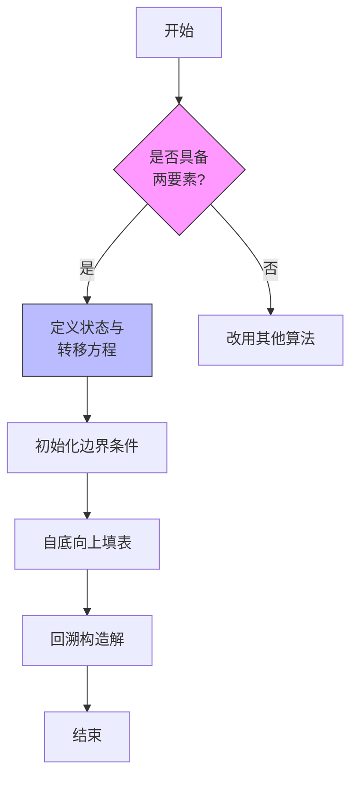

# 动态规划法的基本要素（最优子结构、重叠子问题）与设计步骤

## 动态规划法的基本要素与设计步骤

动态规划（Dynamic Programming, DP）是求解**最优化问题**的核心算法。其本质是将大问题分解为较小的同类子问题，但与分治法不同，DP 专门解决子问题**重叠**且具备**最优子结构**的场景。

> [!IMPORTANT]
> 一个最优化多步决策问题适合用动态规划求解，必须同时具备两个基本要素：
> 1. ==最优子结构性质==
> 2. ==重叠子问题性质==

### 核心要素解析

**1. 最优子结构性质**
问题的最优解包含其子问题的最优解。
*   **证明方法**：通常采用**反证法**。假设由原问题最优解导出的子问题解不是最优的，则可构造出比原问题更优的解，从而产生矛盾。
*   **应用**：这是建立递推关系式（状态转移方程）的基础。例如在多段图中，若 $(s, v_2, \dots, t)$ 是最短路径，则 $(v_2, \dots, t)$ 必是从 $v_2$ 到 $t$ 的最短路径。

**2. 重叠子问题性质**
在递归求解时，相同的子问题被反复计算。
*   **对比分治法**：分治法的子问题相互独立；而 DP 的子问题共享数据。
*   **解决策略**：通过**表格存储**已解决的子问题结果，避免重复计算，将指数级复杂度降为多项式级。

### 与贪心、分治的区别

| 特性 | 动态规划 (DP) | 贪心法 (Greedy) | 分治法 (Divide & Conquer) |
| :--- | :--- | :--- | :--- |
| **子问题关系** | 重叠 | 重叠/独立 | 独立 |
| **求解方向** | ==自底向上== | 自顶向下 | 自顶向下 |
| **选择策略** | 考察所有子解，选最优 | 局部最优选择 | 合并子解 |
| **适用前提** | 最优子结构 + 重叠子问题 | 最优子结构 + 贪心选择 | 子问题独立 |

> [!TIP]
> **记忆口诀**：DP 是“查表填坑”，贪心是“眼前利益”，分治是“各自为战”。

### 设计步骤

1.  **刻画结构**：分析是否具有最优子结构。
2.  **递归定义**：建立状态转移方程（如 LCS 中的 $c[i][j]$）。
3.  **计算最优值**：通常采用**自底向上**的方式填表。
4.  **构造最优解**：根据表格信息回溯具体方案。

### 实例演示：最长公共子序列 (LCS)

给定序列 $X=\{xzyzzyx\}$，$Y=\{zxyyzxz\}$。
设 $c[i][j]$ 为 $X_i$ 和 $Y_j$ 的 LCS 长度。
**递推式**：
$$
c[i][j] = \begin{cases} 
0 & i=0 \text{ or } j=0 \\
c[i-1][j-1]+1 & x_i=y_j \\
\max(c[i-1][j], c[i][j-1]) & x_i \neq y_j 
\end{cases}
$$

> [!NOTE]
> 依据课件习题 7-9 的计算结果，最终 $c[7][7]=4$。
> 通过回溯数组 $s[i][j]$ 或直接观察 $c$ 表，可得一个最长公共子序列为 `(x, y, z, z)`。

> [!WARNING]
> **常见坑**：混淆“子串”与“子序列”。子序列不要求连续，而子串要求连续。LCS 是典型的子序列问题，不可直接用滑动窗口求解。
