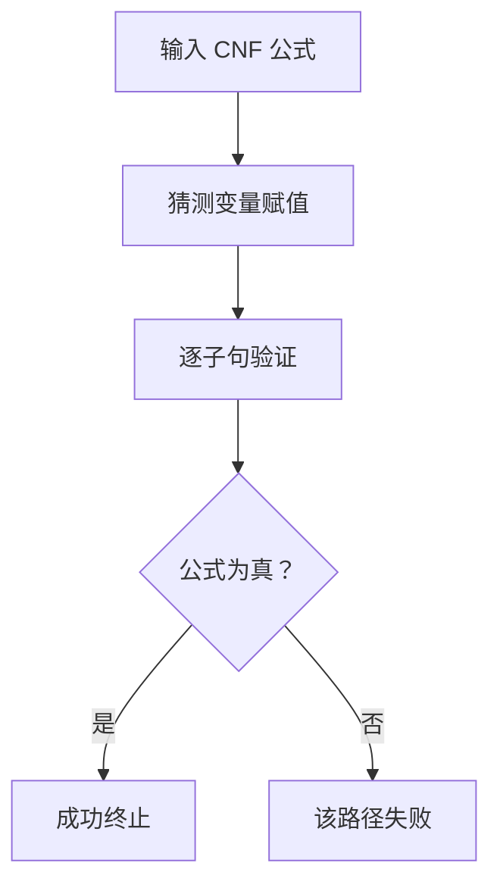

# 可满足性问题（SAT）与不确定算法

## 可满足性问题（SAT）

可满足性问题是判定问题：给定一个命题公式，问是否存在一组布尔变量的赋值（真值指派），使公式为真。若存在，称公式可满足；否则不可满足。

常用的是 CNF 可满足性问题。CNF 公式由若干子句合取而成，每个子句是若干文字的析取，文字是 $x_i$ 或 $\overline{x}_i$。例如
$$
(x_1\lor x_2)\land(\overline{x}_1\lor x_3)
$$
取 $x_1=1,x_2=0,x_3=1$，两个子句都为真，因此该公式可满足。

> [!IMPORTANT]
> ==SAT 只问“是否存在”，不要求找出所有赋值。==

## 不确定算法

确定算法的每一步由当前状态唯一决定；不确定算法在需要选择时调用 `Choice`，从有限个候选值中作出选择。若至少存在一组选择能使算法成功，就认为该不确定算法成功；只有所有选择都不能成功时，才失败终止。

可把它理解成：每次选择都复制若干程序副本，各副本并行尝试不同选择；任一副本成功，全部计算立即结束。它是分析计算复杂性的抽象模型，不是普通计算机能直接实现的并行技巧。

SAT 的不确定算法很直接：

1. 用 `Choice` 为每个变量猜测一个真值；
2. 代入公式并检查每个子句；
3. 公式为真则成功，否则失败。

若公式有 $n$ 个变量、$m$ 个子句，猜测需 $O(n)$，一次验证通常可写成输入规模的多项式时间，因此 SAT 有多项式时间不确定算法，属于 NP。这里的“多项式时间”指==一条成功计算路径的猜测与验证时间==，不是把 $2^n$ 种赋值全部枚举。

| 概念 | 关键含义 |
|---|---|
| 确定算法 | 每步选择唯一 |
| 不确定算法 | 允许猜测，存在成功路径即可 |
| NP 类问题 | 可由多项式时间不确定算法求解的判定问题 |
| NP 完全问题 | 属于 NP，且任意 NP 问题都能多项式约化到它 |

## Cook 定理与解题

Cook 于 1971 年证明：==CNF 可满足性问题是第一个被证明的 NP 完全问题==。它不是“SAT 很难”的实验结论，而是复杂性理论中的定理。

判断具体 CNF 公式时，优先利用单位子句和矛盾。例如
$$
(x_1\lor x_2)\land(x_1\lor x_3)\land\overline{x}_1
\land(\overline{x}_2\lor\overline{x}_3)
$$
由 $\overline{x}_1$ 得 $x_1=0$，前两个子句迫使 $x_2=1,x_3=1$，最后子句却为假，所以不存在真值指派。

> [!WARNING]
> 找到一组赋值使公式为假，不能推出不可满足；必须说明所有赋值都不行。也不要把 NP 理解成“非多项式”，它对应多项式时间可验证。
