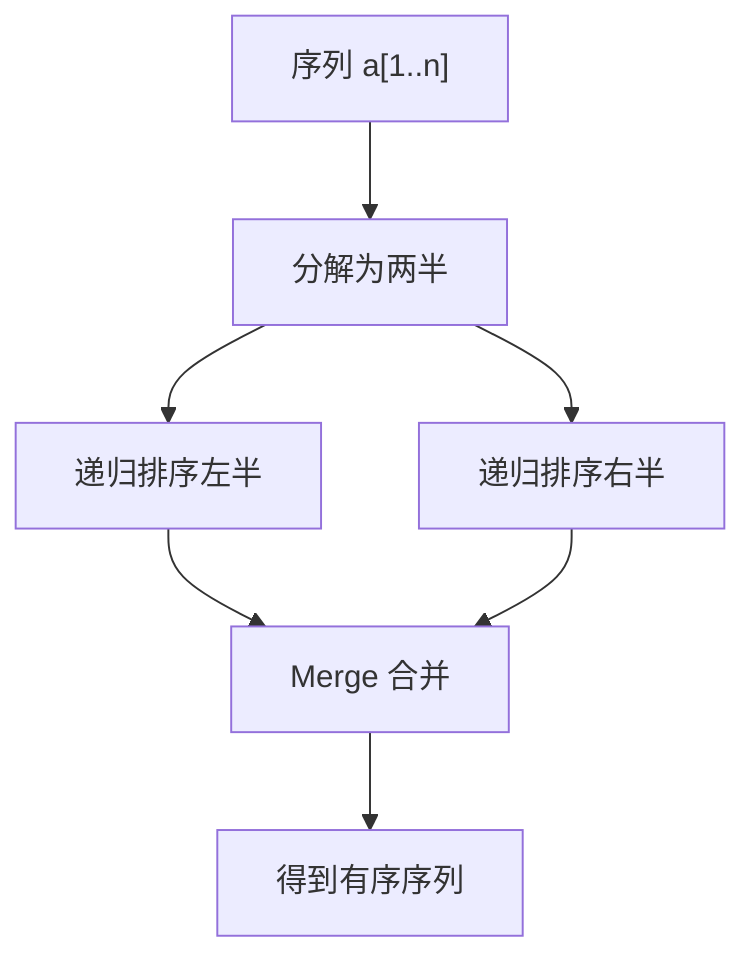

# 两路合并排序算法及其时间与空间复杂度分析

## 它是什么

两路合并排序（Merge Sort）基于分治法：把序列一分为二，分别排好序，再用 **Merge（两路合并）** 把两个有序子序列合并为一个有序序列。递归到长度为 1 时天然有序，递归返回时逐层合并。

## 为什么需要

插入、冒泡、选择排序的最坏时间都是 $O(n^2)$；快速排序平均 $O(n\log n)$，但最坏退化到 $O(n^2)$。==两路合并排序任何情况下都稳定保持 $O(n\log n)$==，这就是选择 6 与选择 21 中它被称为“最优算法”、且最坏情形仍为 $O(n\log n)$ 的原因。

## 怎么做

Merge 的核心：设两个有序段 `a[p..q]`、`a[q+1..r]`，用两个指针逐次取较小者放入辅助数组 `b`，再把 `b` 拷回原数组。每次比较都能确定一个元素的最终位置，故合并代价为 $O(r-p+1)$。

## 时间与空间复杂度

设 $T(n)$ 为排序 $n$ 个元素的时间，分解为 $2T(n/2)$，合并为 $O(n)$：

$$T(n)=2T(n/2)+O(n),\quad T(1)=O(1)$$

由主定理得 $T(n)=O(n\log n)$。==合并排序的空间复杂度为 $O(n)$==：Merge 需要与原序列等长的辅助数组 $b$（填空 4 的标准答案）。

> [!IMPORTANT]
> 两路合并排序：时间 $O(n\log n)$（最好/最坏/平均一致），空间 $O(n)$，是稳定排序。

## 与快速排序的异同（简答 25 要点）

| 阶段 | 两路合并排序 | 快速排序 |
| --- | --- | --- |
| 分解 | 一分为二，十分简单 | 调用 Partition，依赖主元选择 |
| 求解子问题 | 递归排序两半 | 递归排序两个子序列 |
| 合并 | 调用 Merge，代价 $O(n)$ | 几乎无须额外工作，序列自然有序 |

一句话记忆：**快排“先难后易”，合并排序“先易后难”**——快排难在划分、易在合并；合并排序易在划分、难在合并。

## 常见坑

> [!WARNING]
> 1. 迭代（自底向上）版本第一趟是把相邻长度为 1 的子序列两两合并，不要写成整体排序后的结果。
> 2. 空间复杂度只答 $O(n)$，不要写成 $O(\log n)$——$O(\log n)$ 是递归栈深度，辅助数组才是大头。
> 3. “最优”指最坏情形时间最优，并非指空间最小。

## 一个算对了的例子

对 `[4, 2, 3, 3, 5, 8, 5]`（末尾 $\infty$ 为哨兵）执行两路合并，与“排序 1”的追踪表一致：先合并相邻有序段，逐层向上，最终得到 `[2, 3, 3, 4, 5, 5, 8]`。每次合并段内指针移动、取小者入辅助数组，正好对应表中每一步的归并过程。
