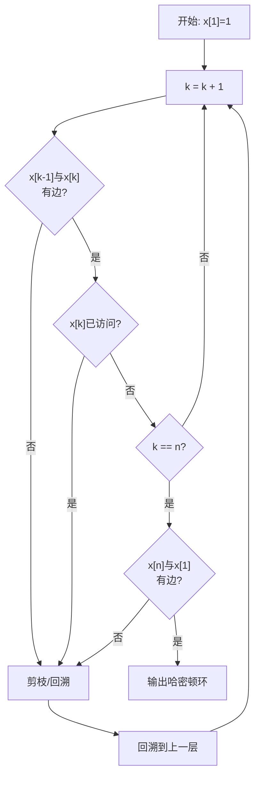

# 哈密顿环的回溯法求解

# 哈密顿环的回溯法求解

==哈密顿环（Hamiltonian Cycle）==是指经过图中每个顶点**恰好一次**并回到起点的回路。与遍历所有边的欧拉回路不同，哈密顿环关注的是顶点的访问顺序。在《算法分析与设计》中，我们通常使用==回溯法==来寻找是否存在这样的环，或者找出所有的哈密顿环。

## 为什么需要回溯法？

判断一个图是否包含哈密顿环是 NP-完全问题，目前没有已知的多项式时间算法。暴力枚举所有排列的时间复杂度为 $O(n!)$，效率极低。回溯法通过==剪枝函数==（Constraint Function）在搜索过程中提前排除无效路径，从而大幅减少实际生成的状态空间树节点数。

> [!IMPORTANT]
> **核心区别**：哈密顿环要求每个顶点访问且仅访问一次；而深度优先搜索（DFS）遍历图时，顶点可能被多次访问（若无 visited 标记）或仅用于连通性判断，不强制形成闭合回路覆盖所有点。

## 算法怎么做？

我们将解表示为一个向量 $x[1..n]$，其中 $x[i]$ 表示环中第 $i$ 个访问的顶点。算法从起点 $x[1]=1$ 开始，递归地尝试将未访问的相邻顶点加入路径。

### 约束条件
在扩展节点 $x[k]$ 时，必须满足以下两个条件：
1. **显式约束**：$x[k]$ 与 $x[k-1]$ 之间必须有边相连，即 $(x[k-1], x[k]) \in E$。
2. **隐式约束**：$x[k]$ 不能与前 $k-1$ 个顶点重复，即 $x[k] \notin \{x[1], ..., x[k-1]\}$。
3. **闭合约束**：当 $k=n$ 时，还需检查 $x[n]$ 与起点 $x[1]$ 是否有边相连。

## 典型例题解析

以南邮课件中的图 8-15(a) 为例，假设顶点编号为 1, 2, 3, 4, 5。若算法按顶点编号从小到大尝试扩展：

1. 路径 `1 -> 2`：合法。
2. 路径 `1 -> 2 -> 3`：合法。
3. 路径 `1 -> 2 -> 3 -> 4`：合法。
4. 路径 `1 -> 2 -> 3 -> 4 -> 5`：合法。
5. 检查闭合：5 与 1 是否有边？若有，则找到环 `1-2-3-4-5-1`。

若在步骤 3 中，3 没有连向 4 的边，算法会回溯到 2，尝试 2 的下一个邻居。

> [!WARNING]
> **常见坑**：画状态空间树时，只画出**实际生成**的部分。如果某分支因“无边”或“重复访问”被剪枝，该分支下的子节点不应出现。例如，若顶点 2 不与 3 相连，则 `1->2->3` 这个节点根本不会生成。

## 快速判断无哈密顿环

在选择题中，常需快速识别不含哈密顿环的图。

| 特征 | 说明 |
| :--- | :--- |
| **割点/桥** | 若移除某顶点后图不连通，且该顶点度数不为2，可能无环。 |
| **度数为1** | 若存在度数为 1 的顶点，一定**不包含**哈密顿环（进得去出不来）。 |
| **二分图特性** | 若二分图两部分顶点数不等，一定无哈密顿环。 |

> [!TIP]
> **解题技巧**：看到选项中有“悬挂点”（度为1的顶点），直接选它。如课件选择题中，图 D 往往包含此类结构或明显的拓扑断裂，导致无法形成闭合回路覆盖所有点。
