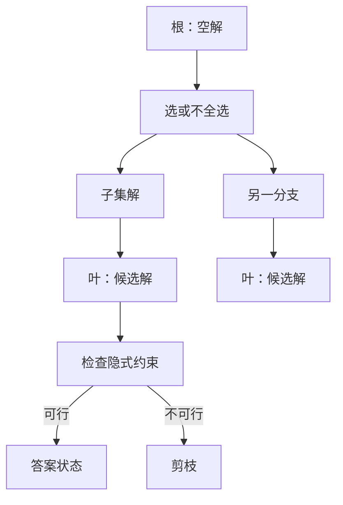
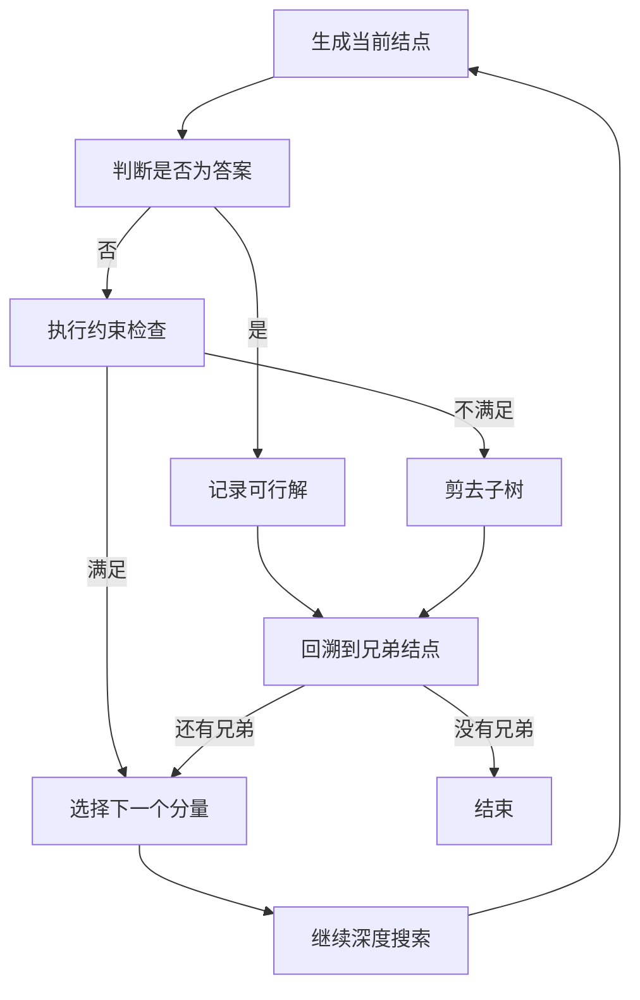

# 回溯法的基本概念（解空间、状态空间树、显式约束与隐式约束）

## 基本概念

回溯法用于系统地搜索问题的解空间：按==深度优先策略==从根结点逐层生成状态空间树，并在搜索过程中使用约束函数或限界函数剪去不可能产生答案结点的子树。

> [!IMPORTANT]
> 采用深度优先策略生成状态空间树结点，并使用剪枝函数的求解方法称为回溯法；采用广度优先策略的对应方法称为分枝限界法。

## 解空间与两类约束

设一个候选解表示为 $n$ 元组：

$$
(x_0,x_1,\ldots,x_{n-1})
$$

- **显式约束**：规定每个 $x_i$ 的取值范围，即$x_i\in S_i$。所有满足显式约束的元组组成该实例的==解空间==。
- **隐式约束**：规定不同分量之间必须满足的关系，用于判断候选解是否可行。

例如，子集和问题可令 $x_i\in\{0,1\}$，表示第 $i$ 个元素“不选”或“选”，这是显式约束；而“所选元素之和等于 $M$”是隐式约束。此时共有 $2^n$ 个候选解。

| 约束类型 | 回答的问题 | 例子 |
|---|---|---|
| 显式约束 | 每个分量可以取什么值？ | $x_i\in\{0,1\}$ |
| 隐式约束 | 各分量组合起来是否可行？ | $\sum w_ix_i=M$ |

> [!TIP]
> 显式约束通常决定状态空间树的形状；隐式约束通常用于设计约束函数并实施剪枝。

## 状态空间树

状态空间树是描述解空间的树形结构。树中每个结点表示一个问题状态；根到结点的路径表示一个部分解或候选解。

- 路径代表候选解元组的结点称为==解状态==。
- 路径代表可行解元组的结点称为==答案状态==。
- 叶结点的孩子集合为空，有限状态空间树上的回溯搜索必然终止。

常见状态空间树有两类：

- **排列树**：每个叶结点对应一个排列，有 $n!$ 个叶结点，如 $n$ 皇后问题。
- **子集树**：每个叶结点对应一个子集，有 $2^n$ 个叶结点，如子集和问题。

回溯法并不会先建立完整状态空间树，而是在搜索过程中按深度优先顺序==动态生成==相关结点。

## 剪枝与搜索过程

约束函数针对部分解判断：其子树是否还可能包含答案状态。若不可能，就剪去该子树。对优化问题，还可用限界函数比较当前上界与已知最优解下界。

> [!WARNING]
> 剪枝必须建立在“该子树确实不可能产生答案”的证明上，不能仅凭当前解暂时不优就剪枝，否则可能漏解。

## 算例：子集和

给定 $W=\{1,2,3,5,7\}$，要求所有元素和等于 $M=10$ 的子集。

可行解包括：

$$
\{3,7\},\quad \{1,2,7\},\quad \{2,3,5\},\quad \{1,2,3,5-1\}
$$

最后一项中的 $5-1=4$ 不属于集合，因此无效。正确结果是：

$$
\boxed{\{3,7\},\ \{1,2,7\},\ \{2,3,5\}}
$$

搜索时，若当前和已经大于 $10$，可立即剪枝；若当前和恰为 $10$，该分支已经得到答案，无须继续加入元素。

## 常见误区

1. ==解空间不是可行解集==：它只包含满足显式约束的候选解。
2. 状态空间树中并非所有叶结点都是答案状态。
3. 显式约束与隐式约束的划分并非绝对；同一条件可以在不同建模方式中作为显式约束或隐式约束。
4. 回溯法的时间主要取决于剪枝后==实际生成的结点数==，而不只是完整树的结点数。

> [!NOTE]
> 蒙特卡罗方法通过随机选取状态空间树中的一条路径，估计各层未受剪枝时的孩子数，从而估算整棵树实际生成的结点数，常用于评价回溯算法的平均运行效率。
