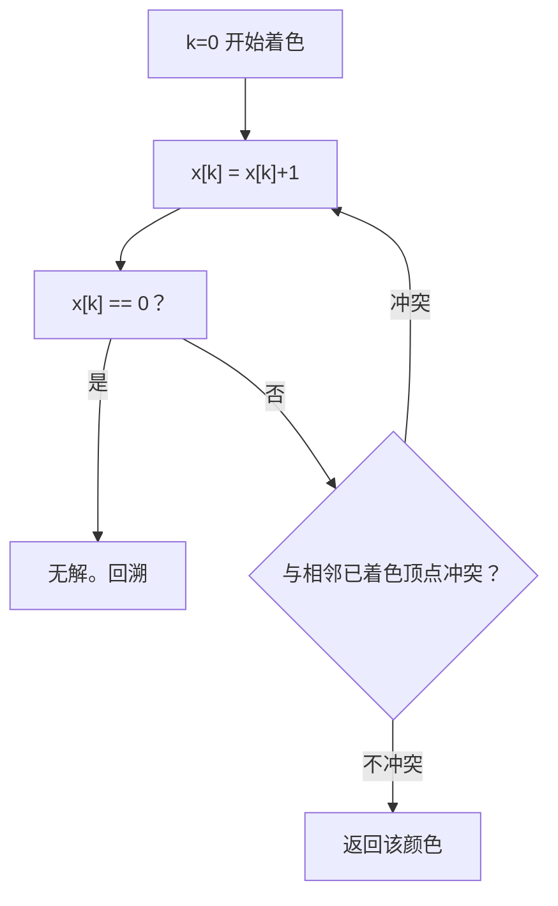

# 图的m-着色问题回溯法求解与四色定理

## 图的 m-着色问题与四色定理

想象你有一张地图，要给每个国家涂上颜色。规则很简单：相邻的国家不能同色，否则边界就看不清了。问题是——最少需要几种颜色？

这个问题在图论中被抽象为**图的 m-着色问题**：给定一个无向图 $G=(V,E)$ 和 $m$ 种颜色，找出所有可能的着色方案，使得任意一条边的两个端点颜色不同。

> [!IMPORTANT]
> ==四色定理==指出：任何平面地图对应的平面图，最多只需 **4 种颜色** 就能完成合法着色。这个定理的证明经历了上百年，最终在 1976 年借助计算机完成，是第一个由计算机辅助证明的重大数学定理。

### 图如何代表地图

转化的规则很直观：

- 每个区域（国家）→ 图的一个顶点
- 两个区域相邻（共享边界线，而非一个点）→ 对应顶点间连一条边
- 飞地暂时忽略

这样的转换结果一定是==平面图==——可以画在平面上且边互不交叉。反过来，四色定理也就等价于：==任意平面图都是 4-可着色的==。

> [!NOTE]
> 如果图不是平面图，4 种颜色就可能不够。因为四色定理只对平面图有效，一般图所需的颜色数等于其色数 $\chi(G)$。

### 约束条件

m-着色问题的解可表示为一个 n-元组 $X = (x_0, x_1, ..., x_{n-1})$，其中 $x_i \in \{1,2,...,m\}$ 表示顶点 $i$ 分配的颜色。

- ==显式约束==：$x_i \in \{1, 2, ..., m\}$，即每个顶点只能从 m 种颜色中选取。
- ==隐式约束==：若边 $(u,v) \in E$，则 $x_u \neq x_v$，即相邻顶点颜色不能相同。

### 回溯法求解

回溯法在状态空间树（m 叉树，高度为 n）上做深度优先搜索。核心逻辑分为两层：

**`NextValue` 函数**：为当前顶点 k 选一个"可用"的颜色。算法按照颜色序号递增尝试，一旦遇到和某个已着色的相邻顶点同色就立即跳过。



**`mColoring` 递归函数**：对当前顶点调用 `NextValue` 获取一个合法颜色。如果成功且已到最后一个顶点，则输出解；否则递归进入下一层。

```cpp
void MGraph<T>::mColoring(int k, int m, int *x) {
    do {
        NextValue(k, m, x);     // 为 x[k] 分配颜色
        if (!x[k]) break;       // 无颜色可选，回溯
        if (k == n-1) {         // 找到完整着色方案
            for (int i=0; i<n; i++) cout << x[i] << " ";
            cout << endl;
        } else {
            mColoring(k+1, m, x); // 处理下一顶点
        }
    } while (1);
}
```

> [!TIP]
> `x[k]++` 放在 `NextValue` 最前面，意味着每次尝试的下一个颜色是在上一次基础上递增，而不是每次都从 1 开始试。这是回溯法"逐步试探"的典型实现。

### 完全图的时间复杂度实例

以 n 个顶点的完全图 $K_n$ 为例。完全图里每对顶点都相邻，实用上意味着任何两个顶点都不能同色，因此至少需要 n 种颜色。当 $m=n$（即颜色数等于顶点数）时合法方案很多（实际为 $n!$ 种）；当 $m=n/2$（向上取整）时，若 $m < n$ 则完全图根本无法合法着色。

| n | m=n（时间）| m=n/2（时间） |
|---|---|---|
| 2 | 12 | 无法着色 |
| 3 | 117 | 21.38 |
| 4 | 1360 | 120.00 |
| 5 | 19525 | 805.47 |
| 6 | 335916 | 6552.00 |
| 7 | 6725593 | 63042.71 |

> [!WARNING]
> 这张表的 m=n/2 列使用==向上取整==。如果改为向下取整，部分 n 的 m 会更小，可能出现**无法着色**的情况（例如 n=3 向下取整 m=1，完全图 K₃ 显然无法单色着色）。做题时务必确认题干是向上还是向下取整。

### 常考易错总结

1. **四色定理前提**：四个颜色只对==平面图==成立。随便一个图（如 K₅）可能需要 5 色。
2. **冲突检测**：只检查==已着色的相邻顶点==（循环 `for j=0 to k-1`），这样渐近式检查兼顾了正确性和剪枝。
3. **m < n**：对于完全图 Kₙ，若颜色数 m < n，则无论如何都会在某一步 `NextValue` 返回 0 导致回溯到底部。这是算法自动发现的"无解"。
4. **地图转图**：仅共享一个点不算相邻。飞地视作独立国家，可能需要单独处理。
