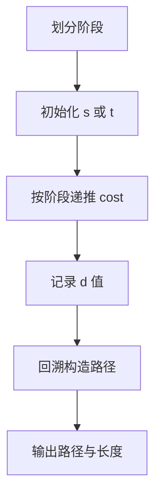

# 多段图问题的向前/向后递推动态规划算法

多段图（multistage graph）是一种特殊的有向无环图，顶点被划分成 $k$ 个不相交的阶段 $V_1,V_2,\dots,V_k$，每条有向边都从第 $i$ 阶段指向第 $i+1$ 阶段。源点 $s\in V_1$，汇点 $t\in V_k$。问题求从 $s$ 到 $t$ 的最短（最小代价）路径。

为什么用动态规划？想一下：如果从 $s$ 走到 $t$ 的最优路径经过顶点 $v$，那么这条路径上 $s\to v$ 的那一段，一定是 $s\to v$ 的最优路径——最优子结构成立；而各阶段互不交叉，可以把"前 $i$ 个阶段的最短路"作为一个子问题，阶段之间不会重复，自然想到 ==递推动态规划==。

## 两种递推方向

| | 向后递推（backward） | 向前递推（forward） |
|---|---|---|
| 含义 | $cost(i)$：从 $i$ 到 $t$ 的最短路长 | $cost(i)$：从 $s$ 到 $i$ 的最短路长 |
| 递推式 | $cost(i)=\min_{(i,j)\in E}\{c(i,j)+cost(j)\}$ | $cost(j)=\min_{(i,j)\in E}\{cost(i)+c(i,j)\}$ |
| 初值 | $cost(t)=0$ | $cost(s)=0$ |
| 计算顺序 | 第 $k$ 阶段 → 第 1 阶段 | 第 1 阶段 → 第 $k$ 阶段 |
| 回溯 | 从 $s$ 沿 $d$ 前进到 $t$ | 从 $t$ 沿 $d$ 回退到 $s$ |

课件中式 7-1 就是向前递推式；==两种方向算出的最短路径长度必然相同==，只是 $d$ 数组的含义不同。

> [!WARNING]
> $d$ 的含义是易错点：向前递推时 $d[j]$ 是 $j$ 的 ==前驱==，回溯从 $t$ 往回走；向后递推时 $d[i]$ 是 $i$ 的后继，回溯从 $s$ 往前走。写答案时一定要先声明再用。

## 递推流程

## 一个算对了的例子（习题 7-2 思路）

对图 7-19，用向前递推算出各顶点的 $cost$ 后，再用 $d[i,j]$ 记录"第 $i$ 阶段顶点 $j$ 在最短路径上的前驱"。回溯过程如下：

- 取 $d(1,0)=2$，说明 $0$ 的后继是 $2$；
- 取 $d(2,2)=4$，$2$ 的后继是 $4$；
- 取 $d(3,4)=7$，$4$ 的后继是 $7$；
- 取 $d(4,7)=8$，$7$ 的后继是 $8=t$。

故最短路径为 $(0,2,4,7,8)$。

> [!TIP]
> 考试答题模板：先写递推式与初值 → 列出每阶段每个顶点的 $cost$、$d$ → 写出回溯过程 → 给出路径与长度。==少写递推式和初值通常会被扣分==。

## 常见的坑

> [!CAUTION]
> - 递推方向搞反：把"向前"写成从 $t$ 起算。看清题目是"从前向后"还是"从后向前"。
> - 邻接矩阵存储时，非边通常用 $0$ 或 $\infty$ 表示，不要直接把 $0$ 当作边权加入 $\min$；用 `min` 前先判边是否存在（参见"图的表示"）。
> - 路径长度与路径序列分开写，避免只报长度不报路径。

> [!NOTE]
> 多段图 DP 的时间复杂度是 $O(|V|+|E|)$（每条边恰好参与一次 $\min$），空间复杂度 $O(|V|)$（若只求长度），与 Dijkstra 等通用最短路算法相比更轻量，但只适用于"阶段分层"的特殊图。
