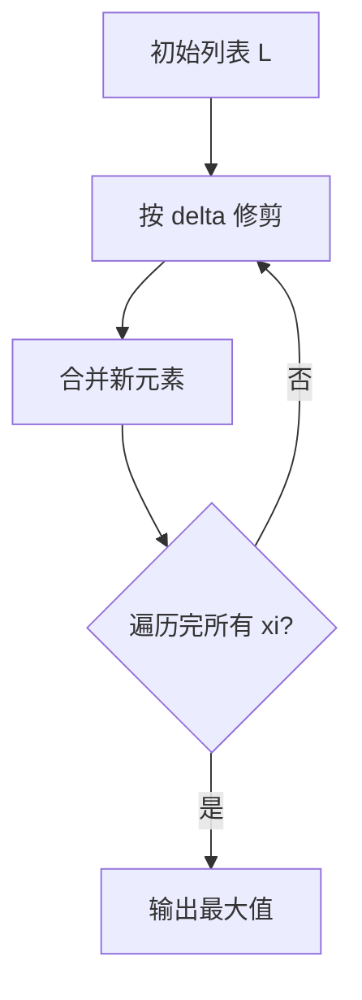

# 多项式时间近似方案（PTAS）与完全多项式时间近似方案（FPTAS，如子集和数）

> [!IMPORTANT]
> 近似方案 $A(\varepsilon)$：对任意固定的 $\varepsilon>0$ 和实例 $I$，产生可行解使相对误差 $\frac{|OPT(I)-F(I)|}{OPT(I)}\le\varepsilon$（假定 $OPT(I)>0$）。

## 为什么需要它

很多优化问题（如子集和数、任务调度）是 NP 难的，无法在多项式时间内求出精确最优解。退而求其次，我们希望==用可控的误差换取多项式时间==。参数 $\varepsilon$ 就是“误差预算”：$\varepsilon$ 越小，解越接近最优，但计算代价通常越高。

## PTAS 与 FPTAS 的区别

两者都要求对**固定**的 $\varepsilon$，运行时间是实例规模 $n$ 的多项式。但当 $\varepsilon \to 0$ 时，它们的“脾气”截然不同：

| 对比维度 | PTAS | FPTAS |
| :--- | :--- | :--- |
| **全称** | 多项式时间近似方案 | 完全多项式时间近似方案 |
| **时间复杂度** | $O(n^{f(1/\varepsilon)})$ | $O((n, 1/\varepsilon)\text{的多项式})$ |
| **对 $1/\varepsilon$ 的要求** | 允许指数级（如 $2^{1/\varepsilon}$） | ==必须是 $1/\varepsilon$ 的多项式== |
| **典型例子** | 任务调度 LPT 方案 | 子集和数 ApproxSumofSubset |

以课件中任务调度为例：若取前 $k$ 个最大任务精确枚举，剩余 $n-k$ 个用 LPT 调度，当 $k=\lceil n\varepsilon \rceil$ 时，枚举时间为 $O(m^k)$。对于固定机器数 $m$，它是 $n$ 的多项式（故为 PTAS），但 $m^k$ 关于 $1/\varepsilon$ 呈指数增长，因此==它不是 FPTAS==。

## 子集和数的 FPTAS 怎么做

给定集合 $S=\{x_1,\dots,x_n\}$ 和目标值 $t$，求子集和不超过 $t$ 的最大值。精确动态规划的状态数可能达到 $O(nt)$，属于伪多项式时间。如何将其压缩？核心思想是**修剪（Trimming）**。

算法 `ApproxSumofSubset` 的关键步骤：
1. 设修剪参数 $\delta = \frac{\varepsilon}{2n}$。
2. 维护有序列表 $L_i$ 表示前 $i$ 个元素能组成的子集和。每加入一个 $x_i$，将 $L_{i-1}$ 与 $L_{i-1}+x_i$ 合并。
3. **修剪**：若列表中相邻两元素 $z_j, z_{j+1}$ 满足 $z_{j+1} - z_j \le \delta \cdot z_{j+1}$，则删去较小的 $z_j$。这保证了列表长度被限制在多项式范围内。
4. 最后删除超过 $t$ 的元素，返回 $L_n$ 中的最大值。

> [!NOTE]
> 定理 12-13 证明了 `ApproxSumofSubset` 是子集和数问题的 FPTAS。每次修剪引入的相对误差不超过 $\delta$，累积 $n$ 次后总相对误差不超过 $(1+\delta)^n - 1 \le \varepsilon$。

## 算对了的例子

设 $S=\{10, 20, 30\}$，$t=45$，$\varepsilon=0.2$。则 $\delta = \frac{0.2}{2\times 3} \approx 0.033$。

- **精确最优解**：选 $\{10, 30\}$ 或 $\{20, 30\}$（超界），实际最优为 $10+30=40$，即 $OPT=40$。
- **近似过程**：
  - $L_0 = \{0\}$
  - 加入 10：合并得 $\{0, 10\}$，修剪后保留 $\{0, 10\}$
  - 加入 20：合并得 $\{0, 10, 20, 30\}$，修剪后保留 $\{0, 10, 20, 30\}$
  - 加入 30：合并得 $\{0, 10, 20, 30, 30, 40, 50, 60\}$，去重并删去 $>45$ 的值得 $\{0, 10, 20, 30, 40\}$
- **输出**：$F(I)=40$。相对误差 $\frac{40-40}{40}=0 \le 0.2$，满足要求。

> [!TIP]
> 考试判断技巧：看到时间复杂度里 $1/\varepsilon$ 在**指数位置**（如 $n^{1/\varepsilon}$）就是 PTAS；如果 $1/\varepsilon$ 只是作为一个**乘积因子或多项式底数**（如 $n^2/\varepsilon$），才是 FPTAS。

> [!WARNING]
> 常见坑：误以为“对所有 $\varepsilon$ 都是多项式”。定义强调的是对**任一固定的** $\varepsilon>0$ 运行时间是 $n$ 的多项式。FPTAS 进一步要求这个多项式的阶数不能随 $1/\varepsilon$ 爆炸。
