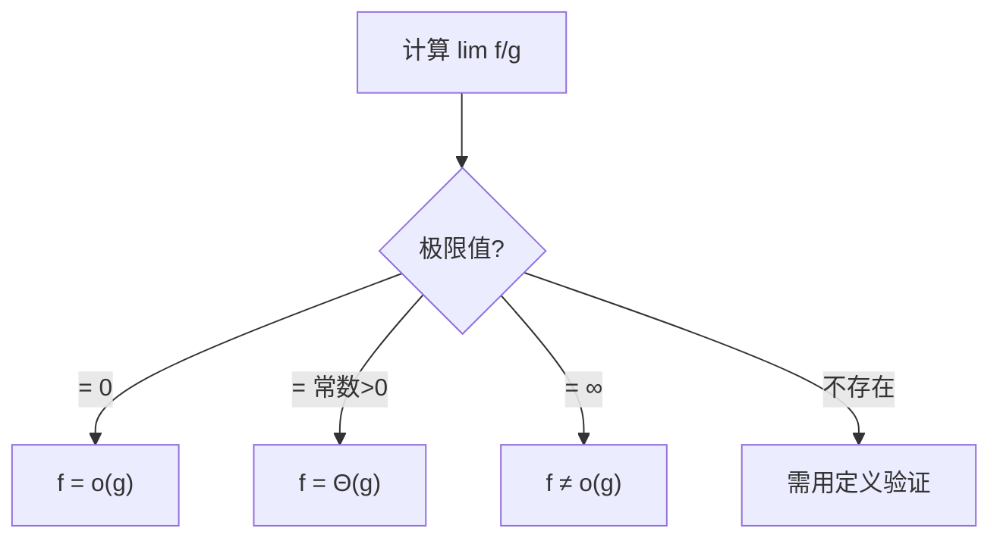

# 渐近表示法：大O记号（紧上界）

## 非紧上界记号 o

当我们用大 $O$ 描述算法复杂度时，是否想过它可能“过于宽松”？例如 $n = O(n^2)$ 虽然数学正确，却未能反映 $n$ 远小于 $n^2$ 的事实。如何精确表达这种“==严格小于==”的增长关系？这就需要引入非紧上界记号 $o$。

> [!IMPORTANT]
> $f(n) = o(g(n))$ 表示 $f(n)$ 的增长率==严格低于== $g(n)$，即对于任意正常数 $c > 0$，都存在 $n_0$，使得对所有 $n \geq n_0$，恒有 $0 \leq f(n) < c \cdot g(n)$。其等价极限定义为：
> $$ \lim_{n \to \infty} \frac{f(n)}{g(n)} = 0 $$

## 与大 O 的核心区别

$o$ 与 $O$ 最易混淆，二者本质差异在于“是否存在某个固定常数 $c$”：

| 记号 | 含义 | 量词 | 极限形式 | 直观理解 |
| :--- | :--- | :--- | :--- | :--- |
| $O(g(n))$ | 渐近紧上界 | $\exists c > 0$ | $\limsup \frac{f}{g} < \infty$ | $f$ 不超过 $g$ 的某倍数 |
| $o(g(n))$ | 非紧上界 | $\forall c > 0$ | $\lim \frac{f}{g} = 0$ | $f$ 相对 $g$ 可忽略不计 |

> [!WARNING]
> $f(n) = o(g(n))$ 蕴含 $f(n) = O(g(n))$，但反之不成立。例如 $n^2 = O(n^2)$ 成立，但 $n^2 = o(n^2)$ ==错误==，因为比值极限为 1 而非 0。

## 判定方法与实战

面对具体函数，如何快速判断 $o$ 关系？优先使用极限法，避免繁琐的定义验证。

以习题 2-11(2) 为例：判断 $f(n) = n^2 / \log n$ 与 $g(n) = n \log^2 n$ 的关系。计算比值极限：

$$ \lim_{n \to \infty} \frac{n^2 / \log n}{n \log^2 n} = \lim_{n \to \infty} \frac{n}{\log^3 n} = \infty $$

极限为无穷大，说明 $f(n)$ 增长远快于 $g(n)$，故 $f(n) \neq o(g(n))$，甚至 $f(n) \neq O(g(n))$。结合原题可知正确关系为 $f(n) = \Omega(g(n))$。

> [!TIP]
> 证明 $f(n) = o(g(n))$ 时，若极限为 0 即可直接得出结论；若需严格按定义证明，关键是展示“对==任意== $c$”都能找到对应 $n_0$，而非仅找一个特定常数。

## 常见误区警示

> [!CAUTION]
> 切勿将 $o$ 与 $\Omega$、$\omega$ 混淆。$o$ 是==上界==概念（严格小于），$\omega$ 才是下界概念（严格大于）。书写时注意大小写：小写 $o$ 为非紧上界，大写 $O$ 为紧上界。

> [!NOTE]
> 在算法分析中，$o$ 常用于描述“低阶项可忽略”的场景，如 $T(n) = n^2 + o(n^2)$ 明确表示主项为 $n^2$，其余项增长率严格低于 $n^2$，比写 $O(n^2)$ 传递更多信息。
