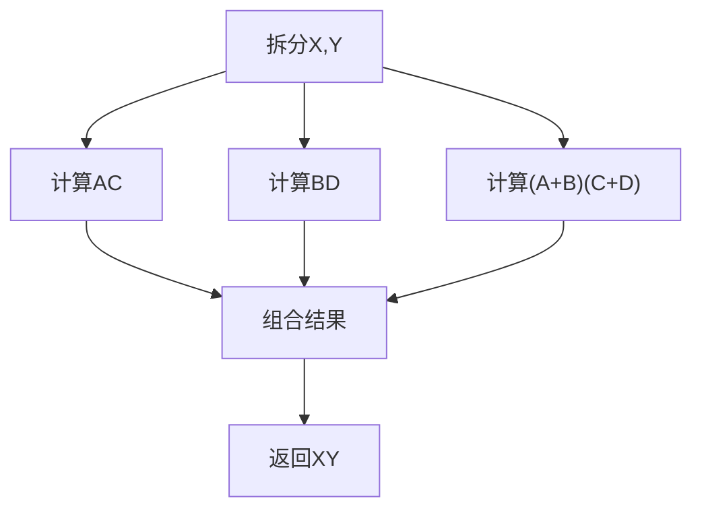

# 大整数相乘的分治算法

## 为什么普通乘法不够用

当两个 $n$ 位大整数相乘时，小学竖式乘法需要逐位相乘再累加，时间复杂度为 $O(n^2)$。在密码学、高精度计算等场景中，$n$ 可达数千甚至数万位，$O(n^2)$ 的代价难以接受。能否利用分治策略，将大问题拆解为更小的子问题，从而降低复杂度？

## 分治策略与Karatsuba优化

最直观的分治是将 $n$ 位数 $X$、$Y$ 各拆为高低两半：$X = A \cdot 10^{n/2} + B$，$Y = C \cdot 10^{n/2} + D$。直接展开得：

$$XY = AC \cdot 10^n + (AD + BC) \cdot 10^{n/2} + BD$$

这需要 ==4次== $n/2$ 位乘法，递推式 $T(n)=4T(n/2)+O(n)$，解得仍为 $O(n^2)$，并未改进。关键突破在于：能否用 ==3次== 乘法算出中间项？注意到 $(A+B)(C+D) = AC + AD + BC + BD$，因此：

$$AD + BC = (A+B)(C+D) - AC - BD$$

这样只需计算 $AC$、$BD$、$(A+B)(C+D)$ 三次子乘法，递推式变为 $T(n)=3T(n/2)+O(n)$，由主定理得 ==$T(n)=O(n^{\log_2 3}) \approx O(n^{1.59})$==。

> [!IMPORTANT]
> Karatsuba算法的核心是==用加减法换取一次乘法==，将子问题数从4降为3，这是复杂度下降的根本原因。

## 与朴素分治及FFT乘法的区别

| 方法 | 子乘法次数 | 时间复杂度 | 适用场景 |
| :--- | :---: | :--- | :--- |
| 朴素分治 | 4 | $O(n^2)$ | 仅教学演示 |
| Karatsuba | 3 | $O(n^{1.59})$ | 中等规模大整数 |
| FFT乘法 | — | $O(n\log n)$ | 超大规模（万位以上） |

> [!NOTE]
> Karatsuba是分治优化的起点，但并非最优；当 $n$ 极大时，基于快速傅里叶变换的Schönhage-Strassen算法更优，但其常数因子大，小规模反而慢。

## 正确计算示例

计算 $1234 \times 5678$（$n=4$）：

- 拆分：$A=12, B=34, C=56, D=78$
- $AC = 12 \times 56 = 672$
- $BD = 34 \times 78 = 2652$
- $(A+B)(C+D) = 46 \times 134 = 6164$
- $AD+BC = 6164 - 672 - 2652 = 2840$
- 结果：$672 \times 10^4 + 2840 \times 10^2 + 2652 = 7006652$

验证：$1234 \times 5678 = 7006652$，正确。

> [!WARNING]
> 拆分时若 $n$ 为奇数，高位部分位数为 $\lceil n/2 \rceil$，低位为 $\lfloor n/2 \rfloor$，==幂次必须对应实际位数==，否则组合结果错误。递归基通常取 $n \leq 2$ 时直接计算，避免过度递归开销。
