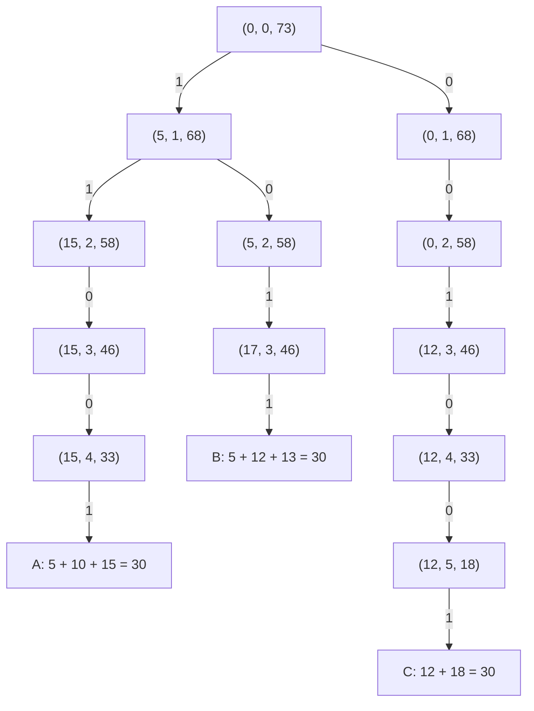

# 子集和数问题的回溯法求解（固定长度元组解）

给定 $n$ 个不同的正数和正目标 $M$，要找出==所有元素和恰好等于 $M$ 的子集==，不是找总和最接近 $M$ 的一个子集。每个子集表示为固定长度向量 $(x_0,\ldots,x_{n-1})$：$x_k=1$ 表示选 $w_k$，$x_k=0$ 表示不选。完整子集树深度为 $n$，有 $2^n$ 个候选叶结点。回溯按深度优先搜索，只生成仍可能含有答案的分支。

## 两道边界决定能不能继续

课件程序 8-5 的 `SumOfSub` 要求输入权值已按非减次序排列。进入状态 $(s,k,r)$ 时，已经决定了前 $k$ 个分量，$s$ 为已选和，$r$ 为从 $w_k$ 开始的未决元素总和。下一次要决定 $x_k$，且进入这一层时有

$$
s<M,\qquad s+r\ge M,\qquad s+w_k\le M.
$$

若 $s+r<M$，剩下的全选也不够；若 $s+w_k>M$，连最小的剩余正数都放不下，而什么都不选又不能补足 $M-s$。初始状态取 $(0,0,\sum_i w_i)$；只有 $n>0$ 且 $w_0\le M\le r$ 才启动搜索。这些是不剪错解的必要检查，不保证通过后一定能凑出 $M$。

| 决策 | 何时记录或继续 | 为什么 |
| --- | --- | --- |
| 取 $w_k$（左枝） | 若 $s+w_k=M$，记录当前前缀，未决分量全补 0。否则还要有下一件，且 $s+w_k+w_{k+1}\le M$，才能进入 $(s+w_k,k+1,r-w_k)$。 | 选入后“已选和 + 未决总和”仍为 $s+r$，上界不用重算；只需检查下一件最小补量会不会超目标。 |
| 不取 $w_k$（右枝） | 还要有下一件，且 $s+r-w_k\ge M$、$s+w_{k+1}\le M$，才能进入 $(s,k+1,r-w_k)$。 | 跳过这一件后，既要检查“全取够不够”，也要检查“只取最小剩余一件会不会超”。 |

> [!IMPORTANT]
> **别在记录一个答案后退出整个搜索。** 正数保证已达 $M$ 的这条路径不能再取任何数，所以可直接把其未决位补 0；随后仍需检查同一结点的另一枝。最后一层 $r=w_k$，两个界把 $s+w_k$ 夹到恰好等于 $M$，故直接记录。实现时先检查 $k+1<n$，再读 $w_{k+1}$。

## 例 8-3：列全三个解

给定 $W=(5,10,12,13,15,18)$，目标 $M=30$。根为 $(0,0,73)$。例如不选第一个数之后是 $(0,1,68)$，此时剩余总和仍足够，最小的未决数 $10$ 也不超目标，所以==根的右枝不能剪掉==。下图只画通往课件三个答案 A、B、C 的路径，结点写作 $(s,k,r)$，边上的 1 和 0 分别是取与不取。

| 解 | $W$ 对应的完整 0/1 向量 | 子集及验算 |
| --- | --- | --- |
| A | $(1,1,0,0,1,0)$ | $\{5,10,15\}$，$5+10+15=30$ |
| B | $(1,0,1,1,0,0)$ | $\{5,12,13\}$，$5+12+13=30$ |
| C | $(0,0,1,0,0,1)$ | $\{12,18\}$，$12+18=30$ |

课件另用三个剪枝点说明两个界不能互相替代：

- 在 $(15,2,58)$ 取 $12$ 只到 $27$，再取最小未决数 $13$ 就到 $40$，所以不生成左枝。
- 在 $(17,3,46)$ 不取 $13$，余下全取可以到 $50$，但只取最小剩余数 $15$ 已到 $32$，所以不生成右枝。
- 在 $(5,4,33)$ 不取 $15$，剩下只有 $18$，全取也只有 $23$，所以不生成右枝。

> [!TIP]
> 手算查漏：含 $18$ 时还差 $12$，只有单取 $12$；不含 $18$ 时，任意两个数的最大和为 $28$，任意四个数的最小和为 $40$，所以必须选三个数，且必含 $5$（不含时三个数最少和为 $35$）。余下两数要凑 $25$，只有 $10+15$ 或 $12+13$。

## 哪个剪枝真的需要排序？

“剩余全取也不够”的上界与顺序无关；==把下一件当作最小补量==，才需要预排序。若直接按 $(11,13,24,7)$ 搜索目标 $31$，取了 $11$ 和 $13$ 后，把紧接的 $24$ 当成最小补量会错误剪掉路径，漏掉 $11+13+7=31$。同样，若题目允许 0 或负数，也不能照搬这里的正数假设：例如达到 $M$ 后还可能加入一个 0，得到另一个子集。
