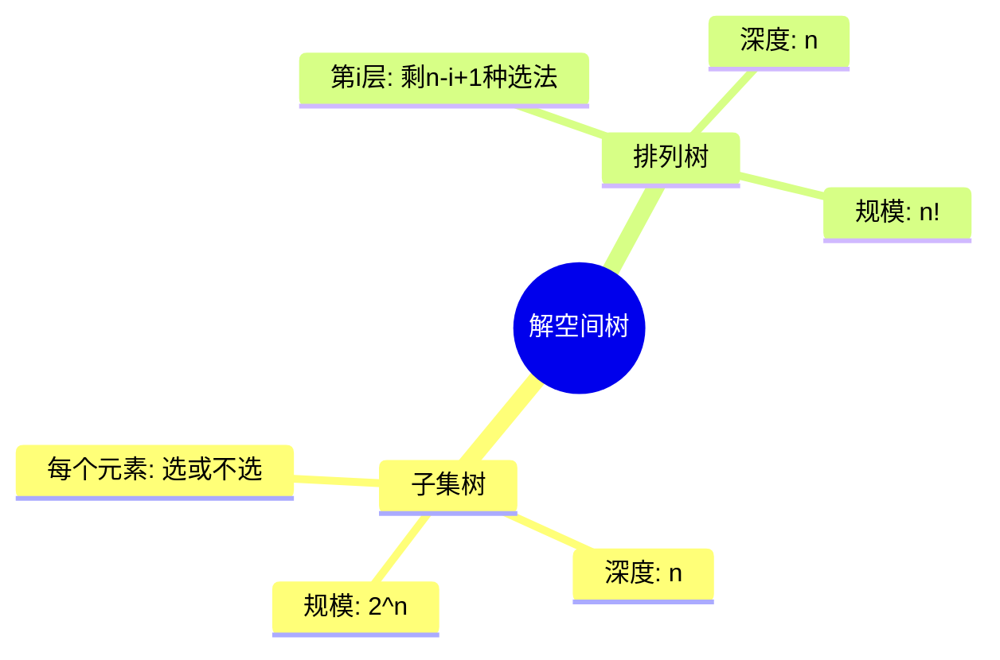

# 子集树与排列树的搜索结构

## 子集树与排列树的搜索结构

在回溯法中，解空间通常组织为树形结构。根据问题性质不同，主要分为**子集树**和**排列树**。理解两者的区别是设计高效回溯算法的前提。

> [!IMPORTANT]
> **核心定义**
> - **子集树**：从 $n$ 个元素的集合中找出满足某些性质的**子集**。解向量长度可变或固定为 $n$（0/1选择）。
> - **排列树**：从 $n$ 个元素的集合中找出满足某些性质的**排列**。解向量长度固定为 $n$，元素互不相同。

### 结构对比与复杂度

| 特性 | 子集树 (Subset Tree) | 排列树 (Permutation Tree) |
| :--- | :--- | :--- |
| **典型问题** | 0/1背包、子集和数、装载问题 | n-皇后、旅行商(TSP)、全排列 |
| **分支因子** | 2 (选/不选) | $n, n-1, \dots, 1$ |
| **叶节点数** | $2^n$ | $n!$ |
| **时间复杂度** | $\Omega(2^n)$ | $\Omega(n!)$ |

### 如何构建与搜索

**子集树**的构建逻辑是“二元选择”。对于第 $i$ 层节点，左孩子代表 $x_i=0$（不选），右孩子代表 $x_i=1$（选）。
**排列树**的构建逻辑是“位置填充”。对于第 $i$ 层，尝试将剩余未使用的元素放入第 $i$ 个位置。

> [!TIP]
> **解题技巧**
> 若题目要求“选出若干元素”且顺序无关，通常是子集树；若要求“安排顺序”或“一一对应”，通常是排列树。

### 常见坑点与边界处理

1.  **数组越界**：在子集和问题中，若使用剪枝函数判断剩余元素之和，需注意索引边界。例如复习题中提到，当 $jj = n - 1$ 时，取 $w[jj+1]$ 可能超界。
    > [!WARNING]
    > **防越界策略**：在权重数组末尾添加一个极大值（如 `INF`）或哨兵，防止访问非法内存导致剪枝失效。

2.  **对称性冗余**：如 n-皇后问题，解存在对偶性。若不限制首行皇后的位置范围（如仅搜索 $0 \to \lfloor n/2 \rfloor$），会重复计算对称解，浪费大量时间。

### 实例演示：子集和数问题

假设集合 $W=\{5, 10, 12, 13, 15, 18\}$，目标和 $M=30$。我们构建子集树，左分支表示不选，右分支表示选。

1.  根节点：当前和 $cs=0$，剩余和 $r=73$。
2.  第一层（元素5）：
    -   左孩子（不选5）：$cs=0, r=68$。
    -   右孩子（选5）：$cs=5, r=68$。
3.  剪枝条件：若 $cs + w[i] > M$ 则剪右枝；若 $cs + r < M$ 则剪左枝（即使全选也不够）。

通过深度优先搜索并应用剪枝，最终找到解向量 $(1, 0, 1, 0, 1, 0)$ 即 $\{5, 12, 13\}$ 等组合。注意，==遍历子集树的时间下限为 $\Omega(2^n)$==，因此剪枝函数的有效性直接决定算法性能。
