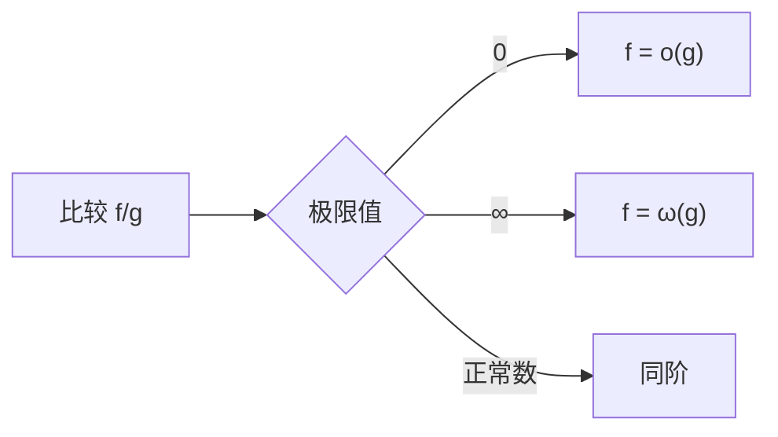

# 非紧上界记号o与非紧下界记号ω

## 是什么

在算法分析中，通常用 $O(g(n))$ 表示渐进上界，用 $\Omega(g(n))$ 表示渐进下界。但它们只限制增长趋势的范围，不能说明函数与 $g(n)$ 的差距是否“很紧”。

为了进一步描述这种差距，引入：

$$
f(n)=o(g(n))
$$

表示 $f(n)$ 相对于 $g(n)$ 是**非紧上界**，即

$$
\lim_{n\to\infty}\frac{f(n)}{g(n)}=0.
$$

相应地，

$$
f(n)=\omega(g(n))
$$

表示 $f(n)$ 相对于 $g(n)$ 是**非紧下界**，即

$$
\lim_{n\to\infty}\frac{f(n)}{g(n)}=\infty.
$$

直观地说：$f(n)$ 相对于 $g(n)$ 增长得“慢得多”或“快得多”。

> [!IMPORTANT]
> $o$ 和 $\omega$ 描述的是两个函数之间的严格增长关系，不是单独描述某个函数的绝对数量级。

## 为什么需要

仅有 $O$ 和 $\Omega$ 时，有些信息无法体现。例如：

$$
f(n)=n,\qquad g(n)=n^2.
$$

显然 $f(n)\in O(g(n))$，但这个上界并不紧，因为 $f(n)$ 比 $g(n)$ 小得多。

加入 $o$ 后，可以写成：

$$
n=o(n^2).
$$

它明确说明：虽然 $n$ 有一个 $O(n^2)$ 上界，但这个上界相对于 $n$ 来说是“非紧的”。

同理，若

$$
f(n)=n^2,\qquad g(n)=n,
$$

则

$$
n^2=\omega(n).
$$

因此，$o$ 与 $\omega$ 常用于比较两个算法的增长率、证明某种更优界限，或者说明某个渐近结论还能继续改进。

## 怎么判断

常用方法是比较幂次：

$$
n^a=o(n^b)\quad\Longleftrightarrow\quad a<b,
$$

$$
n^a=\omega(n^b)\quad\Longleftrightarrow\quad a>b.
$$

例如：

$$
n\log n=o(n^{1.5}),\qquad n^{1.5}=\omega(n\log n).
$$

对于同阶函数，不能仅凭 $O$ 或 $\Omega$ 判断。例如 $n$ 与 $2n$ 比值为常数，不满足极限为 $0$ 或 $\infty$。

> [!TIP]
> 判断口诀：比值趋于 $0$，写成 $o$；比值趋于无穷，写成 $\omega$。

## 与相近概念的区别

| 记号 | 含义 | 强调重点 |
|---|---|---|
| $f=O(g)$ | $f$ 不比 $g$ 增长得快 | 上界关系 |
| $f=\Omega(g)$ | $f$ 不比 $g$ 增长得慢 | 下界关系 |
| $f=o(g)$ | $f/g\to 0$ | 上界不紧 |
| $f=\omega(g)$ | $f/g\to\infty$ | 下界不紧 |
| $f=\Theta(g)$ | $f$ 与 $g$ 同阶 | 上下界均紧 |

> [!WARNING]
> $f=o(g)$ 并不等于“$f$ 是 $g$ 的上界”。前者是函数之间的比较关系；只有当 $f(n)\le g(n)$ 最终成立时，才同时有 $f(n)\in O(g(n))$。

## 常见坑

1. **把 $o$ 看成“小于号”**  
   $o$ 不是逐点比较，而是极限意义下的增长率比较。

2. **忽略常数倍**  
   $2n$ 不是 $o(n)$，因为
   $$
   \frac{2n}{n}=2.
   $$

3. **对数与幂比较出错**  
   有 $\log n=o(n)$，但 $n\neq o(\log n)$。

4. **误认为 $O$ 一定紧**  
   实际上 $O$ 只提供上界。若要说明上下界都紧，应使用 $\Theta$。

## 算对的例子

比较常见排序算法的时间复杂度：

$$
T_{\text{归并}}(n)=n\log n,\qquad
T_{\text{堆排序}}(n)=n\log n.
$$

二者比值满足

$$
\lim_{n\to\infty}\frac{n\log n}{n\log n}=1,
$$

所以它们是同阶关系，不能写成其中一个是另一个的 $o$ 或 $\omega$。

而冒泡排序在最好情况下为 $O(n)$。与归并排序比较：

$$
\lim_{n\to\infty}\frac{n}{n\log n}
=\lim_{n\to\infty}\frac1{\log n}=0,
$$

因此

$$
T_{\text{冒泡,最好}}(n)=o(T_{\text{归并}}(n)).
$$

这说明：在最好情况下，冒泡排序相对于归并排序具有一个**非紧上界**。

> [!CAUTION]
> 不要只看两个复杂度表达式中的最高阶项，还要确认它们比较的是同一个问题、同一种输入情形和同一个参数。
