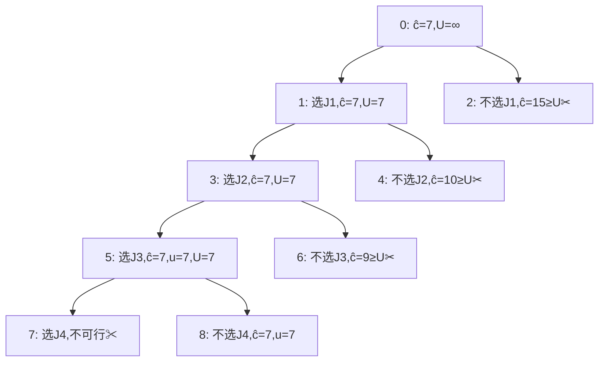

# 带时限作业排序的分枝限界法求解（可变大小元组状态空间树）

带时限作业排序问题要求从 $n$ 个作业中选出子集，使总收益最大且所有选中作业均能在各自时限 $d_i$ 内完成。若直接枚举所有子集，复杂度为 $O(2^n)$。分枝限界法通过==状态空间树剪枝==将搜索限制在可行且有望最优的路径上。为何选择“可变大小元组”？因为最优解长度未知，固定深度树会包含大量无效结点，而可变长度树仅扩展“加入某作业”的分支，天然适配子集选择问题。

## 核心机制与目标函数

算法以==最小化损失==为目标函数（损失 = 总收益 - 当前已选收益）。每个结点 $X$ 需计算两个关键值：

- **损失下界 $\hat{c}(X)$**：当前已选作业的未选剩余作业中，按贪心策略能获得的最大收益对应的损失，即乐观估计。
- **损失上界 $u(X)$**：当前已选作业的实际损失（若当前部分解不可行则为 $\infty$）。

> [!IMPORTANT]
> 剪枝双重条件：生成孩子结点 $Y$ 时，必须同时满足 (1) $Y$ 是可行解（作业可在时限内完成）；(2) $\hat{c}(Y) < U$，其中 $U$ 是当前全局最优损失上界。若 $u(Y) < U$，则更新 $U = u(Y)$。

## FIFOBB 与 LCBB 的区别

| 特性 | FIFOBB | LCBB |
| :--- | :--- | :--- |
| 活结点表 | 队列（FIFO） | 优先队列（按 $\hat{c}$ 升序） |
| 扩展顺序 | 层序遍历 | 最有希望结点优先 |
| 剪枝效率 | 较低，可能扩展较多结点 | 较高，更快逼近最优解 |
| 状态空间树 | 相同结构，但访问路径不同 | 相同结构，但访问路径不同 |

> [!WARNING]
> 无论 FIFO 还是 LC，==状态空间树结构完全相同==（均为可变大小元组树），区别仅在结点扩展顺序。考试中“画出实际生成的树”必须按对应算法的扩展逻辑标注结点编号与剪枝点。

## 正确求解示例

考虑实例：$(p,t,d) = \{(8,1,2), (6,2,3), (5,1,4), (4,2,4), (3,1,1)\}$，总收益 26。按 $d_i$ 非减排序后应用 FIFOBB：

> [!TIP]
> 最优解为 $\{J_1, J_2, J_3\}$，损失 7，最大收益 $26-7=19$。注意结点 2、4、6 因 $\hat{c} \geq U$ 被剪枝，结点 7 因不可行被剪枝——这正是“实际生成的树”与完整树的区别。

> [!CAUTION]
> 常见错误：未先按 $d_i$ 排序导致可行性判断错误；混淆 $\hat{c}$ 与 $u$ 的更新时机；LCBB 中未按 $\hat{c}$ 排序扩展却画成 FIFO 顺序。务必牢记：==$U$ 只在找到更优可行解时更新，$\hat{c} \geq U$ 立即剪枝==。
